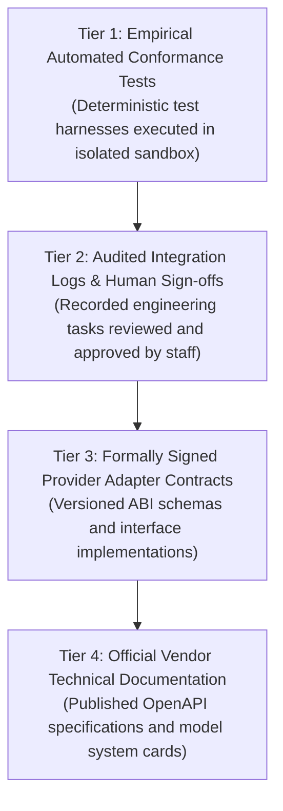

# NexLudic Engine: AI Agent Capability Declaration & Evidence Verification Policy

**Document ID:** `NLE-POL-ACD-001`  
**Phase:** 7 of 12 (AI Coding-Agent Orchestration)  
**Step:** 54 of 100  
**Classification:** Evidence Governance & Conformance Policy  
**Status:** IMPLEMENTATION-READY SPECIFICATION  

---

## 1. Evidence Governance Principles

The NexLudic Engine Provider Registry is an **evidence-based catalog**. A capability claim is never accepted into `VERIFIED` status without reproducible, auditable empirical proof.

The verification policy enforces five core tenets:
1. **Scope Bounding:** An evidence record proves capability *only* for the exact tuple of $\langle \text{Provider}, \text{Model Version}, \text{Agent Harness Version}, \text{Environment} \rangle$ on which the test was executed. Proof for `gpt-4o-2024-08-06` does not prove capability for `gpt-4o-2024-11-20`.
2. **Empirical Primacy:** When vendor marketing or documentation conflicts with observed test results, the empirical test result is authoritative. If a provider claims 128k token context but hallucination fails a needle-in-haystack test at 64k, the verified context limit is recorded as 64k.
3. **Traceability & Immutability:** Evidence records are cryptographically hashed and permanently archived. Test output logs cannot be mutated or overwritten.
4. **Finite Freshness (TTL):** Cloud API models are subject to silent upstream vendor quantization, system prompt revisions, and weight updates. Evidence expires after a defined Time-to-Live (TTL).
5. **No Self-Attestation:** An AI agent cannot certify its own capabilities. An LLM's assertion ("I am fully proficient in C# refactoring") has zero evidentiary value.

---

## 2. Evidence Source Hierarchy & Trust Tiers

Evidence is classified into four distinct evidentiary tiers:



### 2.1 Authorized Evidence Sources
- **Type A: Automated Conformance Test Fixtures (`CONF_TEST`):** Standardized, synthetic test tasks executed by the engine test runner (e.g., generating an AST patch for a synthetic syntax tree, passing a test suite).
- **Type B: Human-Audited Task Evidence (`AUDIT_LOG`):** Execution logs from real historical tasks that were independently inspected, verified, and signed off by a human developer.
- **Type C: Signed Technical Contracts (`TECH_CONTRACT`):** Versioned interface definitions (e.g., Phase 5 SDK wire protocol schemas, Step 52 adapter contracts).
- **Type D: Vendor Specifications (`VENDOR_SPEC`):** Published model cards and API references (admissible only to establish `SUPPORTED` status, never `VERIFIED`).

### 2.2 Prohibited & Untrusted Evidence Sources
The following sources have **zero evidentiary standing** and must be discarded:
- AI-generated model self-evaluations or conversational claims.
- Marketing materials, sales presentations, and vendor blog posts.
- Third-party unverified leaderboard benchmarks (e.g., public LMSYS scores without reproducible local harness traces).
- Unofficial community tutorials, forum discussions, or video demonstrations.

---

## 3. Formal Evidence Record Schema

Every verification artifact stored in the registry must conform to the following schema:

```json
{
  "evidence_id": "ev-conf-csgen-20261118-004",
  "subject_capability": "CAP_CODE_GEN_CSHARP",
  "candidate_tuple": {
    "provider_id": "prov-anthropic-direct",
    "model_deployment_tag": "claude-3-7-sonnet-20250219",
    "agent_harness_version": "1.2.0",
    "environment_id": "env-desktop-medium-il"
  },
  "evidence_type": "AUTOMATED_CONFORMANCE_TEST",
  "test_fixture_ref": "tests/conformance/csharp/scaffold_adapter_stub.json",
  "execution_timestamp": "2026-11-18T10:15:00Z",
  "ttl_days": 14,
  "expiration_timestamp": "2026-12-02T10:15:00Z",
  "test_result": {
    "outcome": "PASSED",
    "score": 1.0,
    "metrics": {
      "compilation_success": true,
      "unit_tests_passed": 12,
      "unit_tests_failed": 0,
      "diff_cleanliness_rating": "CLEAN"
    },
    "log_artifact_path": "logs/verification/ev-conf-csgen-20261118-004.log",
    "log_content_sha256": "8f3b2c...a1e9"
  },
  "verified_by_authority": "NexLudic Automation Harness v1.0",
  "status": "ACTIVE"
}
```

---

## 4. Evidence Freshness & Invalidation Rules

### 4.1 Default Time-to-Live (TTL) Policy
Because external providers and local runtimes change over time, evidence records are assigned finite lifetimes:
- **Public Cloud Endpoints (`PUBLIC_CLOUD`, `STANDARD_CLOUD`):** Default TTL = **14 calendar days**. Cloud endpoints can undergo silent vendor updates, alignment drift, or latency shifts.
- **Enterprise Fixed Deployments (`PRIVATE_CLOUD`, `COMMERCIAL_NO_TRAINING`):** Default TTL = **30 calendar days** (provided exact model deployment tags are pinned).
- **Local On-Device Models (`LOCAL_DEVICE`):** Default TTL = **90 calendar days** (invalidated immediately if model weights hash changes).

### 4.2 Invalidation Trigger Events (`EVT-EVD-01..05`)
An active evidence record is immediately invalidated (`status: "REVOKED"`) upon any of the following triggers:
1. **`EVT-EVD-01` (Model Hash or Tag Change):** The underlying weights hash or vendor deployment string changes.
2. **`EVT-EVD-02` (Harness Version Bump):** The agent orchestration harness code is updated (`MAJOR` or `MINOR` SemVer increment).
3. **`EVT-EVD-03` (Tool Contract Mutation):** The schema of a required tool interface is modified.
4. **`EVT-EVD-04` (Observed Operational Failure):** An agent in production fails a verification check during normal task execution.
5. **`EVT-EVD-05` (Security Advisory):** A security CVE or prompt-injection vulnerability is reported against the model or harness.

---

## 5. Resolution of Conflicting Declarations

When different sources provide conflicting statements regarding capabilities, the conflict is resolved deterministically:

| Conflict Scenario | Primary Source | Secondary Source | Resolution Rule |
| :--- | :--- | :--- | :--- |
| **Vendor Doc vs Conformance Test** | Vendor docs claim 128k context | Test fails at 64k tokens | **Empirical test wins.** Verified context window clamped to 64k. |
| **Agent Profile vs Provider Schema** | Agent claims `CAP_TOOL_EXEC_CMD` | Provider API lacks tool execution | **Provider schema wins.** Capability marked `UNSUPPORTED`. |
| **Old Passing Test vs New Failing Test** | Previous test passed 10 days ago | Retest fails today | **Latest test wins.** Capability transitioned to `REVOKED`. |
| **Model Card vs Security Policy** | Model card claims safe bash execution | Engine policy forbids shell execution | **Engine security policy wins.** Capability vetoed by `BLK-SEC-01`. |
| **Two Different Environment Results** | Passes on Windows Container | Fails on Medium IL host | **Environment-scoped.** Valid only for Windows Container. |
