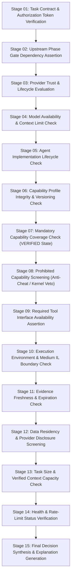

# NexLudic Engine: AI Agent Capability Eligibility Matching Rules

**Document ID:** `NLE-RUL-AEM-001`  
**Phase:** 7 of 12 (AI Coding-Agent Orchestration)  
**Step:** 54 of 100  
**Classification:** Matching Engine Rules & Predicate Specification  
**Status:** IMPLEMENTATION-READY SPECIFICATION  

---

## 1. Matching Engine Architecture

The **Capability Eligibility Matching Engine** evaluates whether a registered candidate tuple $\langle \text{Provider}, \text{Model}, \text{Agent}, \text{Environment} \rangle$ is structurally, technically, and legally qualified to perform an authorized engineering task.

The engine operates on a strict **deterministic pipeline** executing 15 discrete stages:



---

## 2. The 9 Hard Eligibility Predicates

Eligibility is governed by **9 non-negotiable hard predicates**. A candidate tuple must satisfy **100% of applicable hard predicates** to receive an `ELIGIBLE` determination.

A failure of any single hard predicate results in an immediate `INELIGIBLE` or `BLOCKED` verdict. Hard failures **cannot** be overridden, compensated for, or diluted by speed, cost, developer preference, or subjective benchmark scores.

```mermaid
flowchart LR
    P1["PRED_01: Task Token Valid"] --> P2["PRED_02: Upstream Gates Satisfied"]
    P2 --> P3["PRED_03: Provider Approved"]
    P3 --> P4["PRED_04: Agent Approved"]
    P4 --> P5["PRED_05: Capabilities VERIFIED"]
    P5 --> P6["PRED_06: Tools Available"]
    P6 --> P7["PRED_07: Environment Medium IL"]
    P7 --> P8["PRED_08: Evidence Fresh"]
    P8 --> P9["PRED_09: Privacy Compliant"]
    P9 --> Eligible["ELIGIBLE"]
```



### 2.1 Formal Predicate Definitions

1. **`PRED_01_TASK_TOKEN_VALID`:** The task descriptor contains an unexpired cryptographic authorization token (`NLE-POL-TIN-001`) signed by an authorized human authority.
2. **`PRED_02_UPSTREAM_GATES_SATISFIED`:** All required upstream phase gates are satisfied. Specifically, if the task implements a Step 49 Mashup Integration Plan, Phase 6 must be recorded as verified (if unverified, evaluates to `BLOCKED_BY_DEPENDENCY`).
3. **`PRED_03_PROVIDER_APPROVED`:** The hosting Provider's lifecycle state is `APPROVED_FOR_USE` or `AVAILABLE`, and its trust status is not `REVOKED`.
4. **`PRED_04_AGENT_APPROVED`:** The Agent Implementation's lifecycle state is `APPROVED_FOR_USE` or `AVAILABLE`, and its harness version matches the tested baseline.
5. **`PRED_05_CAPABILITIES_VERIFIED`:** Every capability declared as mandatory in the Task Demand Profile (`NLE-SPC-TCR-001`) is present in the candidate's profile with state `VERIFIED`. `DECLARED` or `SUPPORTED` claims fail this predicate.
6. **`PRED_06_TOOLS_AVAILABLE`:** All tool interfaces required by the agent and permitted by the task exist in the target execution environment.
7. **`PRED_07_ENVIRONMENT_MEDIUM_IL`:** The target execution environment enforces Windows Medium Integrity Level non-elevated bounds (`DEC-002`) and anchors write paths to the project workspace (`DEC-009`, `ADR-0009`).
8. **`PRED_08_EVIDENCE_FRESH`:** Supporting evidence records for all required capabilities are unexpired ($t_{\text{current}} < t_{\text{expiration}}$) and have not been revoked by advisories.
9. **`PRED_09_PRIVACY_COMPLIANT`:** The provider's `data_processing_tier` satisfies the task's data residency constraints (e.g., confidential game files are not transmitted to public cloud).

---

## 3. The 14 Standardized Matching Outcome States

The matcher produces exactly one of 14 mutually exclusive outcome states:

| Outcome State Name | Classification | Meaning & Operational Consequence |
| :--- | :--- | :--- |
| **`ELIGIBLE`** | Success | Candidate satisfies all 9 hard predicates; qualified for assignment consideration. |
| **`INELIGIBLE_MISSING_CAPABILITY`** | Failure | Candidate lacks one or more mandatory capabilities in `VERIFIED` status. |
| **`INELIGIBLE_PERMISSION_SCOPE`** | Failure | Candidate requires permissions (e.g. write/exec) prohibited by the task token. |
| **`INELIGIBLE_POLICY_CONFLICT`** | Security Veto | Candidate violates platform security policy (e.g. anti-cheat, memory hook). |
| **`INELIGIBLE_ENVIRONMENT`** | Failure | Target environment lacks required tool binaries or violates Medium IL. |
| **`INELIGIBLE_EVIDENCE`** | Failure | Supporting evidence has expired (TTL) or has been revoked by advisory. |
| **`INELIGIBLE_PROVIDER_STATE`** | Operational | Provider is in `DRAFT`, `SUSPENDED`, `REVOKED`, or `RETIRED` state. |
| **`INELIGIBLE_AGENT_STATE`** | Operational | Agent implementation is suspended, unapproved, or deprecated. |
| **`INELIGIBLE_PRIVACY_CONSTRAINT`** | Data Governance | Candidate's cloud disclosure tier violates task confidentiality rules. |
| **`NEEDS_ADDITIONAL_VERIFICATION`** | Pending | Capability is declared and supported, but requires a fresh conformance run. |
| **`NEEDS_CLARIFICATION`** | Upstream Gated | Task demand profile has missing or contradictory requirement definitions. |
| **`BLOCKED_BY_DEPENDENCY`** | Upstream Blocked | Blocked by missing upstream gate (e.g., Step 51 Phase 6 unverified gate). |
| **`EVALUATION_FAILED`** | Diagnostic | Matcher encountered internal engine error, corrupted schema, or timeout. |
| **`NOT_EVALUATED`** | Neutral | Evaluation aborted early due to hard failure in an upstream prerequisite stage. |

---

## 4. Formal Explainable Decision Record Schema

Every evaluation produces an immutable, machine-readable **Eligibility Decision Record**:

```json
{
  "decision_id": "dec-match-c7a8b3f1-cand01-v1",
  "task_id": "c7a8b3f1-9d2e-4b8a-b1f4-8e7c6d5a4b3c",
  "task_version": "1.0.0",
  "candidate_tuple": {
    "provider_id": "prov-anthropic-direct",
    "model_id": "mod-claude-3-7-sonnet",
    "agent_id": "agt-adapter-scaffold-v1",
    "environment_id": "env-desktop-medium-il"
  },
  "evaluation_timestamp": "2026-11-19T15:15:00Z",
  "matcher_version": "1.0.0",
  "overall_outcome": "ELIGIBLE",
  "predicate_results": {
    "PRED_01_TASK_TOKEN_VALID": { "status": "PASSED", "evidence": "token-sig-verified" },
    "PRED_02_UPSTREAM_GATES_SATISFIED": { "status": "PASSED", "evidence": "NLE-GAT-PH5-001=READY_WITH_CONDITIONS" },
    "PRED_03_PROVIDER_APPROVED": { "status": "PASSED", "evidence": "prov-anthropic-direct=APPROVED_FOR_USE" },
    "PRED_04_AGENT_APPROVED": { "status": "PASSED", "evidence": "agt-adapter-scaffold-v1=APPROVED_FOR_USE" },
    "PRED_05_CAPABILITIES_VERIFIED": { "status": "PASSED", "evidence": "6/6 mandatory capabilities VERIFIED" },
    "PRED_06_TOOLS_AVAILABLE": { "status": "PASSED", "evidence": "tool.fs.read, tool.fs.patch active" },
    "PRED_07_ENVIRONMENT_MEDIUM_IL": { "status": "PASSED", "evidence": "Windows Medium IL verified" },
    "PRED_08_EVIDENCE_FRESH": { "status": "PASSED", "evidence": "all evidence records within 14-day TTL" },
    "PRED_09_PRIVACY_COMPLIANT": { "status": "PASSED", "evidence": "COMMERCIAL_NO_TRAINING matches task tier" }
  },
  "evaluated_capabilities": {
    "satisfied": [
      "CAP_ADAPTER_CONTRACT_ANALYSIS",
      "CAP_ADAPTER_WIRE_SERIALIZATION",
      "CAP_CODE_GEN_CSHARP",
      "CAP_SOURCE_EDIT_DIFF",
      "CAP_TOOL_FS_READ",
      "CAP_TOOL_FS_WRITE_DIFF"
    ],
    "missing": []
  },
  "reasons_and_diagnostics": [
    "Candidate satisfies all 9 hard eligibility predicates for task category ADAPTER_DEVELOPMENT."
  ],
  "eligible_for_ranking": true
}
```

---

## 5. Absolute Prohibition of Silent Task Mutation

If no candidate satisfies all 9 hard predicates, the matching engine must emit `INELIGIBLE` or `BLOCKED` with full diagnostics.

The system is strictly forbidden from:
- Silently relaxing mandatory acceptance criteria.
- Downgrading capability requirements to fit an available agent.
- Automatically broadening path whitelists or tool permissions.
- Bypassing data residency tiers because an on-premise model is offline.
- Selecting an ineligible candidate simply because it is the only configured provider.
