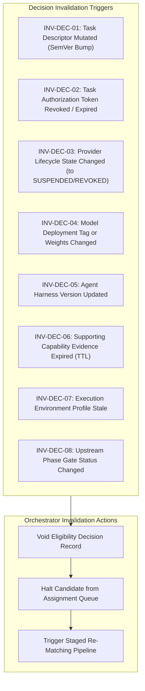

# NexLudic Engine: AI Agent Capability Failure, Freshness & Invalidation Policy

**Document ID:** `NLE-POL-ACF-001`  
**Phase:** 7 of 12 (AI Coding-Agent Orchestration)  
**Step:** 54 of 100  
**Classification:** Operational Resilience & Invalidation Governance Policy  
**Status:** IMPLEMENTATION-READY SPECIFICATION  

---

## 1. Operational Resilience Philosophy

In distributed AI agent systems, external models, local daemons, and software environments are inherently dynamic. Cloud providers update underlying weights without notice, rate limits fluctuate, network connections fail, and security vulnerabilities emerge.

The **Capability Failure, Freshness & Invalidation Policy** specifies deterministic rules for detecting stale metadata, handling operational faults, invalidating superseded decisions, and recovering safely without compromising system integrity.

---

## 2. Failure Classification & Handling Matrix

The policy defines 10 operational failure conditions and their deterministic handling:

| Failure ID | Failure Description | Matching Outcome | Halt Evaluation? | Re-Evaluation Allowed? | Human Escalation Required? |
| :--- | :--- | :--- | :---: | :---: | :---: |
| **`FLR-CAP-01`** | **Registry Unavailable / Corrupt** | `EVALUATION_FAILED` | **YES** | Yes (After file recovery) | Yes (Admin alert) |
| **`FLR-CAP-02`** | **Profile Missing for Agent** | `INELIGIBLE_AGENT_STATE` | No (Skip candidate) | Yes (After profile registration) | No |
| **`FLR-CAP-03`** | **Evidence Expired (TTL Exceeded)** | `INELIGIBLE_EVIDENCE` | No (Skip candidate) | Yes (After re-conformance test) | No (Automated retest) |
| **`FLR-CAP-04`** | **Evidence Revoked (Advisory/Failure)** | `INELIGIBLE_EVIDENCE` | No (Skip candidate) | No (Until advisory cleared) | Yes (Security review) |
| **`FLR-CAP-05`** | **Provider Rate-Limited / Offline** | `INELIGIBLE_PROVIDER_STATE` | No (Skip candidate) | Yes (Exponential backoff) | No |
| **`FLR-CAP-06`** | **Agent Suspended by Policy** | `INELIGIBLE_AGENT_STATE` | No (Skip candidate) | No (Locked) | Yes (Security audit) |
| **`FLR-CAP-07`** | **Required Tool Binary Missing** | `INELIGIBLE_ENVIRONMENT` | No (Skip candidate) | Yes (After tool install) | No |
| **`FLR-CAP-08`** | **Task Authorization Token Revoked** | `INELIGIBLE_PERMISSION_SCOPE`| **YES (All candidates)** | No (Task blocked) | Yes (Task owner) |
| **`FLR-CAP-09`** | **Upstream Phase Gate Unverified** | `BLOCKED_BY_DEPENDENCY` | **YES (All candidates)** | No (Roadmap blocked) | Yes (Architecture lead) |
| **`FLR-CAP-10`** | **Zero Candidates Eligible** | `INELIGIBLE_MISSING_CAPABILITY`| **YES** | No (Scope adjustment needed) | Yes (User review) |

---

## 3. Decision Invalidation Triggers (`INV-DEC-01..08`)

A previously recorded `ELIGIBLE` decision record is rendered **stale and void** upon the occurrence of any of the following 8 invalidation triggers:

1. **`INV-DEC-01` (Task Contract Mutation):** The user or intake system updates the task's scope, acceptance criteria, or path whitelists (triggering a `MAJOR` or `MINOR` SemVer revision).
2. **`INV-DEC-02` (Authorization Invalidation):** The human owner revokes the authorization token or the 4-hour token TTL expires (`NLE-POL-TVI-001`).
3. **`INV-DEC-03` (Provider State Transition):** The provider transitions out of `AVAILABLE` or `APPROVED_FOR_USE` (e.g. suspended for security review).
4. **`INV-DEC-04` (Model Weight / Tag Drift):** Upstream vendor publishes a model update that changes the deployment tag.
5. **`INV-DEC-05` (Agent Harness Bump):** The agent orchestration wrapper codebase is recompiled or updated.
6. **`INV-DEC-06` (Evidence TTL Expiration):** The 14-day or 30-day freshness window for any mandatory capability expires.
7. **`INV-DEC-07` (Environment Mutation):** Host workstation configuration changes (e.g., tool binary deleted, path changed).
8. **`INV-DEC-08` (Phase Gate Invalidation):** An upstream phase gate (e.g., Phase 5 SDK gate) is altered or revoked.

---

## 4. Impact on Active Tasks vs. Queued Tasks

The orchestrator enforces a clean distinction between tasks currently executing and tasks awaiting assignment:

### 4.1 Tasks Awaiting Assignment (In Queue)
- If an invalidation trigger occurs, the candidate's eligibility determination is immediately cleared.
- The task remains in the queue while the matching engine automatically re-evaluates the remaining candidate pool.
- If no alternative candidates are eligible, the task transitions to `BLOCKED_BY_DEPENDENCY` and alerts the user.

### 4.2 Active Tasks Currently Executing
- If a provider or agent transitions to `SUSPENDED` or `REVOKED` while an agent is mid-execution:
  1. The execution harness immediately revokes active tool access tokens.
  2. The agent process or network connection is terminated.
  3. Any uncommitted workspace file modifications in the isolated worktree are reverted via `git checkout -- .`.
  4. The task status is transitioned to `ABORTED_BY_SECURITY_POLICY` with full diagnostic logging.
  5. The system **never** attempts an automatic failover to another model without explicit human re-authorization.
