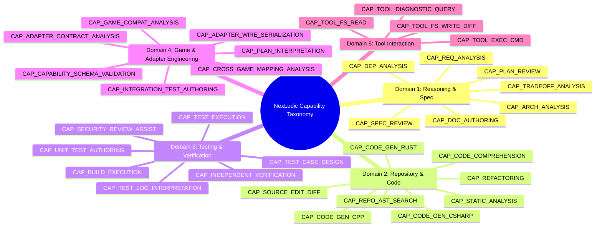
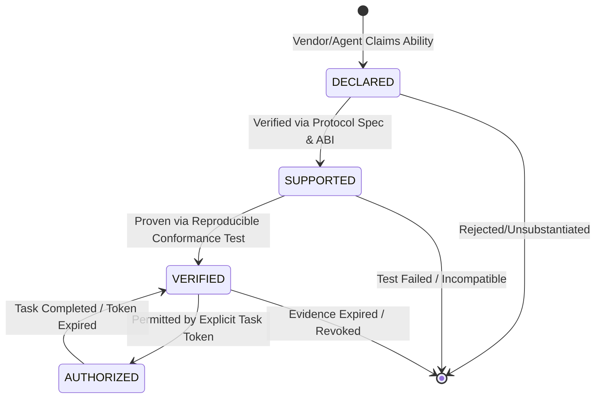

# NexLudic Engine: AI Agent Capability Taxonomy & Profile Contract

**Document ID:** `NLE-CON-ACP-001`  
**Phase:** 7 of 12 (AI Coding-Agent Orchestration)  
**Step:** 54 of 100  
**Classification:** Capability Contract & Profile Specification  
**Status:** IMPLEMENTATION-READY SPECIFICATION  

---

## 1. Capability Taxonomy Architecture

NexLudic Engine establishes a standardized, provider-neutral capability taxonomy. This taxonomy enables the orchestration engine to describe task requirements and agent abilities using precise semantic tokens rather than vendor-specific marketing terms.

The taxonomy organizes 32 standardized capability tokens across 5 functional engineering domains:



---

## 2. Complete Catalog of 32 Capability Tokens

### Domain 1: Reasoning & Specification
1. **`CAP_REQ_ANALYSIS`:** Ability to deconstruct user prompts, extract unambiguous requirements, and identify missing acceptance criteria.
2. **`CAP_ARCH_ANALYSIS`:** Ability to evaluate architectural trade-offs against Architectural Decision Records (ADRs).
3. **`CAP_DOC_AUTHORING`:** Ability to author structured technical markdown specifications with valid tables and links.
4. **`CAP_SPEC_REVIEW`:** Ability to inspect existing specifications for internal contradictions or missing sections.
5. **`CAP_DEP_ANALYSIS`:** Ability to resolve dependencies across project phases and roadmap milestones.
6. **`CAP_TRADEOFF_ANALYSIS`:** Ability to compare competing technical options using objective criteria.
7. **`CAP_PLAN_REVIEW`:** Ability to audit a Step 49 mashup integration plan for completeness and consistency.

### Domain 2: Repository & Coding Work
8. **`CAP_CODE_COMPREHENSION`:** Ability to parse and understand multi-file C#, C++, or Rust codebases without modifying files.
9. **`CAP_REPO_AST_SEARCH`:** Ability to search symbol references, type hierarchies, and method call graphs.
10. **`CAP_CODE_GEN_CSHARP`:** Ability to generate syntactically and semantically valid C# 12 / .NET 9 source code.
11. **`CAP_CODE_GEN_RUST`:** Ability to generate memory-safe Rust source code with proper lifetime annotations.
12. **`CAP_CODE_GEN_CPP`:** Ability to generate modern C++20 code compliant with engine ABI contracts.
13. **`CAP_SOURCE_EDIT_DIFF`:** Ability to produce clean, unified diffs targeting specific lines without collateral corruption.
14. **`CAP_REFACTORING`:** Ability to restructure existing code while strictly preserving interface contracts and tests.
15. **`CAP_STATIC_ANALYSIS`:** Ability to interpret compiler warnings, linter diagnostics, and static analysis outputs.

### Domain 3: Testing & Verification
16. **`CAP_TEST_CASE_DESIGN`:** Ability to design edge-case test suites, boundary conditions, and negative test matrices.
17. **`CAP_UNIT_TEST_AUTHORING`:** Ability to write automated unit test fixtures (e.g., xUnit, NUnit, cargo test).
18. **`CAP_TEST_EXECUTION`:** Ability to invoke authorized test harnesses and parse test results within an isolated sandbox.
19. **`CAP_BUILD_EXECUTION`:** Ability to invoke compilation toolchains (e.g., `dotnet build`) and evaluate build status.
20. **`CAP_TEST_LOG_INTERPRETATION`:** Ability to diagnose root causes from stack traces and failure logs.
21. **`CAP_INDEPENDENT_VERIFICATION`:** Ability to review code authored by another agent without shared conversational bias.
22. **`CAP_SECURITY_REVIEW_ASSIST`:** Ability to audit code diffs for buffer overflows, injection flaws, and UAC elevation risks.

### Domain 4: Game & Adapter Engineering
23. **`CAP_ADAPTER_CONTRACT_ANALYSIS`:** Ability to verify conformance against Phase 5 Universal Adapter SDK interfaces.
24. **`CAP_CAPABILITY_SCHEMA_VALIDATION`:** Ability to validate JSON/schema contracts for game capability descriptors.
25. **`CAP_PLAN_INTERPRETATION`:** Ability to map a Step 49 integration plan into concrete adapter deliverables.
26. **`CAP_CROSS_GAME_MAPPING_ANALYSIS`:** Ability to analyze Step 47 cross-game event and property transformation tables.
27. **`CAP_GAME_COMPAT_ANALYSIS`:** Ability to verify mod loader compatibility and runtime environment dependencies.
28. **`CAP_ADAPTER_WIRE_SERIALIZATION`:** Ability to implement wire protocol serialization wrappers satisfying Condition `P5-C01`.
29. **`CAP_INTEGRATION_TEST_AUTHORING`:** Ability to author simulated multi-game integration test harnesses.

### Domain 5: Tool Interaction
30. **`CAP_TOOL_FS_READ`:** Ability to invoke authorized read-only filesystem inspection tools.
31. **`CAP_TOOL_FS_WRITE_DIFF`:** Ability to invoke authorized patch/diff application tools targeting whitelisted paths.
32. **`CAP_TOOL_EXEC_CMD`:** Ability to invoke authorized non-elevated command-line build/test tools.
33. **`CAP_TOOL_DIAGNOSTIC_QUERY`:** Ability to query engine diagnostic endpoints and telemetry registers.

---

## 3. The 4-State Epistemic Stratification

A capability token must never be treated as a single boolean flag. NexLudic Engine governs every capability across four strictly separated epistemic states:



1. **`DECLARED`:** A provider, model, or agent author claims the capability in marketing, system cards, or prompt headers. *Untrusted by default (Tier 6).*
2. **`SUPPORTED`:** The vendor SDK documentation, OpenAPI schema, or tool protocol definition demonstrates that the interface technically supports the operation. *Contractual potential only (Tier 4).*
3. **`VERIFIED`:** The specific (Provider + Model + Agent + Environment) tuple has successfully executed a formal conformance test fixture within the platform test harness, with immutable test logs recorded. *Empirically established (Tier 3).*
4. **`AUTHORIZED`:** A specific, human-approved `CodingTaskDescriptor` authorization token explicitly permits the operation within a whitelisted path glob and diff ceiling. *Legally permitted for this task (Tier 2).*

> **NON-NEGOTIABLE GOVERNANCE AXIOMS:**  
> - `DECLARED` $\neq$ `VERIFIED`: An agent claiming it can refactor C# code cannot be assigned to refactor code until conformance tests prove it.  
> - `VERIFIED` $\neq$ `AUTHORIZED`: An agent proven capable of modifying files is strictly forbidden from writing files unless the task's cryptographic token grants `allow_write: true`.  
> - `AUTHORIZED` $\neq$ `VERIFIED`: Authorizing an agent to perform a task does not prove it is capable of doing so.

---

## 4. Conditional Capabilities & Limitations Contract

### 4.1 Conditional Capability Representation
A capability may be declared as `CONDITIONAL` if its execution requires external tools or environment prerequisites.

Every conditional capability must define its explicit dependencies:
- **`required_tools`:** Specific tool interfaces that must be active (e.g., `["tool.fs.patch", "tool.git.diff"]`).
- **`required_environment`:** Minimum environment isolation (e.g., `isolation_tier: "CONTAINER_SANDBOX"`).
- **`required_context_capacity`:** Minimum verified context window (e.g., `>= 32768 tokens`).

If an environment does not satisfy all conditional prerequisites, the capability evaluates to `UNAVAILABLE` for that candidate tuple.

### 4.2 Explicit Limitations
Capability profiles must record known limitations:
- `MAX_DIFF_LINES`: Maximum verified diff size before hallucination or line-offset drift occurs.
- `UNSUPPORTED_SYNTAX`: Language constructs the model struggles with (e.g., C++ template metaprogramming, Rust async lifetimes).
- `CONTEXT_DEGRADATION_THRESHOLD`: Token count beyond which instruction recall degrades.

---

## 5. Formal Capability Profile Contract

Each candidate agent implementation is bound to a versioned **Capability Profile** (`NLE-CON-ACP-001`):

```json
{
  "profile_id": "prof-adapter-csharp-v1",
  "profile_version": "1.2.0",
  "agent_id": "agt-adapter-scaffold-v1",
  "model_id": "mod-claude-3-7-sonnet",
  "provider_id": "prov-anthropic-direct",
  "declared_capabilities": [
    "CAP_CODE_COMPREHENSION",
    "CAP_CODE_GEN_CSHARP",
    "CAP_SOURCE_EDIT_DIFF",
    "CAP_ADAPTER_WIRE_SERIALIZATION",
    "CAP_TOOL_FS_READ",
    "CAP_TOOL_FS_WRITE_DIFF"
  ],
  "verified_capabilities": [
    {
      "capability": "CAP_CODE_COMPREHENSION",
      "evidence_ref": "ev-conf-ast-20261118-001",
      "verification_date": "2026-11-18T10:00:00Z",
      "status": "ACTIVE"
    },
    {
      "capability": "CAP_CODE_GEN_CSHARP",
      "evidence_ref": "ev-conf-csgen-20261118-004",
      "verification_date": "2026-11-18T10:15:00Z",
      "status": "ACTIVE"
    },
    {
      "capability": "CAP_SOURCE_EDIT_DIFF",
      "evidence_ref": "ev-conf-diff-20261118-009",
      "verification_date": "2026-11-18T10:30:00Z",
      "status": "ACTIVE"
    }
  ],
  "conditional_capabilities": [
    {
      "capability": "CAP_TOOL_FS_WRITE_DIFF",
      "conditions": {
        "required_tools": ["tool.fs.patch", "tool.git.diff"],
        "max_diff_ceiling_lines": 500
      }
    }
  ],
  "unsupported_capabilities": [
    "CAP_CODE_GEN_RUST",
    "CAP_TOOL_EXEC_CMD"
  ],
  "known_limitations": [
    "Cannot execute compilation tools directly",
    "Diff generation limited to 500 lines per turn"
  ],
  "data_disclosure_tier": "COMMERCIAL_NO_TRAINING",
  "lifecycle_state": "APPROVED_FOR_USE"
}
```
