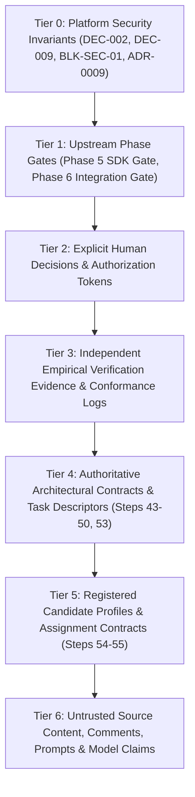
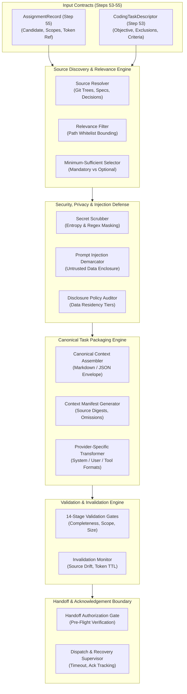

# NexLudic Engine: AI Agent Context Assembly, Secure Task Packaging & Handoff Specification

**Document ID:** `NLE-SPC-CPH-001`  
**Phase:** 7 of 12 (AI Coding-Agent Orchestration)  
**Step:** 56 of 100  
**Classification:** Context Assembly, Secure Packaging & Handoff Architecture Specification  
**Status:** IMPLEMENTATION-READY SPECIFICATION  
**Authoritative Scope:** Specification, Context Modeling, Source Provenance, Security Policies, Validation Gates, and Verification Catalog Only (No Context Assembler Implementation, No Search Runtime, No Prompt Templates in Code, No AI Provider Connections, No Context Transmission, No Code Execution, No Game Tampering)

---

## 1. Executive Summary & Architectural Purpose

The **AI Agent Context Assembly, Secure Task Packaging & Handoff Specification** establishes the authoritative system architecture for preparing, validating, and packaging engineering context for an assigned AI coding agent within the NexLudic Engine platform.

Once an engineering task has been normalized and authorized under Step 53 (`NLE-SPC-TIN-001`), verified against candidate capabilities under Step 54 (`NLE-SPC-APR-001`), and routed to a specific agent assignment under Step 55 (`NLE-SPC-ASR-001`), the orchestration engine must assemble the **minimum sufficient, authoritative, relevant, current, and properly authorized information** needed for the agent to execute its task safely.

This specification enforces four non-negotiable architectural axioms:
1. **Context is Not an Independent Authority:** The assembled context package is a controlled, read-only representation of existing authorized requirements, approved architectural decisions, and bounded source excerpts. Context assembly cannot create new authority, expand writable paths, relax acceptance criteria, or bypass security invariants.
2. **Minimum-Sufficient Context Principle (`INV-CTX-MIN-01`):** The system rejects indiscriminate repository dumps. Only files and specifications explicitly required by the task contract and its direct interface dependencies are retrieved, filtered, and bounded within path whitelists.
3. **Source Provenance & Epistemic Hierarchy:** Every instruction, code excerpt, and constraint in a package must carry immutable source provenance. The 7-tier epistemic hierarchy (`NLE-SPC-ACO-001`) is preserved: untrusted source comments, user issue reports, and external documentation can never override platform security policies (`DEC-002`, `BLK-SEC-01`), upstream phase gates, or authorized task descriptors.
4. **Decoupled Handoff Boundaries:** The platform strictly decouples *Context Preparation $\rightarrow$ Context Validation $\rightarrow$ Handoff Authorization $\rightarrow$ Handoff Dispatch $\rightarrow$ Agent Acknowledgement $\rightarrow$ Execution $\rightarrow$ Output Verification*. A complete package does not authorize external transmission, and an acknowledgement does not prove task completion.

---

## 2. Epistemic Hierarchy & Source-of-Truth Governance

Context assembly operates strictly under the 7-tier epistemic hierarchy established in Step 52 (`NLE-SPC-ACO-001`) and maintained across Steps 53–55:

### 2.1 Governance Rules for Assembled Instructions
- **Tier 0 Dominance:** No context assembly script, prompt template, or repository instruction may instruct an agent to load kernel drivers, hook anti-cheat protected game memory (`BLK-SEC-01`), execute elevated commands (`DEC-002`), or write files outside the authorized workspace (`DEC-009`, `ADR-0009`).
- **Demarcation of Tier 6 Content:** All raw repository files, code comments, error logs, and issue descriptions are demarcated inside `<untrusted_task_data_enclosure>` tags to prevent indirect prompt injection from commandeering agent behavior.
- **Consuming Step 55 Assignments:** Context assembly is triggered *only* upon receipt of an authorized `AssignmentRecord` (`NLE-MOD-ASR-001`). The assembler cannot alter the assigned candidate, re-route the task, or expand the `permitted_path_globs` whitelist.

---

## 3. Mandatory Upstream Gate & Handoff Audit

Before assembling a context package, the pipeline must verify upstream roadmap phase gates:

### 3.1 Phase 5 Universal Adapter SDK Gate (`NLE-GAT-PH5-001`)
- **Recorded Status:** **`READY WITH CONDITIONS`** (`P5-C01`, `P5-C02`, `P5-C03`).
- **Impact on Context Assembly:** When packaging context for an `ADAPTER_DEVELOPMENT` task fulfilling Condition `P5-C01` (Native Language SDK Bindings), the assembler retrieves the authoritative wire protocol schemas from `docs/adapters/` and the Step 47 cross-game data mapping tables (`docs/mashup-designer/`).

### 3.2 Phase 6 Mashup Designer & Planning Gate Audit
- **Audit Findings:** Step 51 (Phase 6 Readiness Review) is missing from the repository. Phase 6 gate status is formally **`UNVERIFIED / MISSING FORMAL SIGN-OFF`**.
- **Impact on Context Assembly (`ERR_PRECONDITION_PHASE6_UNVERIFIED`):**  
  > **Hard Invariant:** Any task requesting the runtime implementation of a Step 49 Mashup Integration Plan (`ACCEPTED_FOR_PLANNING`) is held in **`BLOCKED_BY_DEPENDENCY`**. The context assembler will **not** generate an executable task handoff package for unapproved integration plans until Step 51 is formally conducted and approved.

---

## 4. Architectural Organization of the Context Packaging Subsystem

The Context Assembly, Secure Task Packaging & Handoff subsystem is organized into 6 decoupled architectural components:

### 4.1 Subsystem Component Responsibilities
1. **Source Discovery & Relevance Engine:** Resolves required files, contracts, and ADRs; filters out non-whitelisted paths; extracts the minimum-sufficient context needed to fulfill acceptance criteria.
2. **Security, Privacy & Injection Defense:** Scans source excerpts for secrets; redacts unintended credentials; demarcates untrusted file content; audits data residency against provider disclosure tiers.
3. **Canonical Task Packaging Engine:** Assembles a versioned, provider-neutral `CanonicalTaskPackage` and generates a verifiable `ContextManifest` recording source digests and intentional omissions.
4. **Provider-Specific Transformer:** Adapts canonical packages into concrete model formats (e.g. Claude system/user blocks, GPT-4o messages array, Ollama prompt) while strictly preserving all task constraints and acceptance criteria.
5. **Validation & Invalidation Engine:** Enforces 14 staged validation gates prior to handoff; continuously watches for token expiration, source edits, or gate invalidations.
6. **Handoff & Acknowledgement Boundary:** Authorizes final transmission; dispatches package to the assigned agent harness; tracks 60-second acknowledgement deadlines; manages safe recovery from network timeouts.

---

## 5. Summary of Step 56 Deliverables Suite

The complete architectural, domain, security, and verification standard for Step 56 is specified across 15 synchronized documents in `docs/ai-orchestration/`:

1. `AI_AGENT_CONTEXT_ASSEMBLY_SECURE_TASK_PACKAGING_AND_HANDOFF_SPECIFICATION.md` (`NLE-SPC-CPH-001`): Primary specification (this document).
2. `AI_AGENT_CANONICAL_TASK_CONTEXT_AND_PACKAGE_CONTRACT.md` (`NLE-CON-CTP-001`): Canonical package structure, manifest schema, JSON Schema Draft 2020-12 (`NLE-SCH-CTP-001`).
3. `AI_AGENT_CONTEXT_SOURCE_DISCOVERY_AUTHORIZATION_AND_RELEVANCE_POLICY.md` (`NLE-POL-CSD-001`): Source resolution rules, access authorization, path-bounded relevance filtering, omission tracking.
4. `AI_AGENT_CONTEXT_PROVENANCE_INTEGRITY_AND_TRANSFORMATION_POLICY.md` (`NLE-POL-CPI-001`): Source provenance tracking, SHA-256 digests, excerpt and summary lineage, transformation history.
5. `AI_AGENT_CONTEXT_COMPLETENESS_AND_MINIMUM_SUFFICIENT_CONTEXT_RULES.md` (`NLE-RUL-CMC-001`): Completeness checklists by task category, minimum-sufficient rules, context-quality outcomes.
6. `AI_AGENT_CONTEXT_PRIVACY_SECRET_HANDLING_AND_DISCLOSURE_POLICY.md` (`NLE-SEC-CSH-001`): Secret detection, regex/entropy scrubbing, provider disclosure enforcement, data residency tiers.
7. `AI_AGENT_CONTEXT_TRUST_AND_PROMPT_INJECTION_DEFENSE_SPECIFICATION.md` (`NLE-SPC-CTI-001`): Untrusted input demarcation, prompt injection defense, command vs. content separation.
8. `AI_AGENT_PROVIDER_SPECIFIC_CONTEXT_TRANSFORMATION_CONTRACT.md` (`NLE-CON-PTC-001`): Canonical-to-provider mappings, format transformation invariants, losslessness checks.
9. `AI_AGENT_CONTEXT_PREPARATION_VALIDATION_AND_HANDOFF_READINESS_POLICY.md` (`NLE-POL-CPV-001`): 14-stage validation pipeline, preconditions, readiness states, early exit conditions.
10. `AI_AGENT_HANDOFF_AUTHORIZATION_ACKNOWLEDGEMENT_AND_RECOVERY_CONTRACT.md` (`NLE-CON-HAR-001`): Handoff eligibility, recipient verification, acknowledgement semantics, timeout recovery.
11. `AI_AGENT_CONTEXT_VERSIONING_INVALIDATION_AND_CACHE_POLICY.md` (`NLE-POL-CVI-001`): Package SemVer, invalidation triggers (`INV-CPH-01..09`), cache isolation and freshness rules.
12. `AI_AGENT_CONTEXT_FAILURE_RESOURCE_AND_DIAGNOSTIC_SPECIFICATION.md` (`NLE-SPC-CFD-001`): Error taxonomy (`ERR_CTX_*`), context size headroom, diagnostic schema (`NLE-SCH-CFD-001`).
13. `AI_AGENT_CONTEXT_ASSEMBLY_SYNTHETIC_SCENARIOS_AND_TEST_PLAN.md` (`NLE-CAT-CAS-001`): 24 synthetic test scenarios (Scenarios A through X) covering normal, failure, and security edge cases.
14. `STEP_56_CONTEXT_HANDOFF_REQUIREMENTS_TRACEABILITY_MATRIX.md` (`NLE-MAT-STP-056`): Bidirectional traceability matrix verifying all 30 context requirements (`CPH-REQ-001..030`).
15. `STEP_56_COMPLETION_REPORT.md` (`NLE-REP-STP-056`): Milestone audit, verification of 23 acceptance criteria (`AC-01..23`), sign-off verdict.

---

## 6. Strict Stop Boundary & Forward Directives

Step 56 establishes the architectural, security, and verification standard for context assembly and task handoff. It does **not** implement software, execute retrieval scripts, contact providers, transmit packages, or assign tasks.

Execution halts strictly upon completion of Step 56 documentation and QA review. Step 57 (*AI Coding Agent Execution, Tool Sandboxing & Process Boundary Specification*) shall remain untouched until explicitly authorized by the project owner.
