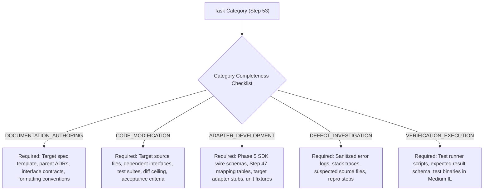

# NexLudic Engine: AI Agent Context Completeness & Minimum-Sufficient Context Rules

**Document ID:** `NLE-RUL-CMC-001`  
**Phase:** 7 of 12 (AI Coding-Agent Orchestration)  
**Step:** 56 of 100  
**Classification:** Context Quality & Completeness Rules  
**Status:** IMPLEMENTATION-READY SPECIFICATION  

---

## 1. Completeness & Minimum-Sufficient Principles

Context assembly operates between two opposing failure modes:
1. **Context Deficit:** Omitting necessary interface contracts or acceptance criteria causes model hallucination, compilation failures, and contract divergence.
2. **Context Bloat:** Dumping entire repository trees causes attention degradation, prompt-injection vulnerability, excessive token costs, and privacy leakage.

This specification establishes **Task-Category Completeness Checklists** and the **Minimum-Sufficient Context Invariant (`INV-CTX-MIN-01`)**.

---

## 2. Completeness Checklists by Task Category

Every canonical package must satisfy the minimum required context items for its specific task category:

### 2.1 Detailed Checklists

| Task Category | Mandatory Context Items | Optional Context Items | Strictly Prohibited Items |
| :--- | :--- | :--- | :--- |
| **`DOCUMENTATION_AUTHORING`** | Parent ADRs, target spec outline, public interface contracts, style conventions. | Non-normative examples, usage tutorials. | Executable binaries, unredacted passwords, core engine C# source. |
| **`SPECIFICATION_ANALYSIS`** | Target specification, governing platform ADRs, upstream phase gate decisions. | Previous revision changelogs. | Source code outside specification scope. |
| **`ARCHITECTURE_REVIEW`** | Target architecture proposal, foundational ADRs (`DEC-001..011`), threat model. | Competitive benchmarks. | Production database connection strings. |
| **`TEST_CASE_DESIGN`** | Feature requirements, interface schema, boundary condition constraints. | Historical defect reports. | Implementation source code (prevents test bias). |
| **`TEST_AUTHORING`** | Target interface, test framework conventions (xUnit/NUnit), assertion contracts. | Mocking guidelines. | Production secrets or live network endpoints. |
| **`CODE_MODIFICATION`** | Target source files, imported type definitions, unit test suite, diff ceiling. | Helper utility snippets. | Files outside `permitted_path_globs`, compiler binaries. |
| **`DEFECT_INVESTIGATION`** | Sanitized stack trace, repro steps, suspected source files, engine log excerpts. | Historical bug tickets. | Memory dumps containing anti-cheat protected game state. |
| **`ADAPTER_DEVELOPMENT`** | Phase 5 SDK wire contracts (`docs/adapters/`), Step 47 data mapping tables, adapter stub. | Simulation harness scripts. | Direct game process memory hook code (`BLK-SEC-01`). |
| **`DEPENDENCY_ANALYSIS`** | Project roadmap milestones, component dependency graph, phase gate criteria. | Past velocity metrics. | Unrelated source files. |
| **`VERIFICATION_EXECUTION`**| Test runner command contracts, input test fixtures, expected output schemas. | Verbose logging flags. | Administrative shell execution tools (`DEC-002`). |

---

## 3. Mandatory vs. Optional Context Stratification

To prevent exceeding model context windows while ensuring task success, context items are prioritized:
- **Priority 1 (Mandatory Constraints):** Task objective, path whitelists, diff ceilings, acceptance criteria, security invariants. **These items can never be omitted, truncated, or summarized.**
- **Priority 2 (Mandatory Interfaces):** Direct type signatures, wire protocol schemas, and method contracts.
- **Priority 3 (Supplementary Code/Docs):** Helper utility classes, extended comments, and background design rationale.
- **Priority 4 (Optional Examples):** Reference implementations in other languages.

If a package approaches the verified model context window limit, items are pruned starting from **Priority 4 $\rightarrow$ Priority 3**. If the package still exceeds the limit after pruning Priority 3, context assembly **halts** rather than truncating Priority 1 or 2.

---

## 4. The 10 Context-Quality Outcomes

Context validation produces exactly one of 10 standardized quality outcomes:

| Outcome Name | State Classification | Operational Meaning | Handoff Permitted? |
| :--- | :--- | :--- | :---: |
| **`COMPLETE`** | Success | All mandatory and optional items resolved, verified, and within token limits. | **YES** |
| **`COMPLETE_WITH_DOCUMENTED_LIMITATIONS`** | Success with Caveat | Mandatory items present; optional items pruned due to context headroom. | **YES** |
| **`NEEDS_SOURCE_RESOLUTION`** | Deficit | One or more mandatory source files cannot be located on disk. | **NO** |
| **`NEEDS_CLARIFICATION`** | Ambiguity | Source documents contain unresolvable internal contradictions. | **NO** |
| **`BLOCKED_BY_DEPENDENCY`** | Upstream Gate | Task references an unverified phase gate (e.g. Step 51 Phase 6). | **NO** |
| **`BLOCKED_BY_AUTHORIZATION`** | Security | Task authorization token expired, revoked, or lacks required scope. | **NO** |
| **`BLOCKED_BY_DISCLOSURE_POLICY`** | Privacy | Context contains confidential data that cannot be sent to the assigned provider.| **NO** |
| **`EXCEEDS_APPROVED_CONTEXT_LIMIT`** | Capacity | Mandatory context exceeds candidate's verified context window. | **NO** |
| **`VALIDATION_FAILED`** | Integrity | Package digest mismatch, schema violation, or unredacted secret found. | **NO** |
| **`NOT_EVALUATED`** | Incomplete | Assembly aborted early due to pre-flight prerequisite failure. | **NO** |
