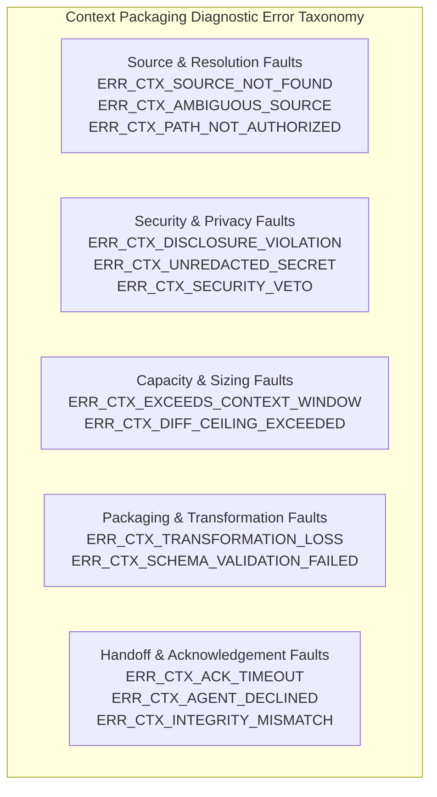

# NexLudic Engine: AI Agent Context Failure, Resource & Diagnostic Specification

**Document ID:** `NLE-SPC-CFD-001`  
**Phase:** 7 of 12 (AI Coding-Agent Orchestration)  
**Step:** 56 of 100  
**Classification:** Diagnostic Schema, Error Taxonomy & Resource Specification  
**Status:** IMPLEMENTATION-READY SPECIFICATION  

---

## 1. Error Taxonomy & Failure Classification

Context assembly and task handoff failures are categorized across 5 diagnostic domains:



| Diagnostic Error Code | Severity | Description | Operational Remediation |
| :--- | :---: | :--- | :--- |
| **`ERR_CTX_SOURCE_NOT_FOUND`** | High | Mandatory source file or ADR missing from Volume D. | Restore missing file or verify file path in task contract. |
| **`ERR_CTX_AMBIGUOUS_SOURCE`** | Medium | Relative path resolves to multiple candidate files. | Disambiguate path in `permitted_path_globs`. |
| **`ERR_CTX_PATH_NOT_AUTHORIZED`** | Critical | Requested source file resides outside task whitelist. | Expand task whitelist in Step 53 via authorized re-normalization. |
| **`ERR_CTX_DISCLOSURE_VIOLATION`**| Critical | Confidential game asset assigned to cloud API endpoint. | Re-route to local air-gapped model (`ZERO_RETENTION_AIR_GAPPED`). |
| **`ERR_CTX_UNREDACTED_SECRET`** | Critical | Suspected private key or credential cannot be safely redacted. | Manually scrub secret from source repository file. |
| **`ERR_CTX_EXCEEDS_CONTEXT_WINDOW`**| High | Mandatory context exceeds candidate's verified context window. | Decompose task into smaller subtasks or select larger-window model. |
| **`ERR_CTX_TRANSFORMATION_LOSS`** | Critical | Provider adapter transformation dropped an acceptance criterion. | Audit adapter template; restore missing invariant. |
| **`ERR_CTX_SCHEMA_VALIDATION_FAILED`**| High | Assembled canonical package violates JSON Schema Draft 2020-12. | Fix context assembler serializer logic. |
| **`ERR_CTX_ACK_TIMEOUT`** | Medium | Agent failed to acknowledge contract within 60-second deadline. | Terminate stale agent process; re-dispatch to fallback candidate. |
| **`ERR_CTX_INTEGRITY_MISMATCH`** | High | Context digest changed between validation and dispatch. | Invalidate package; re-execute full assembly pipeline. |

---

## 2. Context Sizing & Token Headroom Invariants

To guarantee that the assigned agent has sufficient generation headroom to emit complete code modifications without mid-turn truncation:

$$\text{ContextTokens}_{\text{prepared}} \le \text{ContextTokens}_{\text{model\_max}} - \text{Buffer}_{\text{output}}$$

- **Minimum Output Generation Buffer ($\text{Buffer}_{\text{output}}$):** Mandatory **4,096 tokens** reserved exclusively for agent response and code diffs.
- **Safety Headroom:** Prepared context must not exceed **90% of available input context**.
- **Context Ceiling Action:** If a package exceeds this threshold, the pipeline prunes Priority 4 and Priority 3 supplementary items (`NLE-RUL-CMC-001`). If Priority 1 and 2 mandatory items still exceed the ceiling, the pipeline halts with `ERR_CTX_EXCEEDS_CONTEXT_WINDOW`. **The pipeline is strictly forbidden from truncating acceptance criteria or security instructions.**

---

## 3. Formal Machine-Readable Diagnostic Schema

The diagnostic output conforms to JSON Schema Draft 2020-12 (`NLE-SCH-CFD-001`):

```json
{
  "diagnostic_report_id": "diag-ctx-c7a8b3f1-20261119-001",
  "task_id": "c7a8b3f1-9d2e-4b8a-b1f4-8e7c6d5a4b3c",
  "assignment_id": "asg-4f8a-9c2e-b1f4-7d6e5a4b3c2d",
  "timestamp": "2026-11-19T15:35:40Z",
  "validation_stage_failed": "Stage 11: Security & Disclosure Validation",
  "primary_error_code": "ERR_CTX_DISCLOSURE_VIOLATION",
  "severity": "CRITICAL",
  "diagnostic_message": "Task contains CONFIDENTIAL_GAME_ASSET (orion_memory_offsets.bin). Assigned candidate tuple (prov-anthropic-direct/mod-claude-3-7-sonnet) is a cloud API, violating air-gapped data residency mandate.",
  "violating_source_paths": [
    "assets/dumps/orion_memory_offsets.bin"
  ],
  "remediation_guidance": "1. Re-route task to local on-device inference provider (prov-local-ollama). 2. Alternatively, separate proprietary memory offsets from wire protocol specifications."
}
```

---

## 4. Privacy & Log Sanitization Invariants

1. **Zero Raw Secret Echoing:** Diagnostic messages and error logs must **never** print the plaintext value of a detected secret or password.
2. **Path Relativization:** Paths in error messages are reported relative to the workspace root.
3. **No Unsanitized Payload Dumps:** In the event of a transformation failure, the system dumps the structural diff of missing fields, not raw multi-megabyte source text.
