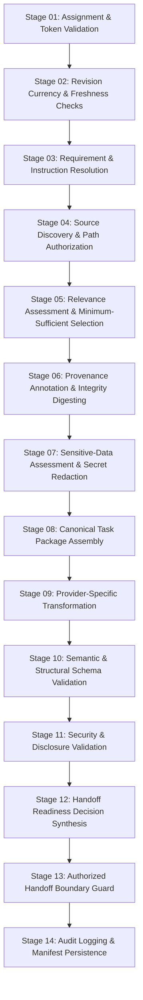

# NexLudic Engine: AI Agent Context Preparation, Validation & Handoff Readiness Policy

**Document ID:** `NLE-POL-CPV-001`  
**Phase:** 7 of 12 (AI Coding-Agent Orchestration)  
**Step:** 56 of 100  
**Classification:** Validation Pipeline & Readiness Policy  
**Status:** IMPLEMENTATION-READY SPECIFICATION  

---

## 1. Validation Pipeline Architecture

The **Context Preparation & Validation Pipeline** governs the end-to-end process of ingesting an authorized assignment, discovering sources, redacting secrets, assembling the canonical package, transforming for the target provider, and asserting handoff readiness.

The pipeline executes **14 deterministic validation stages**. If a stage encounters a failure or missing prerequisite, processing halts immediately, preventing the generation of an invalid or dangerous handoff package:

---

## 2. Detailed 14-Stage Validation Gate Specifications

### Stage 01: Assignment & Token Validation
- **Assertion:** `AssignmentRecord` exists in state `ASSIGNMENT_CREATED`; cryptographic authorization token is verified and unexpired ($t_{\text{current}} < t_{\text{token\_exp}}$).
- **Failure Code:** `ERR_CTX_INVALID_ASSIGNMENT` / `ERR_CTX_TOKEN_EXPIRED`.

### Stage 02: Revision Currency & Freshness Checks
- **Assertion:** Git working tree commit matches assignment baseline; candidate profile version has not drifted.
- **Failure Code:** `ERR_CTX_STALE_REVISION`.

### Stage 03: Requirement & Instruction Resolution
- **Assertion:** Resolves primary objective, permitted path globs, acceptance criteria, and security invariants from Step 53 contract.
- **Failure Code:** `ERR_CTX_INCOMPLETE_TASK_CONTRACT`.

### Stage 04: Source Discovery & Path Authorization
- **Assertion:** Discovers required files on Volume D; verifies all paths reside within `permitted_path_globs` or global doc roots.
- **Failure Code:** `ERR_CTX_PATH_NOT_AUTHORIZED` / `ERR_CTX_SOURCE_NOT_FOUND`.

### Stage 05: Relevance Assessment & Minimum-Sufficient Selection
- **Assertion:** Evaluates category completeness checklist (`NLE-RUL-CMC-001`); prunes out-of-scope files; logs omissions in manifest.
- **Failure Code:** `ERR_CTX_MANDATORY_SOURCE_MISSING`.

### Stage 06: Provenance Annotation & Integrity Digesting
- **Assertion:** Computes SHA-256 digests for all verbatim files and excerpts; attaches Git commit SHAs and author tiers.
- **Failure Code:** `ERR_CTX_INTEGRITY_COMPUTATION_FAILED`.

### Stage 07: Sensitive-Data Assessment & Secret Redaction
- **Assertion:** Scans text for credentials and high-entropy strings; applies automated redactions (`NLE-SEC-CSH-001`); logs transformations.
- **Failure Code:** `ERR_CTX_UNREDACTED_SECRET_BLOCKED`.

### Stage 08: Canonical Task Package Assembly
- **Assertion:** Assembles the 7 sections of `CanonicalTaskPackage`; generates `ContextManifest`.
- **Failure Code:** `ERR_CTX_ASSEMBLY_INTERNAL_ERROR`.

### Stage 09: Provider-Specific Transformation
- **Assertion:** Transforms canonical package into target model format; asserts all 7 transformation invariants (`INV-TRN-01..07`).
- **Failure Code:** `ERR_TRANSFORMATION_LOSS`.

### Stage 10: Semantic & Structural Schema Validation
- **Assertion:** Validates assembled JSON against schema `NLE-SCH-CTP-001`; verifies XML enclosure closure.
- **Failure Code:** `ERR_CTX_SCHEMA_VALIDATION_FAILED`.

### Stage 11: Security & Disclosure Validation
- **Assertion:** Audits data residency; verifies confidential assets are not routed to cloud endpoints; checks Medium IL constraints.
- **Failure Code:** `ERR_CTX_DISCLOSURE_VIOLATION`.

### Stage 12: Handoff Readiness Decision Synthesis
- **Assertion:** Synthesizes validation outcomes into an explicit readiness verdict (`READY_FOR_HANDOFF`, `BLOCKED`, `NEEDS_CLARIFICATION`).
- **Failure Code:** Emits diagnostic report.

### Stage 13: Authorized Handoff Boundary Guard
- **Assertion:** Enforces strict execution stop boundary: package preparation completes; no real network transmission occurs during documentation.
- **Failure Code:** Halt execution.

### Stage 14: Audit Logging & Manifest Persistence
- **Assertion:** Writes structured JSONL audit record with package digest, item counts, and timestamps.
- **Failure Code:** `ERR_CTX_AUDIT_LOG_FAILED`.

---

## 3. Standardized Readiness States

The pipeline concludes with exactly one of 6 readiness determinations:

| Readiness State Name | Pipeline Outcome | Next System Action |
| :--- | :--- | :--- |
| **`READY_FOR_HANDOFF`** | Success (All 14 stages passed) | Eligible for dispatch by authorized handoff supervisor. |
| **`INCOMPLETE`** | Deficit in non-mandatory sources | Context prepared with documented omissions; alerts developer. |
| **`AWAITING_APPROVAL`** | Sensitive context / policy edge case | Held in queue until human architect reviews context envelope. |
| **`BLOCKED_BY_DEPENDENCY`** | Upstream gate unverified (Step 51) | Package preparation halted until roadmap gate is recorded. |
| **`INCOMPATIBLE_PROVIDER`** | Context exceeds model token limit | Package halted; router must re-route to larger-context model. |
| **`VALIDATION_FAILED`** | Security violation, schema error, secret | Package aborted; diagnostic emitted to developer. |
