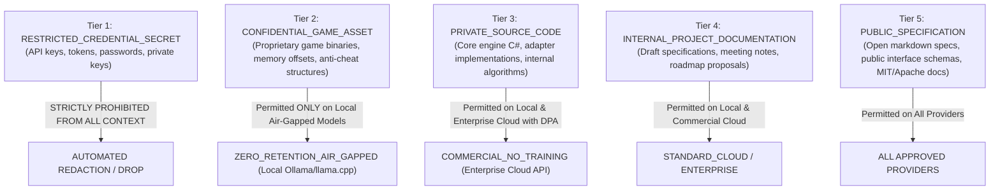
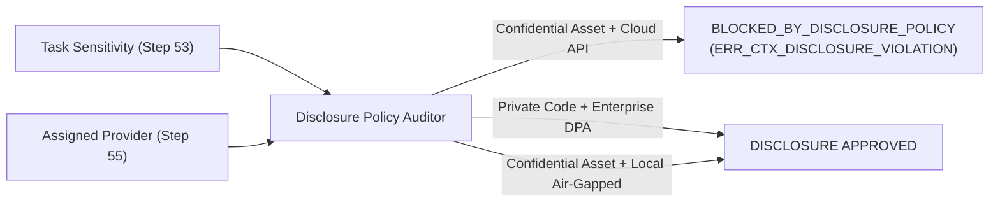

# NexLudic Engine: AI Agent Context Privacy, Secret Handling & Disclosure Policy

**Document ID:** `NLE-SEC-CSH-001`  
**Phase:** 7 of 12 (AI Coding-Agent Orchestration)  
**Step:** 56 of 100  
**Classification:** Information Security, Privacy & Secret Handling Policy  
**Status:** IMPLEMENTATION-READY SPECIFICATION  

---

## 1. Information Security & Privacy Governance

Assembling context packages brings source code, configuration files, and architectural designs together into a single serialized payload. If this process does not aggressively scan for and redact sensitive information, API keys, private tokens, and proprietary intellectual property could be inadvertently transmitted to external cloud providers or logged to disk in plaintext.

This policy specifies mandatory data classification, automated secret detection, redaction, and provider disclosure controls.

---

## 2. Information Classification Taxonomy

Every artifact processed by the context assembly pipeline is classified under one of 5 sensitivity tiers:

---

## 3. Automated Secret Detection & Redaction Engine

Context assembly employs a two-tier secret detection engine:

### 3.1 Pattern-Based Regex Detection (`RULE-SEC-PAT-01`)
The pipeline scans all text content for known credential signatures:
- OpenAI API Keys (`sk-[A-Za-z0-9]{32,}` / `sk-proj-[A-Za-z0-9_-]{64,}`)
- Anthropic API Keys (`sk-ant-[A-Za-z0-9_-]{64,}`)
- Google Gemini API Keys (`AIza[0-9A-Za-z-_]{35}`)
- GitHub Personal Access Tokens (`ghp_[0-9a-zA-Z]{36}`, `github_pat_[0-9a-zA-Z_]{82}`)
- RSA/EC/OpenSSH Private Keys (`-----BEGIN [A-Z ]+ PRIVATE KEY-----`)
- AWS Access Keys (`AKIA[0-9A-Z]{16}`)
- JWT Bearer Tokens (`ey[A-Za-z0-9-_]+\.ey[A-Za-z0-9-_]+\.[A-Za-z0-9-_]+`)

### 3.2 Shannon Entropy Scanning (`RULE-SEC-ENT-02`)
For unstructured string literals, the pipeline computes Shannon entropy over sliding windows of 16 to 64 characters:
- If a string exhibits entropy $H > 4.5\text{ bits/char}$ and is not an approved file hash or identifier, it is flagged as a suspected secret.

### 3.3 Redaction Replacement Semantics
- Detected secrets are replaced with deterministic placeholder tokens:
  `[REDACTED_BY_POLICY:CREDENTIAL_DETECTED]` or `[REDACTED_BY_POLICY:ENTROPY_FLAG]`
- Redactions must **never** corrupt surrounding code syntax (e.g. quotes, brackets, and semicolons are strictly preserved).
- The substitution is logged in the `ContextManifest` transformation history.

---

## 4. Provider Disclosure Enforcement

Before a package can be marked ready for handoff, the disclosure engine asserts:

$$\text{TaskSensitivity} \le \text{ProviderProcessingTier}$$

- **Air-Gapped Mandate (`INV-DISC-01`):** Any task referencing `CONFIDENTIAL_GAME_ASSET` is strictly forbidden from dispatch to external cloud endpoints. Handoff is authorized *only* to local on-device models.
- **Enterprise DPA Mandate (`INV-DISC-02`):** `PRIVATE_SOURCE_CODE` may be dispatched to cloud endpoints only if the provider has an active, legally binding corporate agreement guaranteeing zero data retention and no model training.

---

## 5. Ephemeral In-Memory Context & Retention

1. **No Plaintext Secret Persistence:** Rendered prompts containing context items are maintained in volatile RAM during handoff and zeroed out after transmission.
2. **Sanitized Cache:** Disk caches for parsed ASTs and Markdown specifications must not contain credential strings or unredacted proprietary game binaries.
3. **Audit Data Minimization:** Audit logs archive metadata, task IDs, and SHA-256 hashes; they do not retain multi-megabyte prompt bodies.
