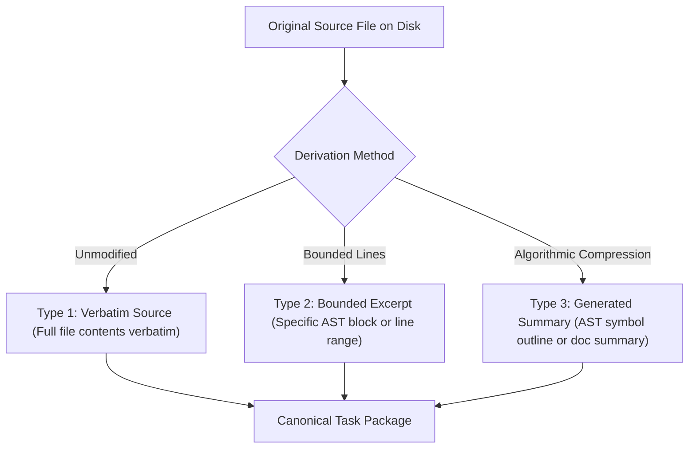

# NexLudic Engine: AI Agent Context Provenance, Integrity & Transformation Policy

**Document ID:** `NLE-POL-CPI-001`  
**Phase:** 7 of 12 (AI Coding-Agent Orchestration)  
**Step:** 56 of 100  
**Classification:** Source Provenance, Content Integrity & Transformation Policy  
**Status:** IMPLEMENTATION-READY SPECIFICATION  

---

## 1. Provenance & Integrity Governance

When an AI coding agent generates software modifications, auditing the agent's work requires knowing exactly which versions of which files and specifications informed its decisions. If context is extracted without commit hashes or integrity digests, reproducing bugs or validating security claims becomes impossible.

This policy specifies mandatory provenance, cryptographic integrity, excerpt lineage, and transformation tracking rules.

---

## 2. Source Provenance Metadata Schema

Every context item included within a `CanonicalTaskPackage` must carry complete provenance metadata:

```json
{
  "item_id": "ctx-item-src-orion-wire-001",
  "source_path": "src/adapters/orion/wire/OrionTelemetryWireSerializer.cs",
  "provenance": {
    "repository_root": "D:/App Winrar Files/Nexludic Engine (working)",
    "git_commit_sha": "c25b1d7a8b3f1e9d2e4b8ab1f48e7c6d5a4b3c2d",
    "git_branch": "main",
    "file_line_range": "1-145",
    "retrieval_timestamp": "2026-11-19T15:35:00Z",
    "source_authority_tier": "Tier4_ArchitecturalContract",
    "authoritative_status": "APPROVED_IMPLEMENTATION_BASELINE"
  },
  "content_integrity": {
    "content_digest_sha256": "4a7d1ed414474e4033ac29ccb8653d9b008e3fe61651171f39a2a2a59054b1a1",
    "content_encoding": "utf-8",
    "byte_length": 4512
  }
}
```

---

## 3. Excerpt, Summary & Lineage Stratification

To prevent loss of semantic fidelity, the system explicitly categorizes context items by their derivation method:



### 3.1 Strict Lineage Rules
1. **Verbatim Fidelity (`RUL-CPI-01`):** Type 1 and Type 2 items must preserve exact characters, indentation, and line breaks from the disk file. No automated re-formatting is permitted during context assembly.
2. **Summary Traceability (`RUL-CPI-02`):** Any generated summary (Type 3) must explicitly cite the parent document ID, section title, and commit hash. A generated summary **cannot** introduce new requirements or modify architectural invariants.
3. **Inference Non-Authority (`RUL-CPI-03`):** AI-generated summaries reside at Tier 6. If a summary contradicts the verbatim source, the verbatim source is authoritative.

---

## 4. Transformation History Tracking

Whenever context is altered between disk retrieval and package assembly (e.g. secret redaction, path relativization, or token pruning), the transformation must be logged in the manifest:

```json
{
  "transformation_history": [
    {
      "item_id": "ctx-item-cfg-orion-002",
      "transformation_type": "SECRET_REDACTION",
      "applied_rule": "SEC-SCRUB-ENTROPY-01",
      "target_field": "connection_string.password",
      "replacement_token": "[REDACTED_BY_POLICY:ENTROPY_DETECTED]",
      "timestamp": "2026-11-19T15:35:10Z"
    },
    {
      "item_id": "ctx-item-doc-orion-spec-001",
      "transformation_type": "PATH_RELATIVIZATION",
      "applied_rule": "SEC-PATH-NORM-01",
      "original_prefix": "D:/App Winrar Files/Nexludic Engine (working)/",
      "normalized_prefix": "",
      "timestamp": "2026-11-19T15:35:12Z"
    }
  ]
}
```

---

## 5. Reconstruction of Historical Packages for Audit

To guarantee full reproducibility:
- An assembled `CanonicalTaskPackage` and its `ContextManifest` are assigned a stable package SHA-256 digest:
  $$\text{PackageDigest} = \text{SHA-256}(\text{package\_id} + \text{task\_version} + \sum \text{ItemDigests})$$
- Even if files on disk change during subsequent development, historical execution audits can verify whether an agent was acting in accordance with the exact context envelope it received at handoff time.
