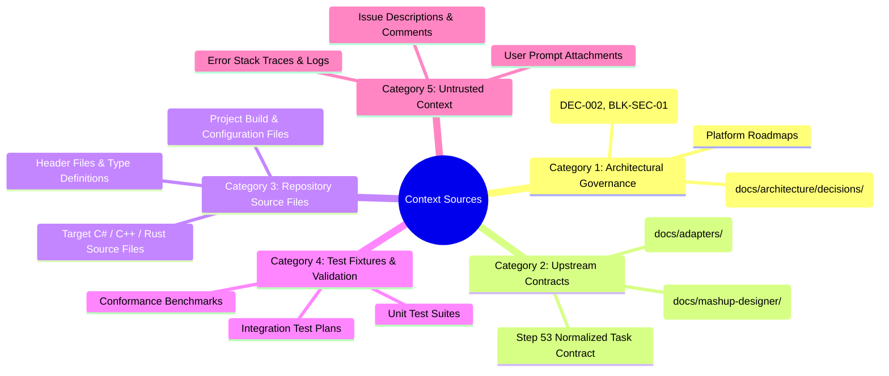
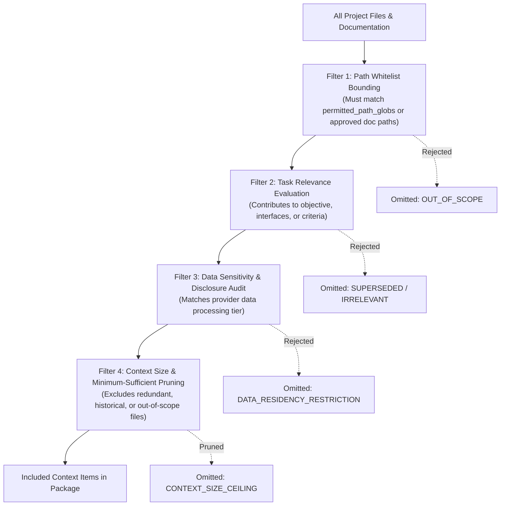

# NexLudic Engine: AI Agent Context Source Discovery, Authorization & Relevance Policy

**Document ID:** `NLE-POL-CSD-001`  
**Phase:** 7 of 12 (AI Coding-Agent Orchestration)  
**Step:** 56 of 100  
**Classification:** Source Discovery & Authorization Policy  
**Status:** IMPLEMENTATION-READY SPECIFICATION  

---

## 1. Source Discovery Philosophy

In agentic software engineering, providing too much context is just as dangerous as providing too little. Indiscriminate source dumps introduce distracting tokens, dilute agent attention, increase latency and cost, and risk leaking sensitive files.

This policy governs how the context assembly pipeline discovers, authorizes, filters, and resolves source artifacts.

---

## 2. Source Category Catalog & Authority Mapping

Candidate context sources are classified across 5 authoritative categories:



---

## 3. The 4-Filter Source Selection Funnel

Every potential context source must pass through a 4-filter funnel before being included in a canonical task package:



### 3.1 Filter 1: Path Whitelist Bounding (`RUL-CSD-01`)
- Source files residing outside the task's `permitted_path_globs` (or approved global architectural documentation directories `docs/architecture/` and `docs/adapters/`) are **strictly excluded**.
- Attempts to pull in files from sensitive directories (`src/core/**`, `.git/**`, `config/credentials/`) result in immediate rejection.

### 3.2 Filter 2: Task Relevance Evaluation (`RUL-CSD-02`)
- Relevance is evaluated against the task's `primary_objective` and `acceptance_criteria`.
- An artifact is relevant only if:
  1. It defines the interface the agent is implementing;
  2. It contains the code the agent must modify;
  3. It defines the unit tests required to verify the deliverable; or
  4. It establishes the architectural invariants governing the component.

### 3.3 Filter 3: Data Sensitivity & Disclosure Audit (`RUL-CSD-03`)
- Evaluates the candidate provider's approved `data_processing_tier` (`NLE-SEC-APR-001`).
- If an artifact contains `CONFIDENTIAL_GAME_ASSET` or unredacted proprietary game offsets, it is blocked from inclusion if the destination is a cloud provider.

### 3.4 Filter 4: Minimum-Sufficient Pruning (`RUL-CSD-04`)
- When multiple documents describe the same requirement, the latest approved ADR or specification takes precedence; older meeting notes or discussion logs are pruned.

---

## 4. Stable Source Resolution & Missing File Handling

During source extraction, file references may be missing, renamed, or broken:
1. **Missing Mandatory File:** If a file explicitly declared in `required_deliverables` or `prerequisites` cannot be found on Volume D, context assembly **halts** with diagnostic `ERR_CTX_SOURCE_NOT_FOUND`.
2. **Ambiguous Matches:** If a relative reference resolves to multiple files, the assembler does **not** guess; it halts with `ERR_CTX_AMBIGUOUS_SOURCE_REFERENCE`.
3. **Broken Internal Links:** If an included specification contains broken relative Markdown links to other specs, the assembler logs a warning `WARN_CTX_BROKEN_DOC_LINK` and records the missing link in the context manifest.

---

## 5. Formal Omission Tracking Schema

To maintain complete transparency, the context manifest must record every candidate file that was evaluated but excluded:

```json
{
  "omitted_sources": [
    {
      "source_path": "src/core/CoreMemoryManager.cs",
      "omission_reason": "OUT_OF_SCOPE",
      "justification": "Path outside task permitted_path_globs (docs/adapters/orion/**, src/adapters/orion/**)."
    },
    {
      "source_path": "docs/architecture/archive/DEPRECATED_ADR_0004.md",
      "omission_reason": "SUPERSEDED",
      "justification": "Superseded by ADR-0008."
    },
    {
      "source_path": "assets/dumps/game_orion_mem_dump.bin",
      "omission_reason": "DATA_RESIDENCY_RESTRICTION",
      "justification": "Task assigned to cloud API; binary dump requires local air-gapped provider."
    }
  ]
}
```
