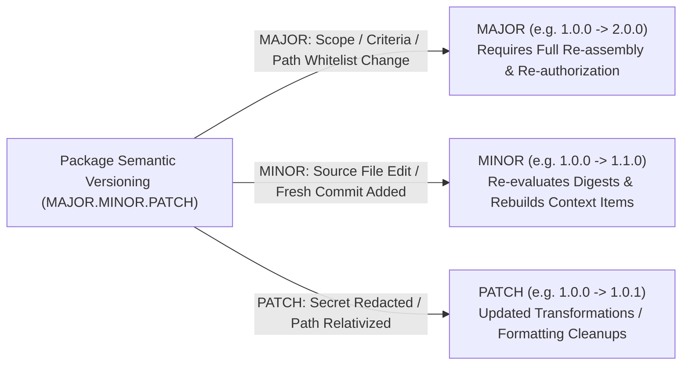
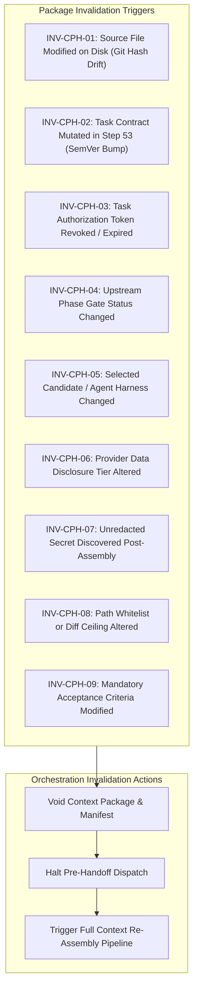

# NexLudic Engine: AI Agent Context Versioning, Invalidation & Cache Policy

**Document ID:** `NLE-POL-CVI-001`  
**Phase:** 7 of 12 (AI Coding-Agent Orchestration)  
**Step:** 56 of 100  
**Classification:** Versioning, Cache Isolation & Invalidation Policy  
**Status:** IMPLEMENTATION-READY SPECIFICATION  

---

## 1. Versioning & Cache Governance

Engineering repositories are active, evolving workspaces. Files are edited, branches are merged, and authorization tokens expire. A context package assembled 10 minutes ago may become dangerously stale if a developer modifies a dependent interface or if an upstream security advisory revokes a provider's approval.

This policy specifies semantic versioning for packages, defines the 9 invalidation triggers (`INV-CPH-01..09`), and enforces cache isolation boundaries.

---

## 2. Package Semantic Versioning & Traceability

Every `CanonicalTaskPackage` is assigned a strict Semantic Version (`MAJOR.MINOR.PATCH`):

---

## 3. The 9 Invalidation Triggers (`INV-CPH-01..09`)

An assembled or cached context package is immediately rendered **void and un-dispatchable** upon the occurrence of any of the following 9 events:

1. **`INV-CPH-01` (Source Hash Drift):** A source file included in the package has a different SHA-256 hash or Git commit on disk than recorded in the manifest.
2. **`INV-CPH-02` (Task Descriptor Mutation):** The normalized task contract is revised in Step 53.
3. **`INV-CPH-03` (Token Invalidation):** The 4-hour task authorization token expires or is explicitly revoked by the project owner.
4. **`INV-CPH-04` (Upstream Gate Alteration):** A governing phase gate (e.g., Phase 5 SDK gate) is amended or revoked.
5. **`INV-CPH-05` (Candidate Re-assignment):** Step 55 re-routes the task to a different candidate tuple.
6. **`INV-CPH-06` (Disclosure Policy Revision):** Provider terms change, revoking commercial no-training agreements.
7. **`INV-CPH-07` (Post-Assembly Secret Flag):** A background security scan detects a previously missed credential inside the assembled context.
8. **`INV-CPH-08` (Scope Mutation):** The task's `permitted_path_globs` or `max_diff_lines` are adjusted.
9. **`INV-CPH-09` (Criteria Mutation):** Acceptance criteria are added, removed, or edited.

---

## 4. Revalidation vs. Full Reassembly Rules

When an invalidation trigger occurs:
- **Full Reassembly Required (`MAJOR` triggers: `INV-CPH-02, 03, 04, 05, 08, 09`):** The entire context package is discarded. The pipeline restarts from Stage 01.
- **Partial Re-digesting Permitted (`MINOR` trigger: `INV-CPH-01`):** If only an individual source file changed on disk, the pipeline re-extracts that specific file, re-computes its SHA-256 digest, updates the manifest, and increments the `MINOR` version.

---

## 5. Cache Isolation & Freshness Mandate

If an implementation utilizes in-memory or disk caching for parsed ASTs, Markdown specifications, or dependency graphs:
1. **Scope-Isolated Keys:** Cache keys must incorporate the file's Git commit SHA and the task's path whitelist:
   $$\text{CacheKey} = \text{SHA-256}(\text{FilePath} + \text{CommitSHA} + \text{TaskScopeHash})$$
2. **No Cross-Task Cache Bleed:** Private or confidential context cached for Task A must **never** be accessible to Task B if Task B operates under a different authorization token or provider disclosure tier.
3. **Zero Secret Caching:** Cached representations must be scrubbed of credentials prior to storage.
