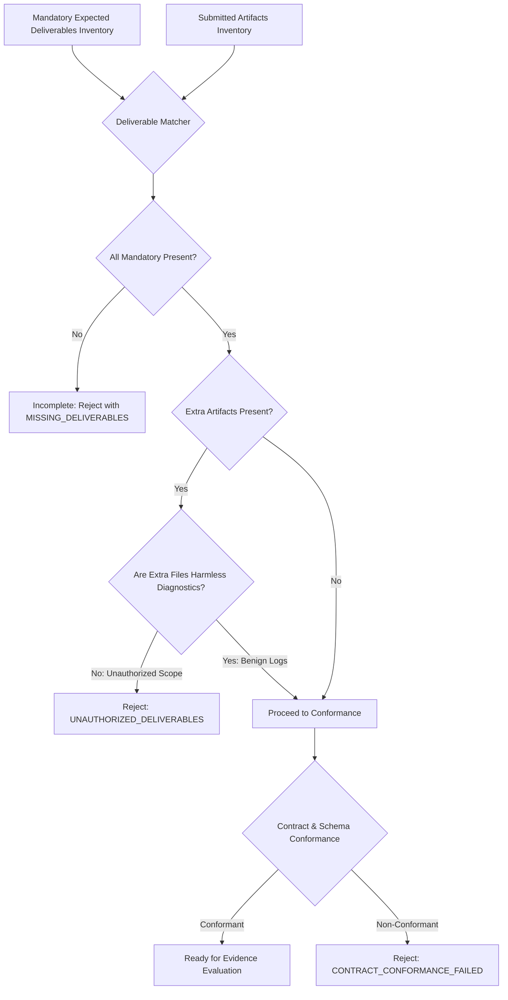

# NexLudic Engine: AI Agent Deliverable Completeness & Contract Conformance Policy

**Document ID:** `NLE-POL-ADC-002`  
**Phase:** 7 of 12 (AI Coding-Agent Orchestration)  
**Step:** 59 of 100  
**Classification:** Quality Assurance & Deliverable Governance Policy  
**Status:** IMPLEMENTATION-READY SPECIFICATION  
**Upstream Dependencies:** `NLE-CON-CTI-001` (Task Contract), `NLE-MOD-AOC-001` (Domain Model)  
**Downstream Dependents:** `NLE-POL-AVE-001` (Evidence Trust), `NLE-CON-AAC-001` (Acceptance Contract)  

---

## 1. Deliverable Completeness Verification

Every task contract (`NLE-CON-CTI-001`) establishes a mandatory **Expected Deliverables Inventory**. The verification engine maps every submitted artifact to this inventory before evaluating acceptance criteria.

---

## 2. Deliverable Conformance Rules

### Rule ADC-01: No Deliverable Substitution
A submitted artifact cannot substitute for a missing mandatory deliverable unless the task contract explicitly declares an authorized alternative:
- *Example:* Submitting a narrative text file `NOTES.txt` cannot satisfy a requirement for `ADAPTER_SPECIFICATION.md`.
- **Verdict:** If any mandatory deliverable is missing, the submission status is marked `NEEDS_REMEDIATION` with code `ERR_MANDATORY_DELIVERABLE_MISSING`.

### Rule ADC-02: Handling Unsolicited Extra Artifacts
If the agent submits files not enumerated in the expected deliverables:
- **Benign Extra Artifacts:** Temporary compiler caches, test runner logs, or unified diff patches inside `tmp/` are categorized as supporting diagnostics and preserved.
- **Unauthorized Extra Artifacts:** New source modules, modified core scripts, or added configuration files outside the task scope trigger `ERR_UNAUTHORIZED_SCOPE_EXPANSION` and halt acceptance.

### Rule ADC-03: Unsupported Natural-Language Claims
Natural language assertions in completion summaries (e.g. "I fixed the bug", "All 42 tests pass", "Zero regressions") are classified as **Tier T02 Agent Claims**. They carry zero evidentiary weight. The engine validates each claim against independent physical files and exit codes before accepting the deliverable.
