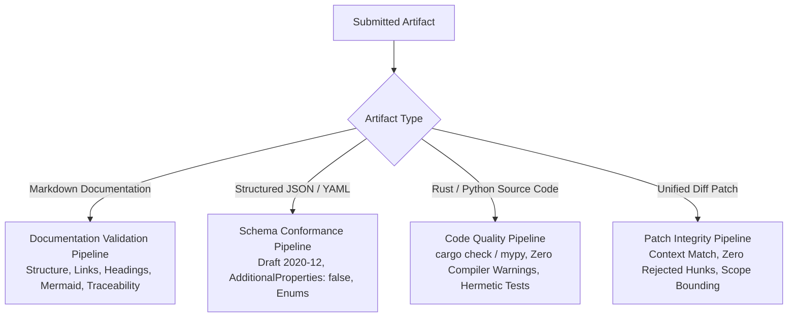

# NexLudic Engine: AI Agent Documentation, Code & Structured Artifact Validation Policy

**Document ID:** `NLE-POL-ADV-001`  
**Phase:** 7 of 12 (AI Coding-Agent Orchestration)  
**Step:** 59 of 100  
**Classification:** Artifact Validation & Quality Control Policy  
**Status:** IMPLEMENTATION-READY SPECIFICATION  
**Upstream Dependencies:** `NLE-MOD-AOC-001` (Domain Model), `NLE-POL-API-001` (Provenance Policy)  
**Downstream Dependents:** `NLE-POL-ARS-001` (Regression & Security Policy), `NLE-CON-AAC-001` (Acceptance Contract)  

---

## 1. Multi-Disciplinary Artifact Validation

NexLudic Engine tasks encompass both implementation code and formal architectural documentation. The verification engine applies specialized validation pipelines based on the artifact's formal classification:

---

## 2. Documentation Validation Standards

When an artifact is classified as `MARKDOWN_DOCUMENT`:
1. **Structural Completeness:** Must contain required standard headings (`Executive Summary`, `Specification`, `JSON Schemas`, `Traceability`).
2. **Link & Anchor Integrity:** All referenced file paths must resolve to actual repository files using forward-slash formatting. No broken anchors or dead relative links.
3. **Diagram Syntactic Conformance:** Mermaid diagrams must compile without syntax errors. Flowcharts, Sequence, and State diagrams must conform strictly to Mermaid specifications.
4. **Architectural Non-Contradiction:** Documentation must not contradict approved platform architecture decisions (`DEC-001..011`, `ADR-0001..0011`). Claiming that an unapproved design is "approved" triggers a critical validation defect.

---

## 3. Structured Data Validation Standards

When an artifact is classified as `JSON_SCHEMA` or structured configuration:
1. **Formal Schema Validation:** Evaluated strictly against JSON Schema Draft 2020-12.
2. **Closed Object Schemas:** Must specify `"additionalProperties": false` to prevent silent parameter injection.
3. **Identifier Consistency:** Entity UUID patterns, regex constraints, and enumeration values must match upstream definitions in `docs/ai-orchestration/`.

---

## 4. Source Code Validation Standards

When an artifact is classified as `RUST_SOURCE` or `PYTHON_SOURCE`:
1. **Compilation & Type Safety:** Code must compile cleanly under `cargo check` or `mypy` with zero errors and zero unhandled compiler warnings.
2. **Formatting & Linter Cleanliness:** Must satisfy standard formatting rules (`rustfmt`, `ruff`).
3. **Isolation & Sandboxing:** Source code must not import forbidden OS APIs (e.g. raw Win32 process injection functions) or introduce undeclared network dependencies.
