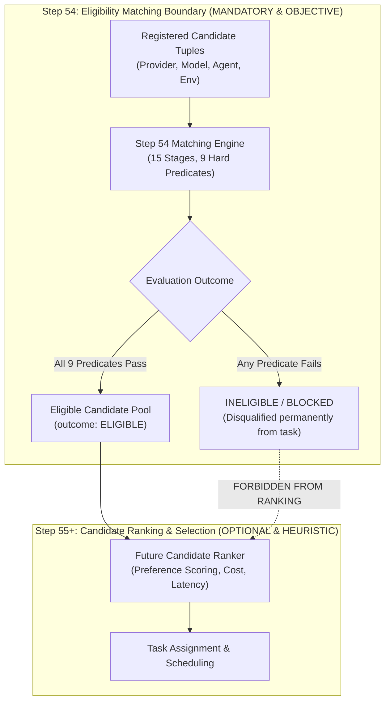

# NexLudic Engine: AI Agent Eligibility & Candidate Ranking Boundary Policy

**Document ID:** `NLE-POL-ARB-001`  
**Phase:** 7 of 12 (AI Coding-Agent Orchestration)  
**Step:** 54 of 100  
**Classification:** Architectural Boundary & Governance Policy  
**Status:** IMPLEMENTATION-READY SPECIFICATION  

---

## 1. Architectural Boundary Separation

In poorly architected multi-agent frameworks, capability matching, cost estimation, candidate scoring, and task dispatch are frequently entangled into a single heuristic ranking algorithm. Such entanglement creates grave vulnerabilities: a candidate that is cheap or fast might be selected despite lacking a required security constraint or having unverified capabilities.

NexLudic Engine enforces a strict, two-phase architectural boundary between **Eligibility Matching** and **Candidate Ranking**:

---

## 2. Hard Eligibility Precedes All Preference Scoring

1. **Eligibility is a Binary Gate:** A candidate is either `ELIGIBLE` or it is not. There is no concept of "mostly eligible" or "90% compliant".
2. **Zero-Compensation Rule:** A candidate failing a mandatory capability (e.g., lacks `CAP_SOURCE_EDIT_DIFF`) cannot compensate by having high speed, low cost, or large context windows.
3. **Disqualified Candidates Never Enter Ranking:** Any candidate tuple evaluated to `INELIGIBLE_*`, `BLOCKED_*`, `SUSPENDED`, or `NEEDS_*` is immediately filtered out. The future Step 55 ranking engine receives *only* the set of confirmed `ELIGIBLE` tuples.

---

## 3. Rejection of Universal Scalar Scoring (The "Pseudo-Score" Fallacy)

NexLudic Engine explicitly **rejects and prohibits** the introduction of a universal 0-to-100 "Capability Score" or "Agent Quality Index" for the following architectural reasons:

1. **False Equivalence:** A single composite number collapses orthogonal dimensions (security compliance, token cost, coding accuracy, and operational latency) into an arbitrary scalar where high speed can mathematically mask severe security defects.
2. **Context Blindness:** A model that scores "85/100" in Python web development may score "20/100" in C# memory-safe adapter wire serialization.
3. **Spurious Precision:** Claiming an agent is an "87.4" while another is an "86.9" provides a false veneer of scientific objectivity unsupported by empirical variance.

Instead of scalar scores, the platform permits only **multi-dimensional vector evaluations** over confirmed eligible candidates.

---

## 4. Proposed Ranking Dimensions (Future Step 55 Proposals)

> **NOTICE: PROPOSED, NOT YET APPROVED**  
> The ranking dimensions, weighting algorithms, and optimization formulas described in this section represent forward-looking design proposals for Step 55 and subsequent roadmap steps. They are **not** approved requirements for Step 54 and must not be implemented during this milestone.

When multiple candidates are confirmed `ELIGIBLE`, a future selection engine may rank candidates across four independent, objective vectors:

### Vector 1: Operational Latency & Availability (`V_LATENCY`)
- Median time-to-first-token (TTFT) and token generation velocity ($tokens/sec$).
- Provider historical uptime and current queue saturation.

### Vector 2: Economic & Compute Cost (`V_COST`)
- Marginal token cost per 1k input/output tokens.
- On-device vs. cloud compute energy expenditure.

### Vector 3: Empirical Conformance Benchmark Score (`V_ACCURACY`)
- Historical pass rate on category-specific conformance test suites (`NLE-POL-ACD-001`).
- Mean diff cleanliness score (absence of extraneous whitespace or unrelated edits).

### Vector 4: Human Review Burden (`V_REVIEW`)
- Historical rate of human sign-off without revision requests.
- Explanatory clarity of generated commit messages and pull request notes.

---

## 5. Handling Missing or Unreliable Metrics

If any metric required by a ranking heuristic is missing, outdated, or unverified:
1. **No Defaulting to "Ideal":** An unmeasured candidate is never assigned a perfect or favorable score.
2. **No Defaulting to "Zero":** An unmeasured candidate is not penalized with arbitrary zero scores if its eligibility is confirmed.
3. **Fallback to Deterministic Tie-Breaker:** If ranking metrics are indeterminate or tied, the system applies a deterministic fallback ordering:
   $$\text{Local-First Air-Gapped} \succ \text{Enterprise Private Cloud} \succ \text{Commercial Cloud API}$$
4. **Human Final Selection:** When automated ranking remains ambiguous, the final candidate selection is deferred to human developer choice in the desktop UI.
