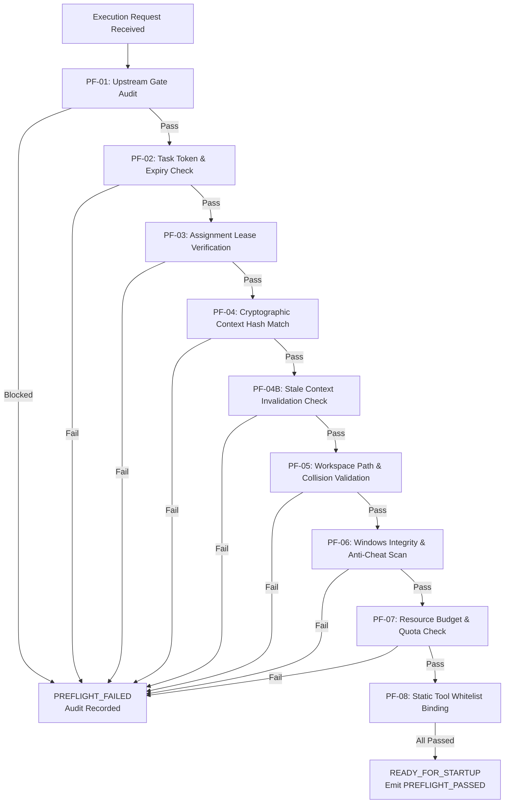

# NexLudic Engine: AI Agent Execution Preflight & Startup Validation Policy

**Document ID:** `NLE-POL-APV-001`  
**Phase:** 7 of 12 (AI Coding-Agent Orchestration)  
**Step:** 57 of 100  
**Classification:** Operational Security & Validation Policy  
**Status:** IMPLEMENTATION-READY SPECIFICATION  
**Upstream Dependencies:** `NLE-SPC-ASL-001` (Lifecycle Spec), `NLE-CON-HAR-001` (Handoff Contract), `NLE-GAT-PH5-001` (Phase 5 Gate), Step 51 Gate Audit (UNVERIFIED)  
**Downstream Dependents:** `NLE-SPC-ASM-001` (State Machine), `NLE-SEC-ARI-001` (Workspace Isolation)  

---

## 1. Policy Purpose & Invariant Directives

The **Execution Preflight and Startup Validation Policy** defines the mandatory, automated gate that every execution request must satisfy before an execution session is marked `READY_FOR_STARTUP` and before any child process, workspace, or network socket is provisioned.

The policy implements the core architectural invariant:
> **`INV-ASL-03: Fail-Closed Preflight Requirement`**  
> Under no circumstances shall an execution session begin execution if any prerequisite validation fails or yields an ambiguous result. Every preflight check must evaluate to `PASS`. Any `FAIL` or `WARNING_UNRESOLVED` immediately transitions the session to `PREFLIGHT_FAILED` (`ERR_PREFLIGHT_FAIL_CLOSED`).



---

## 2. The 8-Stage Preflight Pipeline (`PF-01` through `PF-08`)

### Stage PF-01: Upstream Gate & Readiness Audit
1. **Phase 6 Mashup Planning Gate Verification:**  
   The supervisor checks whether the requested task implements or depends upon an assembled mashup integration plan from Phase 6 (Steps 43–50).  
   - If the task targets mashup workflow execution, the supervisor verifies `NLE-GAT-PH6-001`. Since Step 51 remains `UNVERIFIED / MISSING FORMAL SIGN-OFF`, the check **FAILS CLOSED** with error code `ERR_PRECONDITION_PHASE6_UNVERIFIED`.
   - If the task is a discrete adapter scaffolding, test authoring, or documentation task fulfilling Phase 5 adapter wire protocol serialization (`P5-C01`), it is marked `EXEMPT_PHASE6` and passes to PF-02.
2. **Phase 5 Adapter SDK Gate Verification:**  
   Verifies that adapter implementation tasks explicitly declare wire protocol serialization validation (`P5-C01`) and memory safety wrappers (`P5-C02`). If undeclared, fails with `ERR_PRECONDITION_PHASE5_UNMET`.

### Stage PF-02: Task Contract & Authorization Token Verification
1. Verifies that `task_id` exists in the normalized task repository (`NLE-CON-CTI-001`).
2. Validates that the authorization token embedded in `Execution Request` is signed by the platform core, not revoked, and has `expires_at > current_time + 300_seconds`.
3. If token signature fails or is expired: fails with `ERR_AUTH_TOKEN_INVALID`.

### Stage PF-03: Candidate Assignment & Lease Verification
1. Verifies that `assignment_id` matches the authoritative assignment contract (`NLE-CON-AAH-001`).
2. Confirms that the candidate assigned (`candidate_id`, `provider_id`, `model_id`) matches the active provider registry entry (`NLE-CON-APR-001`). If candidate changed post-assignment without re-authorization: fails with `ERR_ASSIGNMENT_CANDIDATE_MISMATCH`.
3. Validates that the mutual-exclusion lease has not been acquired by another concurrent session: fails with `ERR_LEASE_ACQUISITION_COLLISION`.

### Stage PF-04: Cryptographic Context Package Integrity
1. Computes the SHA-256 digest over the canonical context package on disk.
2. Compares the computed digest with `handoff_package_digest` recorded in the signed handoff contract.
3. If digests do not match byte-for-byte: fails with `ERR_CONTEXT_DIGEST_CORRUPTED`.
4. **Stale Context Check (PF-04B):** Evaluates whether underlying source files in the repository have been modified since context assembly (`git rev-parse HEAD` vs `context_manifest.base_commit_sha`). If stale: fails with `ERR_CONTEXT_STALE_INVALIDATED`.

### Stage PF-05: Workspace Path & Boundary Validation
1. Validates that `workspace_root_path` is within the authorized staging root (`D:\NexLudic\workspaces\`).
2. Ensures the path does NOT point to:
   - Repository root (`d:\App Winrar Files\Nexludic Engine (working)`);
   - Windows system directories (`C:\Windows`, `C:\Program Files`);
   - User profile directories (`C:\Users\...\AppData`);
   - Live game installation directories (`SteamLibrary`, `Riot Games`, etc.).
3. Verifies that the path is not currently locked or populated by an existing session. If violated: fails with `ERR_WORKSPACE_PATH_INVALID`.

### Stage PF-06: Windows Integrity & Anti-Cheat Scan
1. Evaluates current process token integrity: verifies caller runs at `SECURITY_MANDATORY_MEDIUM_RID` (Medium IL). If elevated to High IL/Administrator: fails with `ERR_SECURITY_ELEVATION_PROHIBITED` (`DEC-002`).
2. Scans for active anti-cheat kernel services (Vanguard `vgk.sys`, BattlEye `BEDaisy.sys`, Easy Anti-Cheat `EasyAntiCheat.sys`). If target task touches live process memory while anti-cheat is active: fails with `ERR_SECURITY_ANTIAUDIT_ACTIVE` (`BLK-SEC-01`).

### Stage PF-07: Resource Budget & System Capacity Check
1. Verifies available system RAM exceeds the requested `memory_limit_mb` by at least 2048 MB.
2. Verifies available disk space on the staging drive exceeds `disk_write_limit_mb` by at least 10 GB.
3. Checks active session concurrency count against the platform ceiling (maximum 3 concurrent sessions). If exceeded: fails with `ERR_CAPACITY_LIMIT_EXCEEDED`.

### Stage PF-08: Static Tool Whitelist & Permission Binding
1. Inspects the task contract's `authorized_tool_set`.
2. Validates that every tool requested is mapped to a registered host-brokered tool implementation (`NLE-CON-ATC-001`).
3. Confirms that no unauthorized tool or operation (such as raw shell execution or network socket binding) is requested. If violated: fails with `ERR_TOOL_AUTHORIZATION_DISALLOWED`.

---

## 3. Preflight Decision Record Schema (`NLE-SCH-PDR-001`)

```json
{
  "$schema": "https://json-schema.org/draft/2020-12/schema",
  "$id": "https://schemas.nexludic.com/v1/orchestration/preflight-decision.json",
  "title": "NexLudicPreflightDecisionRecord",
  "type": "object",
  "required": [
    "decision_id",
    "session_id",
    "request_id",
    "evaluated_at",
    "overall_verdict",
    "stages"
  ],
  "properties": {
    "decision_id": { "type": "string", "pattern": "^pdr-[0-9a-f]{8}-[0-9a-f]{4}-4[0-9a-f]{3}-[89ab][0-9a-f]{3}-[0-9a-f]{12}$" },
    "session_id": { "type": "string" },
    "request_id": { "type": "string" },
    "evaluated_at": { "type": "string", "format": "date-time" },
    "overall_verdict": { "type": "string", "enum": ["PASSED", "FAILED_FAIL_CLOSED"] },
    "stages": {
      "type": "array",
      "items": {
        "type": "object",
        "required": ["stage_code", "status", "evaluated_at"],
        "properties": {
          "stage_code": { "type": "string", "enum": ["PF-01", "PF-02", "PF-03", "PF-04", "PF-05", "PF-06", "PF-07", "PF-08"] },
          "status": { "type": "string", "enum": ["PASS", "FAIL", "EXEMPT"] },
          "error_code": { "type": "string" },
          "message": { "type": "string" }
        }
      }
    }
  }
}
```
