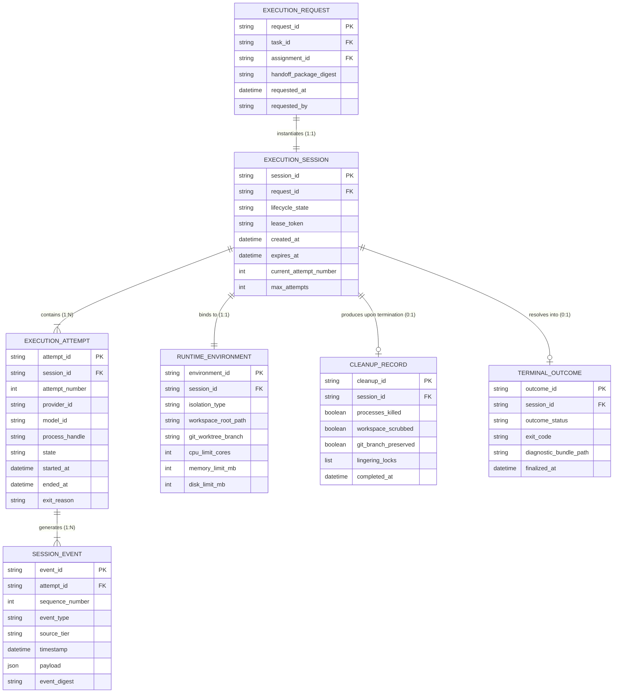

# NexLudic Engine: AI Agent Execution Session & Attempt Domain Model

**Document ID:** `NLE-MOD-ASL-001`  
**Phase:** 7 of 12 (AI Coding-Agent Orchestration)  
**Step:** 57 of 100  
**Classification:** Core Domain Model & Entity Specification  
**Status:** IMPLEMENTATION-READY SPECIFICATION  
**Upstream Dependencies:** `NLE-MOD-CAO-001` (Step 52), `NLE-MOD-CTI-001` (Step 53), `NLE-MOD-APR-001` (Step 54), `NLE-MOD-CSR-001` (Step 55), `NLE-CON-CTP-001` (Step 56)  
**Downstream Dependents:** `NLE-SPC-ASM-001` (State Machine), `NLE-POL-APV-001` (Preflight Policy), `NLE-CON-AEV-001` (Event Contract)  

---

## 1. Architectural Domain Overview

The **Execution Session and Attempt Domain Model** establishes the definitive structural representation of agent execution activities within NexLudic Engine. 

A central failure mode in naive agent orchestration is conflating an **execution intent**, an **administrative session**, and an **underlying OS process or remote API trial**. If a sub-process crashes or times out, treating the entire task as an untracked void leads to leaked processes, orphaned file locks, and unverifiable state.

NexLudic Engine enforces a strict 4-tier epistemic separation:
1. **Execution Request (`NLE-ENT-EXR-001`):** Immutable record of authorized intent resulting from Step 56 handoff.
2. **Execution Session (`NLE-ENT-EXS-001`):** Administrative lifecycle envelope holding mutual-exclusion leases, state, quotas, and governance records.
3. **Execution Attempt (`NLE-ENT-EXA-001`):** A specific, concrete trial executing code via an assigned AI provider and worker process.
4. **Runtime Environment (`NLE-ENT-RTE-001`):** The isolated operating sandbox (Git worktree, Windows Job Object, path restrictions) in which code changes occur.



---

## 2. Entity Specifications

### 2.1 Execution Request (`NLE-ENT-EXR-001`)
- **Cardinality:** Exactly 1 per task handoff dispatch.
- **Mutability:** Strictly Immutable.
- **Attributes:**
  - `request_id`: Primary key, UUIDv4 with prefix `exr-`.
  - `task_id`: Foreign key referencing the normalized task contract (`tsk-...`).
  - `assignment_id`: Foreign key referencing the authorized candidate assignment (`asg-...`).
  - `handoff_package_id`: Canonical context package identifier (`hpk-...`).
  - `handoff_package_digest`: Hexadecimal SHA-256 digest of the canonical package.
  - `requested_by`: Identity string of requester (`user:admin`, `pipeline:ci`).
  - `requested_at`: ISO 8601 UTC timestamp of dispatch.

### 2.2 Execution Session (`NLE-ENT-EXS-001`)
- **Cardinality:** Exactly 1 per active or historical execution session.
- **Mutability:** Stateful; updated solely by the Platform Supervisor State Machine (`NLE-SPC-ASM-001`).
- **Attributes:**
  - `session_id`: Primary key, UUIDv4 with prefix `exs-`.
  - `request_id`: Foreign key to `Execution Request`.
  - `lifecycle_state`: Standardized session state enum (`PENDING_PREFLIGHT`, `RUNNING`, etc.).
  - `lease_token`: Cryptographically random 256-bit token representing current supervisor ownership.
  - `max_attempts`: Positive integer specifying allowable attempt retries (default: 1; max: 3).
  - `current_attempt_number`: Index of the latest active attempt (0 if preflight not completed).
  - `created_at`: Session instantiation timestamp.
  - `updated_at`: Last state mutation timestamp.
  - `expires_at`: Hard wall-clock lease deadline after which watchdog initiates forced termination.

### 2.3 Execution Attempt (`NLE-ENT-EXA-001`)
- **Cardinality:** 1 to N per Execution Session.
- **Mutability:** Mutable only during active attempt execution; finalized upon completion/failure.
- **Attributes:**
  - `attempt_id`: Primary key, UUIDv4 with prefix `exa-`.
  - `session_id`: Foreign key to parent `Execution Session`.
  - `attempt_number`: 1-based sequential integer (`1`, `2`, `3`).
  - `provider_id`: Canonical AI provider (`google-gemini`, `anthropic-claude`, `local-llama`).
  - `model_id`: Canonical model identifier (`gemini-2.5-pro`, `claude-3-7-sonnet`).
  - `process_handle`: Windows Process ID (PID) and job object handle for local workers, or remote session UUID for cloud providers.
  - `attempt_state`: `INITIALIZING`, `ACTIVE`, `PAUSED`, `SUCCEEDED`, `FAILED`, `ABORTED`.
  - `started_at`: Timestamp when the worker process or remote stream was launched.
  - `ended_at`: Timestamp when worker process exited or socket disconnected.
  - `exit_reason`: Standardized error or success code.

### 2.4 Runtime Environment (`NLE-ENT-RTE-001`)
- **Cardinality:** 1 per Execution Session (persists across retry attempts within the session).
- **Mutability:** Immutable once provisioned; torn down during session cleanup.
- **Attributes:**
  - `environment_id`: Primary key, UUIDv4 with prefix `rte-`.
  - `session_id`: Foreign key to parent session.
  - `isolation_type`: Enum (`GIT_WORKTREE_ISOLATION`, `PROCESS_JOB_OBJECT`, `CONTAINER_SANDBOX`).
  - `workspace_root_path`: Absolute normalized Windows filesystem path (e.g. `D:\NexLudic\workspaces\exs-0123abcd\`).
  - `git_worktree_branch`: Dedicated Git branch name (e.g. `nexludic/agent/tsk-1029/attempt-1`).
  - `cpu_limit_cores`: Maximum logical cores allocated (enforced via Windows Job Object).
  - `memory_limit_mb`: Maximum committed memory in Megabytes (enforced via Windows Job Object).
  - `disk_write_limit_mb`: Maximum total scratch disk writes permitted.
  - `integrity_level`: Fixed Windows token integrity level (`SECURITY_MANDATORY_MEDIUM_RID`).

### 2.5 Session Event (`NLE-ENT-SEV-001`)
- **Cardinality:** N per Execution Attempt (append-only ledger).
- **Mutability:** Strictly Immutable.
- **Attributes:**
  - `event_id`: Primary key, UUIDv4 with prefix `sev-`.
  - `attempt_id`: Foreign key to active `Execution Attempt`.
  - `sequence_number`: Monotonically increasing 64-bit integer per session (starts at 1).
  - `timestamp`: Nanosecond-precision UTC timestamp.
  - `event_category`: Enum (`LIFECYCLE`, `TOOL_INVOCATION`, `AGENT_STATUS`, `SECURITY_VIOLATION`, `RESOURCE_USAGE`).
  - `event_type`: Specific event identifier (`TOOL_CALL_REQUESTED`, `FILE_WRITTEN`, `HEARTBEAT`).
  - `source_tier`: Enum (`SUPERVISOR_CORE`, `AGENT_WORKER`, `OPERATOR_OVERRIDE`).
  - `payload`: Structured JSON payload with event parameters.
  - `event_digest`: SHA-256 HMAC of the current event concatenated with previous `event_digest`.

### 2.6 Session Cleanup Record (`NLE-ENT-CLR-001`)
- **Cardinality:** Exactly 1 upon session termination.
- **Mutability:** Immutable once finalized.
- **Attributes:**
  - `cleanup_id`: Primary key, UUIDv4 with prefix `clr-`.
  - `session_id`: Foreign key to terminating session.
  - `processes_killed`: Array of PIDs successfully terminated by supervisor.
  - `orphan_processes_detected`: Array of leaked child PIDs caught and killed by Windows Job Object.
  - `workspace_disposition`: Enum (`SCRUBBED_DELETED`, `PRESERVED_FOR_DIAGNOSTICS`, `BRANCH_RETAINED`).
  - `locks_released`: Array of file handles, port bindings, and named mutexes verified freed.
  - `completed_at`: Timestamp when cleanup verification finished.
  - `cleanup_status`: Enum (`CLEANUP_SUCCESSFUL`, `CLEANUP_PARTIAL_WARNING`, `CLEANUP_FAILED_CRITICAL`).

### 2.7 Terminal Outcome (`NLE-ENT-TMO-001`)
- **Cardinality:** Exactly 1 per finalized session.
- **Mutability:** Strictly Immutable.
- **Attributes:**
  - `outcome_id`: Primary key, UUIDv4 with prefix `tmo-`.
  - `session_id`: Foreign key to finalized session.
  - `outcome_status`: Enum (`COMPLETED_AWAITING_VERIFICATION`, `CANCELLED_BY_OPERATOR`, `FAILED_RUNTIME_ERROR`, `TERMINATED_TIMEOUT`, `ABORTED_PREFLIGHT_FAILURE`).
  - `exit_code`: Standardized integer/string exit code.
  - `verification_handoff_token`: Opaque cryptographic token transferring workspace ownership to Step 58.
  - `diagnostic_bundle_path`: Path to zipped diagnostic logs and session event ledger.
  - `finalized_at`: Timestamp of terminal transition.

---

## 3. Formal JSON Schema for Execution Session (`NLE-SCH-EXS-001`)

```json
{
  "$schema": "https://json-schema.org/draft/2020-12/schema",
  "$id": "https://schemas.nexludic.com/v1/orchestration/execution-session.json",
  "title": "NexLudicExecutionSession",
  "type": "object",
  "required": [
    "schema_version",
    "session_id",
    "request_id",
    "task_id",
    "assignment_id",
    "lifecycle_state",
    "lease_token",
    "max_attempts",
    "current_attempt_number",
    "runtime_environment",
    "created_at",
    "updated_at",
    "expires_at"
  ],
  "properties": {
    "schema_version": { "type": "string", "const": "1.0.0" },
    "session_id": { "type": "string", "pattern": "^exs-[0-9a-f]{8}-[0-9a-f]{4}-4[0-9a-f]{3}-[89ab][0-9a-f]{3}-[0-9a-f]{12}$" },
    "request_id": { "type": "string", "pattern": "^exr-[0-9a-f]{8}-[0-9a-f]{4}-4[0-9a-f]{3}-[89ab][0-9a-f]{3}-[0-9a-f]{12}$" },
    "task_id": { "type": "string", "pattern": "^tsk-[0-9a-f]{8}-[0-9a-f]{4}-4[0-9a-f]{3}-[89ab][0-9a-f]{3}-[0-9a-f]{12}$" },
    "assignment_id": { "type": "string", "pattern": "^asg-[0-9a-f]{8}-[0-9a-f]{4}-4[0-9a-f]{3}-[89ab][0-9a-f]{3}-[0-9a-f]{12}$" },
    "lifecycle_state": {
      "type": "string",
      "enum": [
        "PENDING_PREFLIGHT",
        "PREFLIGHT_FAILED",
        "READY_FOR_STARTUP",
        "STARTING",
        "RUNNING",
        "PAUSED",
        "CANCELLING",
        "CANCELLED",
        "COMPLETING",
        "COMPLETED",
        "FAILED",
        "TIMED_OUT",
        "CLEANING_UP",
        "CLEANUP_FAILED",
        "TERMINATED",
        "HANDED_OFF_FOR_VERIFICATION"
      ]
    },
    "lease_token": { "type": "string", "pattern": "^[0-9a-f]{64}$" },
    "max_attempts": { "type": "integer", "minimum": 1, "maximum": 5, "default": 1 },
    "current_attempt_number": { "type": "integer", "minimum": 0 },
    "runtime_environment": {
      "type": "object",
      "required": ["environment_id", "isolation_type", "workspace_root_path", "integrity_level"],
      "properties": {
        "environment_id": { "type": "string" },
        "isolation_type": { "type": "string", "enum": ["GIT_WORKTREE_ISOLATION", "PROCESS_JOB_OBJECT"] },
        "workspace_root_path": { "type": "string" },
        "git_worktree_branch": { "type": "string" },
        "cpu_limit_cores": { "type": "integer", "minimum": 1, "maximum": 64 },
        "memory_limit_mb": { "type": "integer", "minimum": 512, "maximum": 65536 },
        "disk_write_limit_mb": { "type": "integer", "minimum": 100, "maximum": 1048576 },
        "integrity_level": { "type": "string", "const": "MEDIUM" }
      }
    },
    "created_at": { "type": "string", "format": "date-time" },
    "updated_at": { "type": "string", "format": "date-time" },
    "expires_at": { "type": "string", "format": "date-time" }
  },
  "additionalProperties": false
}
```
