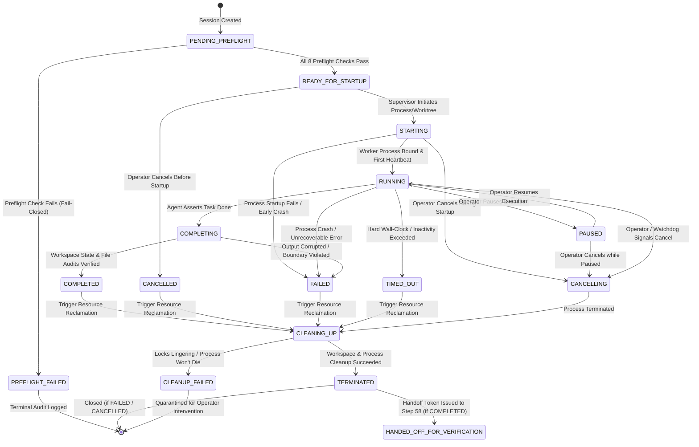

# NexLudic Engine: AI Agent Execution Session State Machine & Transition Rules

**Document ID:** `NLE-SPC-ASM-001`  
**Phase:** 7 of 12 (AI Coding-Agent Orchestration)  
**Step:** 57 of 100  
**Classification:** Core State Machine Specification  
**Status:** IMPLEMENTATION-READY SPECIFICATION  
**Upstream Dependencies:** `NLE-MOD-ASL-001` (Domain Model), `NLE-POL-APV-001` (Preflight Policy)  
**Downstream Dependents:** `NLE-CON-AEV-001` (Event Contract), `NLE-POL-APT-001` (Termination & Cleanup Policy)  

---

## 1. State Machine Architectural Overview

The Execution Session State Machine is the authoritative arbiter of lifecycle transitions for all AI coding agent activities in NexLudic Engine.

### 1.1 State Ownership Invariant
> **`INV-ASM-01: Exclusive Supervisor State Ownership`**  
> All state mutations are authored and committed exclusively by the **Platform Supervisor**. Neither the AI agent, the child process, nor the AI provider API can mutate the session state directly. External agents emit *signals* or *status requests*; the supervisor validates preconditions and executes the transition.

---

## 2. Exhaustive State Definitions

| State | Classification | Description |
| :--- | :--- | :--- |
| `PENDING_PREFLIGHT` | Initial | Session initialized; awaiting execution of 8-stage preflight evaluation pipeline (`PF-01..08`). |
| `PREFLIGHT_FAILED` | Terminal | Preflight evaluated to `FAIL`; no workspace created, no process launched. Fail-closed. |
| `READY_FOR_STARTUP` | Staging | All preflight checks passed; workspace and worktree allocated; awaiting process launch. |
| `STARTING` | Active | Supervisor spawning Windows Job Object, worker sub-process, or establishing remote API stream. |
| `RUNNING` | Active | Worker process active, connected, emitting telemetry, and executing approved tool operations. |
| `PAUSED` | Suspended | Worker process suspended (CPU halted via Job Object or API paused); tool calls queued or blocked. |
| `CANCELLING` | Interruption | Cancellation requested by operator or safety watchdog; supervisor issuing graceful `SIGINT`/`CTRL_C`. |
| `CANCELLED` | Transition | Process stopped in response to cancellation; awaiting resource cleanup. |
| `COMPLETING` | Verification | Agent asserted completion; supervisor validating workspace changes against scope. |
| `COMPLETED` | Success | Workspace changes pass superficial validation; ready for cleanup and Step 58 handoff. |
| `FAILED` | Error | Unrecoverable process crash, security boundary violation, or unhandled tool error. |
| `TIMED_OUT` | Error | Execution exceeded hard wall-clock timeout or inactivity watchdog threshold. |
| `CLEANING_UP` | Housekeeping | Terminating remaining processes, releasing Windows file handles, archiving logs. |
| `CLEANUP_FAILED` | Quarantined | Lingering processes or file locks prevent cleanup; session quarantined for operator audit. |
| `TERMINATED` | Finalized | All resources, handles, and processes confirmed dead; diagnostic bundle generated. |
| `HANDED_OFF_FOR_VERIFICATION` | Terminal Transfer | Ownership of workspace and artifacts transferred to Step 58 verification engine. |

---

## 3. Legal State Transition Matrix

| Current State | Triggering Event / Signal | Target State | Guard Conditions | Side Effects |
| :--- | :--- | :--- | :--- | :--- |
| `PENDING_PREFLIGHT` | `EVT_PREFLIGHT_PASS` | `READY_FOR_STARTUP` | All 8 preflight checks evaluated to `PASS`. | Provision workspace directory and Git worktree branch. |
| `PENDING_PREFLIGHT` | `EVT_PREFLIGHT_FAIL` | `PREFLIGHT_FAILED` | At least 1 check evaluated to `FAIL`. | Write `NLE-SCH-PDR-001` record; zero filesystem changes. |
| `READY_FOR_STARTUP` | `EVT_STARTUP_TRIGGER` | `STARTING` | Supervisor lease valid; system capacity available. | Instantiate Windows Job Object, launch worker process. |
| `READY_FOR_STARTUP` | `EVT_CANCEL_REQUEST` | `CANCELLED` | Operator cancels prior to process launch. | Scrub staging directory; release session lease. |
| `STARTING` | `EVT_PROCESS_BOUND` | `RUNNING` | PID attached to Job Object; initial heartbeat received within 15s. | Start resource watchdogs; open tool invocation gate. |
| `STARTING` | `EVT_STARTUP_TIMEOUT` | `FAILED` | No heartbeat received within 15s; process hung. | Force-kill PID (`TerminateProcess`); record startup failure. |
| `RUNNING` | `EVT_PAUSE_REQUEST` | `PAUSED` | Task policy allows pause; process supports suspension. | Suspend process threads; freeze watchdog countdown timer. |
| `PAUSED` | `EVT_RESUME_REQUEST` | `RUNNING` | Re-validate context digest and authorization token. | Resume process threads; restart watchdog timers. |
| `RUNNING` | `EVT_CANCEL_REQUEST` | `CANCELLING` | Operator or watchdog signals cancellation. | Send graceful interrupt; arm 10s termination watchdog. |
| `RUNNING` | `EVT_WATCHDOG_TIMEOUT`| `TIMED_OUT` | Wall-clock limit (e.g. 1800s) or inactivity limit reached. | Initiate immediate process termination. |
| `RUNNING` | `EVT_PROCESS_CRASH` | `FAILED` | Sub-process exited with non-zero exit code unexpectedly. | Snapshot workspace state for diagnostic post-mortem. |
| `RUNNING` | `EVT_AGENT_DONE_SIGNAL`| `COMPLETING` | Agent emitted `TASK_COMPLETED` status event. | Close tool invocation gate; snapshot git diff. |
| `COMPLETING` | `EVT_DIFF_VERIFIED` | `COMPLETED` | Modified files strictly within authorized task scope. | Seal workspace branch; proceed to cleanup. |
| `COMPLETING` | `EVT_DIFF_VIOLATION` | `FAILED` | Files outside authorized scope were touched. | Mark boundary violation; retain workspace for audit. |
| `COMPLETED` | `EVT_CLEANUP_TRIGGER` | `CLEANING_UP` | Completed state finalized. | Execute process scrub and handle release. |
| `FAILED` | `EVT_CLEANUP_TRIGGER` | `CLEANING_UP` | Failed state finalized. | Terminate lingering child processes. |
| `TIMED_OUT` | `EVT_CLEANUP_TRIGGER` | `CLEANING_UP` | Timeout state finalized. | Force kill entire Job Object process tree. |
| `CANCELLED` | `EVT_CLEANUP_TRIGGER` | `CLEANING_UP` | Cancellation confirmed. | Reclaim resources and scratch workspace. |
| `CLEANING_UP` | `EVT_CLEANUP_SUCCESS`| `TERMINATED` | All PIDs dead; all handles released; locks cleared. | Write `NLE-ENT-CLR-001` record. |
| `CLEANING_UP` | `EVT_CLEANUP_ERROR` | `CLEANUP_FAILED` | PIDs lingering or files locked after 30s timeout. | Alarm raised; mark quarantined for operator manual kill. |
| `TERMINATED` | `EVT_VERIFY_HANDOFF` | `HANDED_OFF_FOR_VERIFICATION` | Prior state was `COMPLETED`; tokens signed. | Issue verification transfer token to Step 58. |

---

## 4. Illegal Transition Governance

Any event triggering a transition not explicitly enumerated in the Legal State Transition Matrix is rejected:
- **Supervisor Reaction:** The invalid transition request is rejected immediately with error `ERR_INVALID_STATE_TRANSITION`.
- **Session State:** The session remains in its current state without modification.
- **Audit & Security:** A high-severity security audit event (`EVT_ILLEGAL_STATE_TRANSITION_ATTEMPT`) is logged.
- **Double Completion Invariant:** A session that is in `TERMINATED` or `HANDED_OFF_FOR_VERIFICATION` can NEVER transition back to `RUNNING` or accept new tool operations.
