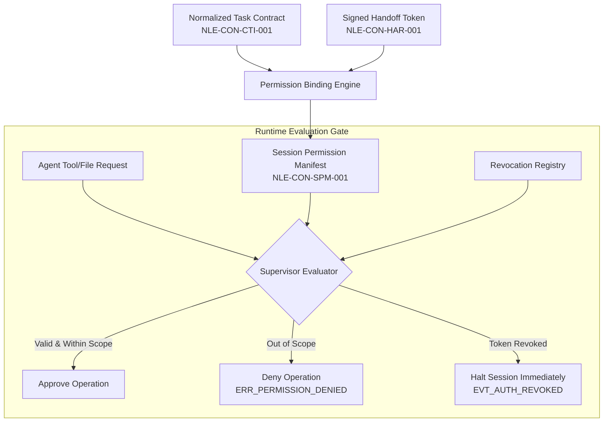

# NexLudic Engine: AI Agent Execution-Time Authorization & Permission Binding Policy

**Document ID:** `NLE-POL-APB-001`  
**Phase:** 7 of 12 (AI Coding-Agent Orchestration)  
**Step:** 57 of 100  
**Classification:** Security Policy & Authorization Contract  
**Status:** IMPLEMENTATION-READY SPECIFICATION  
**Upstream Dependencies:** `NLE-SPC-ASL-001` (Lifecycle Spec), `NLE-CON-CTI-001` (Task Contract), `NLE-CON-AAH-001` (Assignment Contract)  
**Downstream Dependents:** `NLE-CON-ATC-001` (Tool Operation Boundary), `NLE-SEC-ARI-001` (Runtime Isolation)  

---

## 1. Policy Mandate & Core Invariants

The **Execution-Time Authorization and Permission Binding Policy** governs the scope of authority granted to an AI coding agent during an active execution session. 

The policy is governed by three non-negotiable security invariants:
1. **`INV-APB-01: Static Scope Immutability`**  
   An agent's permissions are permanently bounded by the authorized task contract (`NLE-CON-CTI-001`) and the signed handoff token. An agent cannot self-authorize, request elevated scopes at runtime, or dynamically broaden its file access whitelist.
2. **`INV-APB-02: Zero Ambient Authority`**  
   The agent inherits zero implicit permissions from the host user or parent process. Every filesystem read, write, or tool invocation requires an explicit matching grant in the session's active permission manifest.
3. **`INV-APB-03: Real-Time Revocability`**  
   Session authority is continuously re-evaluated. If the operator revokes authorization or updates task policy, all active execution permissions are immediately rescinded.



---

## 2. Session Permission Manifest Structure (`NLE-CON-SPM-001`)

At session creation, the supervisor compiles a **Session Permission Manifest** bound to the session ID:

```json
{
  "$schema": "https://json-schema.org/draft/2020-12/schema",
  "$id": "https://schemas.nexludic.com/v1/orchestration/session-permission-manifest.json",
  "title": "NexLudicSessionPermissionManifest",
  "type": "object",
  "required": [
    "manifest_id",
    "session_id",
    "task_id",
    "bound_at",
    "expires_at",
    "filesystem_grants",
    "tool_grants",
    "network_grants"
  ],
  "properties": {
    "manifest_id": { "type": "string", "pattern": "^spm-[0-9a-f]{8}-[0-9a-f]{4}-4[0-9a-f]{3}-[89ab][0-9a-f]{3}-[0-9a-f]{12}$" },
    "session_id": { "type": "string" },
    "task_id": { "type": "string" },
    "bound_at": { "type": "string", "format": "date-time" },
    "expires_at": { "type": "string", "format": "date-time" },
    "filesystem_grants": {
      "type": "object",
      "required": ["read_roots", "write_roots", "forbidden_patterns"],
      "properties": {
        "read_roots": { "type": "array", "items": { "type": "string" } },
        "write_roots": { "type": "array", "items": { "type": "string" } },
        "forbidden_patterns": { "type": "array", "items": { "type": "string" } }
      }
    },
    "tool_grants": {
      "type": "array",
      "items": {
        "type": "object",
        "required": ["tool_id", "allowed_operations", "rate_limit_per_minute"],
        "properties": {
          "tool_id": { "type": "string" },
          "allowed_operations": { "type": "array", "items": { "type": "string" } },
          "rate_limit_per_minute": { "type": "integer", "minimum": 1 }
        }
      }
    },
    "network_grants": {
      "type": "object",
      "required": ["allow_outbound", "allowed_domains"],
      "properties": {
        "allow_outbound": { "type": "boolean", "default": false },
        "allowed_domains": { "type": "array", "items": { "type": "string" } }
      }
    }
  }
}
```

---

## 3. Runtime Permission Enforcement Rules

### 3.1 Strict Prohibition of Authority Expansion
- If an agent emits a request such as:  
  `{"action": "request_permission", "path": "C:\Windows\System32\drivers"}`  
  or attempts to edit a file outside `write_roots`:
- **Enforcement Action:** The request is rejected immediately with error code `ERR_PERMISSION_SCOPE_EXCEEDED`.
- **Security Escalation:** If three scope-violation attempts occur within a single session, the supervisor flags the activity as potential adversarial subversion or prompt injection, freezes the session (`PAUSED`), and alerts the human operator.

### 3.2 Authorization Revocation & Periodic Revalidation
- The supervisor polls the platform's Authorization Revocation List (ARL) every 5 seconds and immediately prior to approving any file write or tool dispatch.
- If the parent task contract has been marked `REVOKED`, `CANCELLED`, or `PAUSED_BY_USER`:
  1. The supervisor immediately transitions the session state to `CANCELLING`.
  2. Any in-flight tool requests are terminated.
  3. The agent process is signalled for termination (`EVT_AUTH_REVOKED`).
