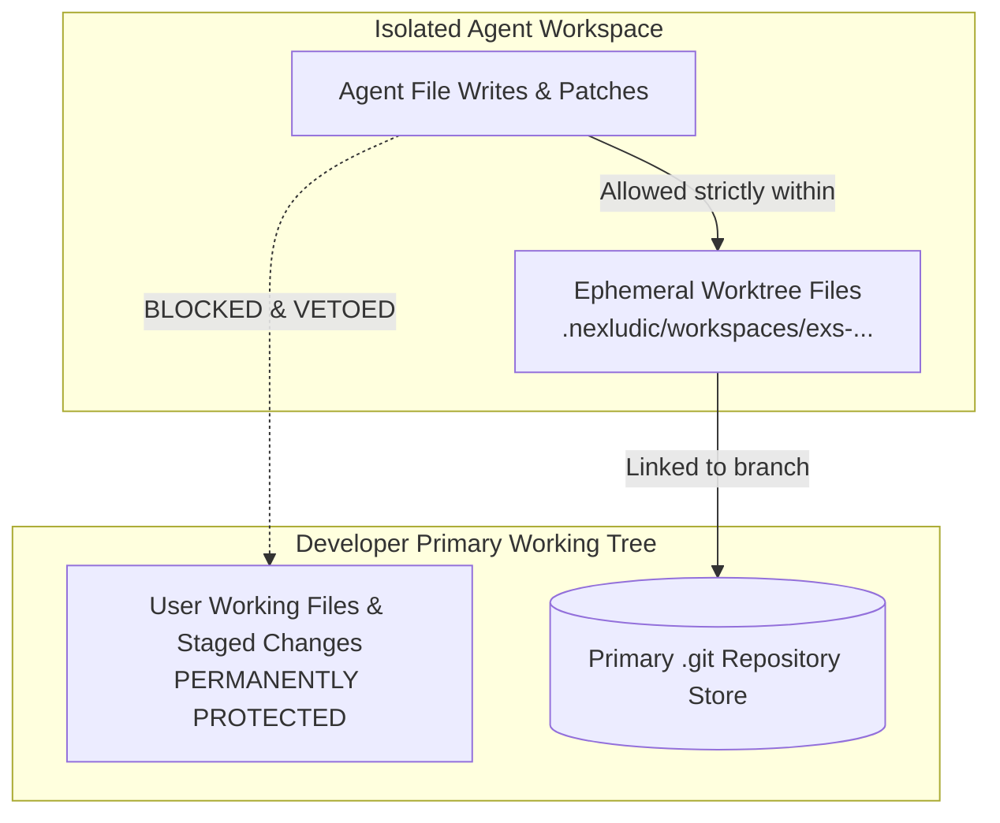

# NexLudic Engine: AI Agent Filesystem, Repository & Workspace Operation Policy

**Document ID:** `NLE-POL-ATF-001`  
**Phase:** 7 of 12 (AI Coding-Agent Orchestration)  
**Step:** 58 of 100  
**Classification:** Operational Filesystem & Repository Policy  
**Status:** IMPLEMENTATION-READY SPECIFICATION  
**Upstream Dependencies:** `NLE-SEC-ARI-001` (Step 57 Isolation Boundary), `NLE-SEC-ATI-001` (Input Validation)  
**Downstream Dependents:** `NLE-CON-ATV-001` (Output & Evidence Contract), Step 58 Traceability Matrix  

---

## 1. Filesystem Operation Policy & Workspace Enclosure

NexLudic Engine enforces a strict boundary between the developer's primary working repository and an AI agent's working space:
1. **Primary Working Copy Protection:** The agent NEVER writes directly to the user's active repository checkout (`d:\App Winrar Files\Nexludic Engine (working)`).
2. **Ephemeral Git Worktree:** All agent writes occur exclusively within an isolated Git worktree (`.nexludic/workspaces/<session_id>/`) checked out on a task-specific branch (`nexludic/agent/<task_id>/attempt-<n>`).
3. **Preservation of User Work:** Under no circumstances shall the gateway silently overwrite, revert, stash, or clean uncommitted user changes in the primary repository.

---

## 2. Read, Write & Patch Governance Rules

### Rule ATF-01: Read Operations & Size Bounding
- Read requests (`fs:read_file`) can access approved files in the repository whitelist.
- Maximum file read buffer is capped at **2 MB** per call. Files exceeding this threshold must be read via paginated line-range queries.
- Secret files (`.env`, `keystore.json`, `.git/config`, credentials) are hard-filtered from read operations.

### Rule ATF-02: Write Operations & Post-Write Verification
- Write operations (`fs:write_file`) are restricted strictly to files within the task's `write_roots`.
- Overwriting existing files requires an explicit flag (`overwrite: true`).
- Following every write operation, the executor immediately computes the SHA-256 digest of the newly written file on disk and verifies that bytes written match bytes requested.

### Rule ATF-03: Unified Diff & Patch Application
- When applying code modifications via patches (`git:apply_patch`):
  1. The patch context is verified against the worktree's current base commit.
  2. If git reports rejected hunks (`.rej` files), the entire patch operation is rolled back immediately (`git checkout -- .`).
  3. Partial patch application is strictly prohibited. An atomic all-or-nothing guarantee is enforced.

### Rule ATF-04: Destructive Operations (Deletions & Cleanups)
- File deletions (`fs:delete_file`) targeting files outside the ephemeral `tmp/` subdirectory require a **Tier 4 Human Approval Token** (`NLE-CON-HAT-001`).
- Recursive directory deletions are permanently blocked for automated agents.
