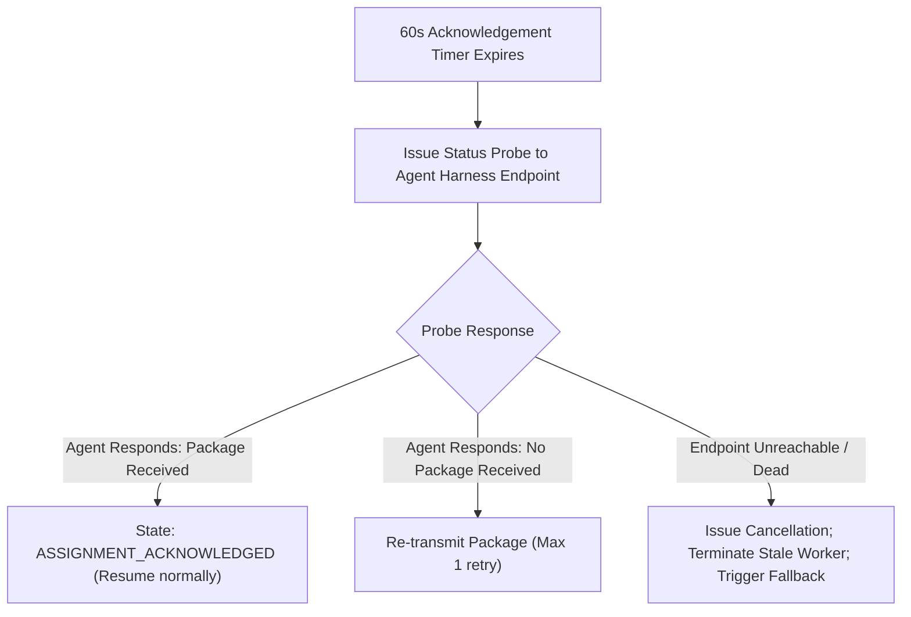

# NexLudic Engine: AI Agent Handoff Authorization, Acknowledgement & Recovery Contract

**Document ID:** `NLE-CON-HAR-001`  
**Phase:** 7 of 12 (AI Coding-Agent Orchestration)  
**Step:** 56 of 100  
**Classification:** Handoff Protocol, Acknowledgement & Recovery Contract  
**Status:** IMPLEMENTATION-READY SPECIFICATION  

---

## 1. Handoff Protocol Architecture

Context packaging produces a validated payload, but **package preparation does not authorize external transmission**.

The handoff protocol enforces strict phase separation across the dispatch boundary:

```mermaid
sequenceDiagram
    participant ContextEngine as Context Packaging Engine
    participant Gate as Handoff Authorization Gate
    participant Dispatcher as Dispatch Supervisor
    participant Agent as Agent Execution Harness
    participant Worktree as Isolated Workspace

    ContextEngine->>Gate: Submit Canonical Package (READY_FOR_HANDOFF)
    Gate->>Gate: Assert Pre-Handoff Recheck (Token TTL, Recipient ID)
    Gate->>Dispatcher: Authorize Transmission
    Dispatcher->>Agent: Transmit Transformed Package
    Note over Dispatcher: Start 60-Second Ack Timer
    Agent->>Worktree: Verify Path Whitelist & Tool Mounts
    Agent-->>Dispatcher: Return Assignment Acknowledgement (ACK)
    Note over Dispatcher: Cancel Ack Timer; State: ASSIGNMENT_ACKNOWLEDGED
    Dispatcher->>Agent: Issue Execution Handoff Signal
```

---

## 2. The 7 Operational Handoff Phases

To prevent premature execution or unmonitored transmissions, the platform governs handoff across 7 distinct states:

1. **`PACKAGE_PREPARED`:** The canonical package and context manifest are assembled and validated in memory.
2. **`HANDOFF_AUTHORIZED`:** The pre-handoff authorization gate asserts token currency, recipient identity, and disclosure permissions.
3. **`HANDOFF_DISPATCHED`:** The payload is serialized and transmitted over local IPC or an authorized secure network socket.
4. **`DELIVERY_CONFIRMED`:** Network socket confirms all bytes successfully delivered to the recipient endpoint.
5. **`AGENT_ACKNOWLEDGED`:** The agent harness parses the package, verifies tool bindings within the workspace, and returns a signed acknowledgement.
6. **`ASSIGNMENT_ACCEPTED`:** The agent harness indicates readiness to begin execution turns.
7. **`EXECUTION_INITIATED`:** The first tool call or generation turn begins under sandbox supervision.

> **NON-NEGOTIABLE GOVERNANCE AXIOM:**  
> These 7 states must never be collapsed. `PACKAGE_PREPARED` $\neq$ `HANDOFF_AUTHORIZED`. `HANDOFF_DISPATCHED` $\neq$ `AGENT_ACKNOWLEDGED`. `AGENT_ACKNOWLEDGED` $\neq$ `EXECUTION_INITIATED`.

---

## 3. Formal Acknowledgement Schema

The agent harness must return an explicit, machine-readable acknowledgement payload:

```json
{
  "acknowledgement_id": "ack-4f8a-9c2e-b1f4-001",
  "assignment_id": "asg-4f8a-9c2e-b1f4-7d6e5a4b3c2d",
  "package_id": "pkg-ctx-c7a8b3f1-001",
  "recipient_tuple": {
    "provider_id": "prov-anthropic-direct",
    "model_id": "mod-claude-3-7-sonnet",
    "agent_id": "agt-adapter-scaffold-v1",
    "environment_id": "env-desktop-medium-il"
  },
  "acknowledgement_status": "ACCEPTED",
  "verified_workspace_root": "D:/App Winrar Files/Nexludic Engine (working)",
  "verified_active_tools": [
    "tool.fs.read",
    "tool.fs.patch",
    "tool.git.diff"
  ],
  "path_whitelist_acknowledged": [
    "docs/adapters/orion/**",
    "src/adapters/orion/wire/**"
  ],
  "max_diff_lines_acknowledged": 500,
  "timestamp": "2026-11-19T15:35:20Z"
}
```

---

## 4. Interrupted or Uncertain Handoff Recovery

Network timeouts and lost packets during transmission create the risk of **uncertain state** (the supervisor does not know if the agent received the prompt).

The system enforces deterministic recovery procedures:



1. **No Blind Retries (`REC-HAR-01`):** A timeout must **never** be assumed to mean "no data was sent". The dispatcher must probe the agent harness or worker daemon before re-transmitting to prevent duplicate executions.
2. **Zombie Agent Termination (`REC-HAR-02`):** If an agent endpoint fails to respond to both the handoff and the recovery probe, the supervisor invokes process termination or revokes the session token to ensure an unmonitored "zombie agent" is not modifying files in the background.
3. **Safe Fallback Transition (`REC-HAR-03`):** Once stale processes are terminated, the assignment transitions to `ASSIGNMENT_EXPIRED`, freeing the task for fallback reassignment (`NLE-POL-AFR-002`).
