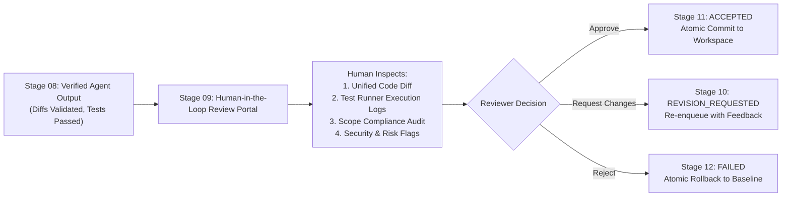

# NexLudic Engine: AI Agent Human Review, Approval & Change Control Policy

**Document ID:** `NLE-POL-AHC-001`  
**Phase:** 7 of 12 (AI Coding-Agent Orchestration)  
**Step:** 52 of 100  
**Classification:** Human Governance & Change Control Specification  
**Status:** IMPLEMENTATION-READY SPECIFICATION  

---

## 1. Human-in-the-Loop (HITL) Primacy Mandate

Within NexLudic Engine, artificial intelligence is an assistant to human creators and engineers, never an autonomous decision-maker. The platform enforces the **Human-in-the-Loop Primacy Mandate**:

> **Governance Invariant:** No AI-generated code, configuration patch, or schema modification may be merged into an active project workspace or deployed to an integration runtime without explicit, recorded review and cryptographic authorization by a qualified human stakeholder.



---

## 2. Actions Requiring Explicit Human Approval

The orchestrator enforces mandatory approval gates for sensitive engineering actions:

| Action Category | Trigger Condition | Required Human Authority | Automated Bypass Permitted? |
| :--- | :--- | :--- | :---: |
| **Workspace Code Merge** | Merging verified patches into `src/**` | Project Developer / Creator | **STRICTLY PROHIBITED** |
| **Contract / Schema Change**| Modifying public APIs or Step 47 mappings | Integration Architect | **STRICTLY PROHIBITED** |
| **New Package Dependency** | Adding a NuGet, npm, or crate package | Systems Architect | **STRICTLY PROHIBITED** |
| **External Data Disclosure**| Sending project context to `PUBLIC_CLOUD` | Security Officer / User | **STRICTLY PROHIBITED** |
| **Scope Expansion** | Modifying files outside initial path globs | Task Requester | **STRICTLY PROHIBITED** |
| **Residual Risk Acceptance**| Merging code with open `MEDIUM` risks | Systems Architect | **STRICTLY PROHIBITED** |

---

## 3. Human Review Outcomes & Feedback Protocols

When a task enters `AWAITING_HUMAN_REVIEW`, the reviewer is presented with an auditable review portal containing the unified diff, test output, and scope audit. The reviewer may render one of three formal decisions:

### 3.1 Verdict 1: `APPROVED` (Task Accepted)
- The reviewer records an approval statement and provides their user identity token.
- The orchestrator generates a signed `HumanReviewRecord`.
- The task transitions to `ACCEPTED`.
- The patch is atomically applied to the target branch on Volume D, and the task closes.

### 3.2 Verdict 2: `REVISION_REQUESTED` (Iterative Feedback Loop)
- The reviewer notes specific functional or stylistic deficiencies (e.g., *"Unit test fails when coordinate offset is negative; please clamp to zero"*).
- The task transitions to `REVISION_REQUESTED`.
- The feedback is packaged into the task's context envelope alongside previous attempt history.
- The task is re-queued for execution (`QUEUED`).

### 3.3 Verdict 3: `REJECTED` (Task Failed)
- The reviewer determines that the proposed solution is architecturally flawed, unsafe, or redundant.
- The task transitions to `FAILED`.
- The workspace sandbox is completely purged, and changes are discarded.

---

## 4. Workspace Baseline Preservation & Atomic Rollback

To ensure that failed, cancelled, or malicious agent attempts never leave the project repository in a dirty, uncompilable, or corrupted state:

```mermaid
flowchart TD
    PreTask["1. Capture Git Baseline Commit Hash & Working Copy Diff"] --> Run["2. Agent Executes in Isolated Task Sandbox"]
    Run --> Check{"Did Task Succeed & Pass Human Review?"}
    
    Check -->|Yes| Apply["3. Apply Verified Patch to Workspace Branch"]
    Check -->|No (Failed / Cancelled / Rejected)| Rollback["3. Execute Atomic Rollback Protocol"]
    
    Rollback --> Clean["Purge scratch/tasks/<task_id>/ Directory"]
    Rollback --> Restore["Assert Workspace Matches Pre-Task Baseline Hash"]
    Rollback --> Log["Log Rollback Event in Project Journal"]
```

### 4.1 Baseline Protection Invariants
1. **Zero Contamination of Main Branch:** Coding agents never write directly to the working tree of the primary branch. All work occurs in task-specific temporary worktrees or patch buffers on Volume D.
2. **Preservation of User Changes:** If the user has unstaged, untracked, or work-in-progress files in the repository when a background agent task runs, the agent sandbox is completely decoupled to ensure user modifications are never overwritten or deleted.
3. **Atomic Rollback Guarantee:** If an agent times out, encounters an unhandled exception, or is aborted by the user, the orchestrator asserts that the workspace working copy exactly matches the pre-task baseline SHA-256 commit hash.
