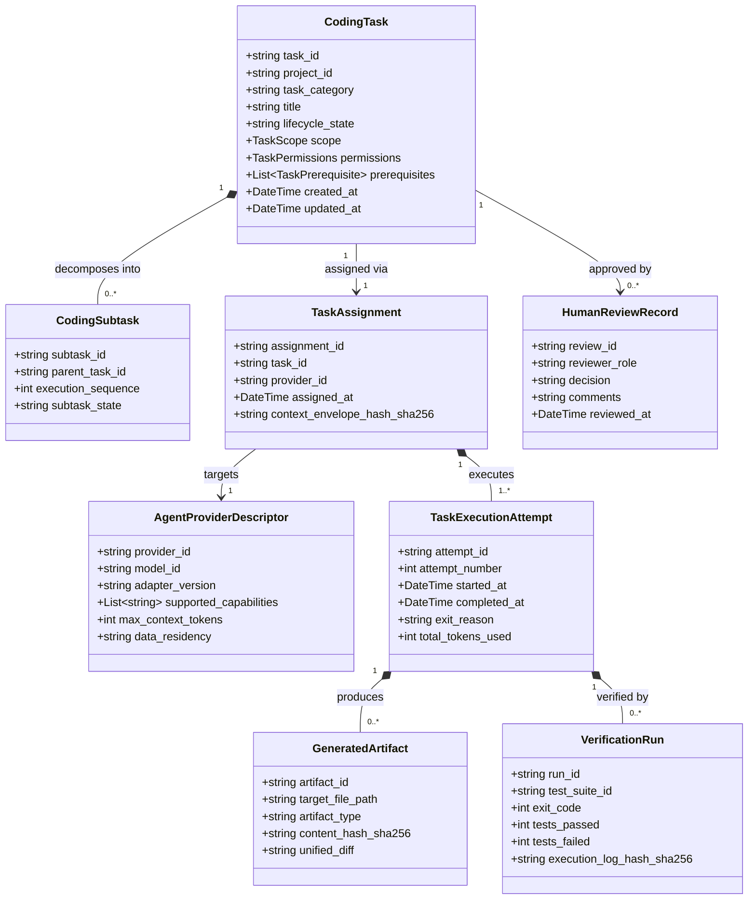
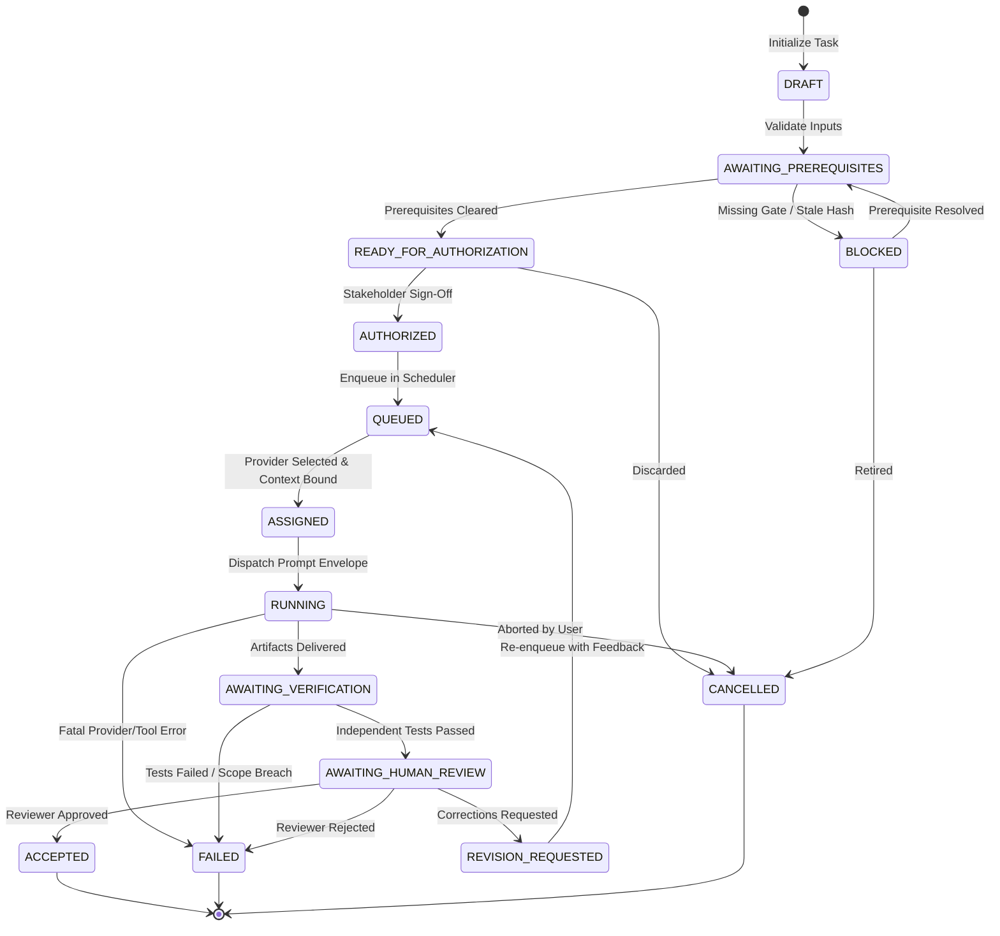

# NexLudic Engine: AI Agent Orchestration Domain Model & Lifecycle

**Document ID:** `NLE-MOD-ACO-001`  
**JSON Schema ID:** `NLE-SCH-ACO-001`  
**Phase:** 7 of 12 (AI Coding-Agent Orchestration)  
**Step:** 52 of 100  
**Classification:** Domain Model & Lifecycle State Specification  
**Status:** IMPLEMENTATION-READY SPECIFICATION  

---

## 1. Domain Entity Model & Taxonomy

The **AI Coding-Agent Orchestration** domain model defines the structured entities governing task specification, agent assignment, execution attempts, generated artifacts, verification runs, and human approvals.



---

## 2. 14-Stage Task Lifecycle State Machine

The task lifecycle governs the progression of a coding task from conception through authorization, execution, testing, review, and acceptance or termination:



### 2.1 State Definitions & Exit Criteria

| State Key | Formal State Name | Definition & Entry Criteria | Permitted Exit Transitions |
| :--- | :--- | :--- | :--- |
| **ST-01** | `DRAFT` | Task metadata initialized; scope and acceptance criteria being drafted. | `AWAITING_PREREQUISITES`, `CANCELLED` |
| **ST-02** | `AWAITING_PREREQUISITES` | Automated verification of upstream phase gates, architecture decisions, and file freshness. | `READY_FOR_AUTHORIZATION`, `BLOCKED`, `CANCELLED` |
| **ST-03** | `READY_FOR_AUTHORIZATION`| Prerequisites verified; awaiting explicit human authorization token. | `AUTHORIZED`, `CANCELLED` |
| **ST-04** | `AUTHORIZED` | Task authorized; scope, tool permissions, and path whitelist locked. | `QUEUED`, `CANCELLED` |
| **ST-05** | `QUEUED` | Task admitted to execution queue; waiting for provider resource slot. | `ASSIGNED`, `CANCELLED` |
| **ST-06** | `ASSIGNED` | Provider matched; context envelope generated and hashed; prompt staged. | `RUNNING`, `CANCELLED` |
| **ST-07** | `RUNNING` | Agent actively executing; tools invoked via default-deny gatekeeper. | `AWAITING_VERIFICATION`, `FAILED`, `CANCELLED` |
| **ST-08** | `AWAITING_VERIFICATION` | Output received; automated diff inspection and deterministic test runner executing. | `AWAITING_HUMAN_REVIEW`, `FAILED` |
| **ST-09** | `AWAITING_HUMAN_REVIEW` | All automated tests passed; diff and evidence presented to human reviewer. | `ACCEPTED`, `REVISION_REQUESTED`, `FAILED` |
| **ST-10** | `REVISION_REQUESTED` | Reviewer identified defects; feedback recorded; task prepared for retry. | `QUEUED`, `CANCELLED` |
| **ST-11** | `ACCEPTED` | Human reviewer approved changes; workspace patch committed. Terminal success. | `[*]` |
| **ST-12** | `FAILED` | Fatal verification failure, unmitigated exception, or reviewer rejection. Terminal. | `[*]` |
| **ST-13** | `BLOCKED` | Blocked by missing upstream gate (e.g., Phase 6 review missing), anti-cheat veto, or locked resource. | `AWAITING_PREREQUISITES`, `CANCELLED` |
| **ST-14** | `CANCELLED` | Explicitly aborted by user, timeout ceiling, or revoked permission. Terminal. | `[*]` |

---

## 3. Strict State Segregation: Task vs. Artifact vs. Verification

To prevent false claims of success, the engine separates **Task Lifecycle State**, **Artifact Structural State**, and **Verification Evidence State**:

```
+----------------------------------------------------------------------------------------------------+
| TASK STATE:          [ AWAITING_VERIFICATION ]                                                     |
| Meaning: The orchestration coordinator is supervising post-execution validation.                   |
+----------------------------------------------------------------------------------------------------+
| ARTIFACT STATE:      [ SYNTACTICALLY_VALID ]                                                       |
| Meaning: The generated C# code parsed without syntax errors and adhered to the path whitelist.     |
+----------------------------------------------------------------------------------------------------+
| VERIFICATION STATE:  [ TESTS_FAILED ]                                                              |
| Meaning: Conformance test suite executed in isolated sandbox; 2 of 14 unit tests failed.           |
+----------------------------------------------------------------------------------------------------+
| VERDICT: Task cannot transition to AWAITING_HUMAN_REVIEW. Transitions to FAILED (or Retry).       |
+----------------------------------------------------------------------------------------------------+
```

### 3.1 Rejection of Illegal Transitions
The state machine enforces transition invariants:
- **`ERR_ILLEGAL_EXEC_BEFORE_AUTH`:** Attempting to transition from `DRAFT` or `READY_FOR_AUTHORIZATION` directly to `RUNNING` without `AUTHORIZED`.
- **`ERR_ILLEGAL_ACCEPT_WITHOUT_TESTS`:** Attempting to transition from `RUNNING` or `AWAITING_VERIFICATION` directly to `ACCEPTED` without passing through `AWAITING_HUMAN_REVIEW`.
- **`ERR_ILLEGAL_GATE_BYPASS`:** Transitioning from `BLOCKED` to `QUEUED` without re-verifying prerequisites.

---

## 4. Formal JSON Schema: `CodingTaskDescriptor` (Draft 2020-12)

```json
{
  "$schema": "https://json-schema.org/draft/2020-12/schema",
  "$id": "https://nexludic.engine/schemas/v1/coding-task.json",
  "title": "CodingTaskDescriptor",
  "description": "Authoritative contract defining an authorized AI coding-agent engineering task.",
  "type": "object",
  "required": [
    "schema_version",
    "task_id",
    "project_id",
    "task_category",
    "title",
    "lifecycle_state",
    "scope",
    "permissions",
    "prerequisites",
    "acceptance_criteria",
    "created_at",
    "updated_at"
  ],
  "properties": {
    "schema_version": { "type": "string", "const": "1.0.0" },
    "task_id": { "type": "string", "format": "uuid" },
    "project_id": { "type": "string", "format": "uuid" },
    "parent_task_id": { "type": ["string", "null"], "format": "uuid" },
    "task_category": {
      "type": "string",
      "enum": [
        "ADAPTER_DEVELOPMENT",
        "PROTOCOL_CODEGEN",
        "TEST_AUTHORING",
        "DEFECT_ANALYSIS",
        "DOCUMENTATION",
        "INTEGRATION_SCAFFOLDING"
      ]
    },
    "title": { "type": "string", "minLength": 5, "maxLength": 128 },
    "objective": { "type": "string", "minLength": 10, "maxLength": 2048 },
    "lifecycle_state": {
      "type": "string",
      "enum": [
        "DRAFT",
        "AWAITING_PREREQUISITES",
        "READY_FOR_AUTHORIZATION",
        "AUTHORIZED",
        "QUEUED",
        "ASSIGNED",
        "RUNNING",
        "AWAITING_VERIFICATION",
        "AWAITING_HUMAN_REVIEW",
        "REVISION_REQUESTED",
        "ACCEPTED",
        "FAILED",
        "BLOCKED",
        "CANCELLED"
      ]
    },
    "scope": {
      "type": "object",
      "required": ["permitted_path_globs", "prohibited_path_globs", "max_files_modified"],
      "properties": {
        "permitted_path_globs": { "type": "array", "items": { "type": "string" }, "minItems": 1 },
        "prohibited_path_globs": { "type": "array", "items": { "type": "string" } },
        "max_files_modified": { "type": "integer", "minimum": 1, "maximum": 50 }
      },
      "additionalProperties": false
    },
    "permissions": {
      "type": "object",
      "required": ["allow_read", "allow_write", "allow_command_execution", "allow_network"],
      "properties": {
        "allow_read": { "type": "boolean" },
        "allow_write": { "type": "boolean" },
        "allow_command_execution": { "type": "boolean" },
        "allow_network": { "type": "boolean", "const": false }
      },
      "additionalProperties": false
    },
    "prerequisites": {
      "type": "array",
      "items": {
        "type": "object",
        "required": ["prerequisite_type", "reference_id", "required_status"],
        "properties": {
          "prerequisite_type": { "type": "string", "enum": ["PHASE_GATE", "ARCHITECTURE_DECISION", "SOURCE_SNAPSHOT", "PARENT_TASK"] },
          "reference_id": { "type": "string" },
          "required_status": { "type": "string" }
        },
        "additionalProperties": false
      }
    },
    "acceptance_criteria": {
      "type": "array",
      "minItems": 1,
      "items": {
        "type": "object",
        "required": ["criterion_id", "description", "verification_method"],
        "properties": {
          "criterion_id": { "type": "string" },
          "description": { "type": "string" },
          "verification_method": { "type": "string", "enum": ["AUTOMATED_UNIT_TEST", "SCHEMA_VALIDATION", "DIFF_INSPECTION", "MANUAL_REVIEW"] }
        },
        "additionalProperties": false
      }
    },
    "created_at": { "type": "string", "format": "date-time" },
    "updated_at": { "type": "string", "format": "date-time" }
  },
  "additionalProperties": false
}
```
