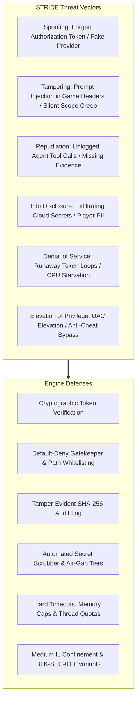

# NexLudic Engine: AI Agent Orchestration Security, Privacy & Threat Model

**Document ID:** `NLE-SEC-ACO-001`  
**Phase:** 7 of 12 (AI Coding-Agent Orchestration)  
**Step:** 52 of 100  
**Classification:** Security Architecture & Threat Model Specification  
**Status:** IMPLEMENTATION-READY SPECIFICATION  

---

## 1. STRIDE Threat Model Analysis

To anticipate and neutralize attack vectors arising from AI-assisted software engineering, NexLudic Engine conducts an exhaustive **STRIDE Threat Modeling Audit** across the orchestration pipeline:



### 1.1 Detailed Threat Assessment Matrix

| Threat Category | Specific Attack Vector / Vulnerability | Likelihood | Impact | Architectural Countermeasure |
| :--- | :--- | :---: | :---: | :--- |
| **Spoofing (S)** | Malicious process or model generates a fake `TaskAuthorizationToken` to execute unauthorized code. | Low | Critical | Tokens require cryptographic signature validated against internal engine private key. |
| **Tampering (T)** | Attacker embeds indirect prompt injection into a mod configuration file to instruct agent to overwrite `src/core`. | High | High | Diff Inspector enforces strict `permitted_path_globs` whitelist. Target files outside whitelist are rejected. |
| **Repudiation (R)**| Agent modifies a file without recording the event, obscuring who authored the vulnerable code. | Low | Medium | Every prompt, response, tool call, and file diff is committed to an append-only JSON journal. |
| **Info Disclosure (I)**| Agent sends proprietary game archive bytes or local user API keys to a public third-party AI provider. | Medium | High | Automated entropy and regex secret scrubber runs before dispatch; local air-gapped models for proprietary games. |
| **Denial of Service (D)**| Malicious prompt causes agent to loop infinitely, exhausting API credits or consuming 100% host CPU. | Medium | Medium | Hard watchdogs enforce 5-minute task timeouts, 2 CPU thread ceilings, and 64k token limits. |
| **Elevation of Priv (E)**| Agent generates a PowerShell command calling `Start-Process -Verb RunAs` to gain Windows Administrator token. | Medium | Critical | Tool Gatekeeper enforces Windows Medium IL (`DEC-002`); elevated commands are blocked. |

---

## 2. Security Trust Boundaries

The orchestration platform enforces 4 explicit trust boundaries that cannot be breached:

```
+----------------------------------------------------------------------------------------------------+
| TRUST BOUNDARY 1: Untrusted Model Output vs. Trusted Orchestrator Core                             |
| Rule: Model output is passive data. It cannot execute code or mutate state directly.               |
+----------------------------------------------------------------------------------------------------+
| TRUST BOUNDARY 2: Core Application vs. Task Execution Sandbox                                      |
| Rule: Test runners execute in isolated child processes on Volume D with zero network egress.       |
+----------------------------------------------------------------------------------------------------+
| TRUST BOUNDARY 3: Desktop Host vs. External AI Cloud Endpoints                                     |
| Rule: Only sanitized, secret-scrubbed context envelopes are transmitted over TLS 1.3.               |
+----------------------------------------------------------------------------------------------------+
| TRUST BOUNDARY 4: NexLudic Engine vs. Protected Game Processes (BLK-SEC-01)                       |
| Rule: Any agent proposing direct memory injection or DLL hooks into anti-cheat games is vetoed.    |
+----------------------------------------------------------------------------------------------------+
```

---

## 3. Game-Specific Anti-Cheat & Licensing Governance (`BLK-SEC-01`)

Coding agents assisting with game interoperability must strictly comply with platform legal and anti-cheat policies:

### 3.1 Prohibited Integration Patterns
The Diff Inspector and Tool Gatekeeper will reject any agent patch containing:
1. Calls to Windows memory injection APIs (`OpenProcess` with `PROCESS_VM_WRITE`, `CreateRemoteThread`, `SetWindowsHookEx`);
2. Attempts to bypass, disable, or unhook anti-cheat services (Easy Anti-Cheat, BattlEye, Vanguard);
3. Attempts to decompress or crack commercial game DRM executables (Steam DRM, Denuvo, Arxan);
4. Injection of uncertified kernel-mode device drivers (`.sys` files).

### 3.2 Non-Invasive Alternative Mandate
If a user requests an integration between a game protected by anti-cheat and another title, the agent is restricted to generating:
- Official mod scripts utilizing the game's sanctioned modding API (e.g., Skyrim Papyrus, UE5 Lua plugins);
- External user-mode telemetry bridges communicating via loopback Named Pipes or Windows shared memory ring buffers;
- Non-invasive optical/screen scrape adapters operating purely on external video frames.
