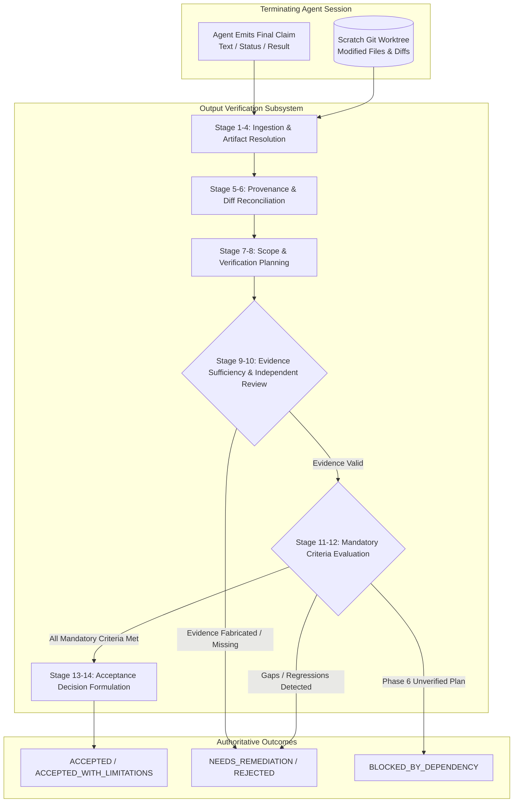

# NexLudic Engine: AI Agent Output Collection, Artifact Validation & Evidence-Based Completion Specification

**Document ID:** `NLE-SPC-AOC-001`  
**Phase:** 7 of 12 (AI Coding-Agent Orchestration)  
**Step:** 59 of 100  
**Classification:** Core Output Verification & Task Acceptance Specification  
**Status:** IMPLEMENTATION-READY SPECIFICATION  
**Upstream Dependencies:** `NLE-SPC-ATG-001` (Step 58 Tool Gateway), `NLE-SPC-ASL-001` (Step 57 Session Lifecycle), `NLE-CON-CTI-001` (Step 53 Task Contract), `NLE-GAT-PH5-001` (Phase 5 Adapter Gate), Step 51 Gate Audit (UNVERIFIED / BLOCKED)  
**Downstream Dependents:** Step 60 (Phase 7 Orchestration Readiness Review & Gate)  

---

## 1. Executive Summary & Governing Principle

The **AI Agent Output Collection, Artifact Validation & Evidence-Based Completion Specification** defines the authoritative subsystem that collects, normalizes, validates, and verifies all deliverables submitted by an AI coding agent upon concluding an authorized execution session.

### The Governing Principle
> **`PRINCIPLE: Claims are Not Truth`**  
> An AI coding agent's final response, textual summary, self-reported success assertion, or claimed test result is strictly an **untrusted claim to be rigorously evaluated**, never proof of successful task completion.

In naive agent implementations, an agent emitting "Task complete, all tests passed" frequently results in unverified code merges, hallucinated test passes, silent repository regressions, and broken builds. NexLudic Engine mandates that **acceptance is an evidence-backed platform determination**, governed by independent artifact inspection, cryptographic hash verification, physical diff reconciliation, and criterion-by-criterion evaluation against the immutable task contract.

---

## 2. The 15-Tier Epistemic Hierarchy of Completion

To prevent the conflation of intent, claims, physical files, and verified truth, the orchestration layer models 15 discrete states:

| Tier # | Epistemic Classification | Definition & Evidentiary Standard |
| :---: | :--- | :--- |
| **T01** | **Progress Report** | In-flight telemetry or intermediate status message emitted by the agent during execution. |
| **T02** | **Reported Final Response** | Natural-language summary text emitted by the agent claiming work is finished. Untrusted claim. |
| **T03** | **Submitted Artifact** | File path, patch, or document referenced in the agent's completion payload. |
| **T04** | **Received Artifact** | Physical file successfully retrieved by the supervisor from the isolated workspace staging path. |
| **T05** | **Established Identity** | Artifact tied cryptographically to session ID, commit SHA, and authoring attempt ID. |
| **T06** | **Structurally Valid Artifact** | Artifact validated against syntax, encoding, markdown schema, or JSON Schema Draft 2020-12. |
| **T07** | **Content / Behaviorally Verified** | Artifact whose semantic contents or logic have passed automated linter, parser, or check. |
| **T08** | **Proposed Test** | Test case written or proposed in source code or documentation; not yet executed. |
| **T09** | **Executed Test** | Test executed by the host executor under Windows Job Object containment; process exit code captured. |
| **T10** | **Passed Test with Evidence** | Test execution confirmed passed with cryptographic log digest, test report XML/JSON, and clean exit. |
| **T11** | **Evaluated Requirement** | Specific requirement in normalized task contract compared against physical verification evidence. |
| **T12** | **Satisfied Requirement** | Requirement where all mandatory evidence meets or exceeds the defined acceptance threshold. |
| **T13** | **Accepted Task** | Formal administrative determination signed by the platform core or operator; ready for staging. |
| **T14** | **Task with Limitations** | Task accepted with explicitly documented, non-blocking caveats or follow-up issues. |
| **T15** | **Failed / Rejected / Blocked** | Task rejected due to unfulfilled mandatory criteria, regressions, security flaws, or gate blockers. |

---

## 3. Core Architectural Invariants

The output validation subsystem is governed by seven non-negotiable architectural invariants:

1. **`INV-AOC-01: Claims are Not Truth`**  
   Agent-supplied text, completion assertions, and self-reported test summaries are untrusted assertions. System acceptance requires independently captured evidence.
2. **`INV-AOC-02: Mandatory Criterion-Level Evaluation`**  
   Every mandatory acceptance criterion defined in the normalized task contract (`NLE-CON-CTI-001`) must be evaluated individually. Success in optional tasks cannot compensate for a failed mandatory criterion.
3. **`INV-AOC-03: Preservation of User-Owned Work`**  
   Pre-existing user modifications, staged changes, and untracked files in the developer's primary repository checkout are permanently protected. Under no circumstances may verification or cleanup revert or overwrite user work.
4. **`INV-AOC-04: Separation of Task Acceptance from Release`**  
   Accepting a completed task does NOT constitute approval to merge into `main`, publish packages, or deploy code. Release and publication remain subject to separate human authorization workflows.
5. **`INV-AOC-05: Cryptographic Lineage & Integrity`**  
   Every accepted artifact must possess an unbroken cryptographic lineage binding it to the task ID, assignment contract, execution attempt, and parent commit SHA via SHA-256 digests.
6. **`INV-AOC-06: Windows Medium IL & Anti-Cheat Non-Interference`**  
   Verification processes run strictly at **Windows Medium Integrity Level** (`DEC-002`). Verification tools are prohibited from inspecting or hooking game memory or triggering anti-cheat drivers (`BLK-SEC-01`).
7. **`INV-AOC-07: Explicit Uncertainty Preservation`**  
   If a test or external side effect yields an ambiguous, incomplete, or unconfirmed outcome, the system preserves that outcome as `UNCERTAIN` and blocks automated task acceptance.

---

## 4. Structural Specification Decomposition

The complete Step 59 specification suite consists of 15 interlocking documents in `docs/ai-orchestration/`:

| Deliverable | Document ID | Purpose |
| :--- | :--- | :--- |
| **Deliverable 1** | `NLE-SPC-AOC-001` | Master Specification & Architectural Overview (This Document) |
| **Deliverable 2** | `NLE-MOD-AOC-001` | Result Submission & Artifact Domain Model |
| **Deliverable 3** | `NLE-POL-API-001` | Artifact Provenance, Integrity & Revision Policy |
| **Deliverable 4** | `NLE-POL-ARD-001` | Repository Diff Reconciliation & User Change Preservation Policy |
| **Deliverable 5** | `NLE-POL-ADC-002` | Deliverable Completeness & Contract Conformance Policy |
| **Deliverable 6** | `NLE-POL-AVE-001` | Verification Evidence Provenance & Trust Policy |
| **Deliverable 7** | `NLE-CON-AAC-001` | Acceptance Criterion Evaluation & Decision Contract |
| **Deliverable 8** | `NLE-POL-ADV-001` | Documentation, Code & Structured Artifact Validation Policy |
| **Deliverable 9** | `NLE-POL-ARS-001` | Regression, Security, Compatibility & Licensing Review Policy |
| **Deliverable 10** | `NLE-POL-APM-001` | Partial Completion, Defect Remediation & Retry Policy |
| **Deliverable 11** | `NLE-CON-ATC-002` | Task Completion Acceptance & Terminal Outcome Contract |
| **Deliverable 12** | `NLE-POL-AOF-001` | Output Failure, Retention & Diagnostic Policy |
| **Deliverable 13** | `NLE-CAT-AOS-001` | Output Validation Synthetic Scenarios & Test Plan (Scenarios A through Z) |
| **Deliverable 14** | `NLE-MAT-STP-059` | Requirements Traceability Matrix (`AOC-REQ-001..032`) |
| **Deliverable 15** | `NLE-REP-STP-059` | Step 59 Completion & Verification Report |

---

## 5. Relationship to Upstream Gates & Phases

### 5.1 Phase 6 Mashup Planning Gate Status
The Phase 6 Mashup Integration Planning gate (Step 51) remains `UNVERIFIED / MISSING FORMAL SIGN-OFF`.
- **Enforcement:** If an agent submits code or artifacts that purport to implement or activate an unverified Phase 6 mashup integration plan (e.g. multi-game workflow execution), the verification engine **FAILS CLOSED** with outcome `BLOCKED_BY_DEPENDENCY` (`ERR_PRECONDITION_PHASE6_UNVERIFIED`).
- **Exemptions:** Discrete adapter scaffolding, wire protocol wrappers (`P5-C01`), tests, or architectural documentation are validated against their task contracts.

### 5.2 Phase 5 Universal Adapter SDK Gate Status
The Phase 5 Universal Adapter SDK Gate (`NLE-GAT-PH5-001`) holds status `READY WITH CONDITIONS` (`P5-C01`, `P5-C02`, `P5-C03`).
- Artifact validation for adapter code explicitly requires verified wire protocol serialization tests (`P5-C01`) and memory safety checks (`P5-C02`).
