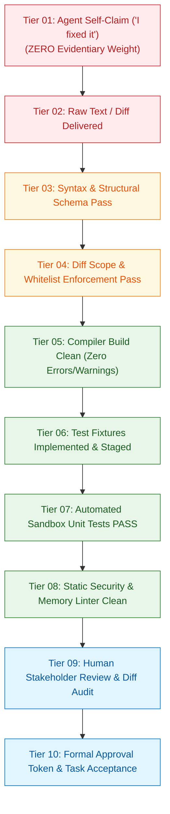

# NexLudic Engine: AI Agent Output Verification & Evidence Contract

**Document ID:** `NLE-CON-AOV-001`  
**Phase:** 7 of 12 (AI Coding-Agent Orchestration)  
**Step:** 52 of 100  
**Classification:** Verification Protocol & Evidence Governance Specification  
**Status:** IMPLEMENTATION-READY SPECIFICATION  

---

## 1. The 10-Tier Evidence Hierarchy

To guarantee that software generated by AI coding agents meets the highest standards of reliability, security, and traceability, NexLudic Engine establishes an inviolable **10-Tier Evidence Hierarchy**:



### 1.1 Evidentiary Significance & Progression Rules

| Tier | Tier Name | Required Evidence Artifact | Minimum Milestone Allowed |
| :---: | :--- | :--- | :--- |
| **01** | Agent Claim | Model text output stating completion. | None. Zero standing. |
| **02** | Artifact Delivery | Text payload or unified diff received by adapter. | Entry to Stage 08 (`AWAITING_VERIFICATION`). |
| **03** | Structural Check | Code compiles into AST or parses against schema. | Output validity confirmed. |
| **04** | Scope Enforcement | Diff Inspector asserts 100% path whitelist match. | Workspace safe to stage in sandbox. |
| **05** | Compiler Clean | `dotnet build` succeeds with zero errors/warnings. | Code syntactically sound. |
| **06** | Test Staged | Test files mapped to acceptance criteria. | Test runner ready to invoke. |
| **07** | Deterministic Test Pass | Signed test runner execution log (`exit_code == 0`). | Entry to Stage 09 (`AWAITING_HUMAN_REVIEW`). |
| **08** | Security Linter Clean | Static analysis asserts no memory unsafe calls or UAC. | Security gate cleared. |
| **09** | Human Review | Human inspects unified diff and test logs. | Sign-off pending. |
| **10** | Formal Acceptance | Cryptographic approval record committed to log. | Transition to `ACCEPTED`; patch committed. |

---

## 2. Diff & Scope Inspection Protocol

Before any proposed file patch can be applied to a test sandbox or workspace, the **Diff Inspector** performs automated line-by-line validation:

### 2.1 Inspection Rules
1. **Path Whitelist Assertion:** Every file path in the unified diff must match at least one pattern in `permitted_path_globs` and must NOT match any pattern in `prohibited_path_globs`.
2. **Deletion Guard:** Deletion of entire directories or files outside the whitelist is strictly prohibited.
3. **Hidden Payload Detection:** The inspector scans diff chunks for disguised prompt injections, hidden shell commands, or obfuscated base64 strings.
4. **Boundary Violation Diagnostic:** If an agent attempts to edit an unwhitelisted file (e.g., `src/core/SecurityPolicy.cs`), the patch is rejected immediately with diagnostic `ERR_SCOPE_VIOLATION`, and the file is reverted.

---

## 3. Deterministic Test Execution & Evidence Provenance

To satisfy Tier 07, testing is executed through an automated, isolated runner:

```json
{
  "verification_run_id": "run-4a5b-6c7d-8e9f-0123456789ab",
  "task_id": "c7a8b3f1-4e92-4a7b-8912-3f1d8e0a1234",
  "attempt_id": "att-001",
  "test_suite": "NexLudic.Adapters.GameOrion.Tests.dll",
  "runner_executable": "dotnet.exe test --no-build --logger:trx",
  "exit_code": 0,
  "metrics": {
    "total_tests": 14,
    "tests_passed": 14,
    "tests_failed": 0,
    "tests_skipped": 0,
    "duration_ms": 1420
  },
  "execution_log_hash_sha256": "8f4e2b1a09c8d7e6f5a4b3c2d1e0f9a8b7c6d5e4f3a2b1c0d9e8f7a6b5c4d3e2",
  "log_file_path": "scratch/tasks/c7a8b3f1/test_output.trx",
  "executed_at": "2026-11-19T14:35:12Z",
  "verifier_signature": "TEST_RUNNER_SECURE_TOKEN_PASS"
}
```

### 3.1 Unit Test Pass $\neq$ End-to-End Interoperability
The engine enforces a vital epistemic distinction in all verification logs:
> *"Notice: A successful unit test execution proves that the generated C# adapter classes satisfy local interface contracts and mock fixtures. It does NOT prove that live inter-process communication between Game Orion and Game Atlas succeeds in running games."*

---

## 4. Task Acceptance Evaluation Engine

A task cannot transition to `ACCEPTED` unless all acceptance criteria declared in its contract are verified:

$$\forall c_i \in \text{AcceptanceCriteria}: \text{Status}(c_i) == \text{VERIFIED}$$

If any mandatory criterion remains `FAILED` or `UNTESTED`, the task cannot be accepted. The orchestrator emits `ERR_ACCEPTANCE_CRITERIA_UNMET` and provides feedback for revision.
