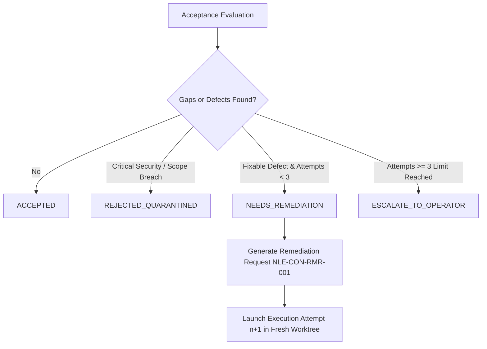

# NexLudic Engine: AI Agent Partial Completion, Defect Remediation & Retry Policy

**Document ID:** `NLE-POL-APM-001`  
**Phase:** 7 of 12 (AI Coding-Agent Orchestration)  
**Step:** 59 of 100  
**Classification:** Defect Governance & Remediation Policy  
**Status:** IMPLEMENTATION-READY SPECIFICATION  
**Upstream Dependencies:** `NLE-SPC-AOC-001` (Master Spec), `NLE-CON-AAC-001` (Acceptance Contract)  
**Downstream Dependents:** `NLE-CON-ATC-002` (Terminal Outcome Contract), Step 60 Phase Gate  

---

## 1. Defect Classification Taxonomy

When an artifact, test run, or acceptance criterion fails verification, the engine classifies the issue into one of six standardized **Defect Categories**:

| Defect Category | Severity | Examples | Remediation Path |
| :--- | :---: | :--- | :--- |
| **`DEFECT_CRITICAL_SECURITY`** | High | Secret leak, path traversal, prohibited process injection, anti-cheat hook. | **Immediate Task Termination / Quarantine**. |
| **`DEFECT_SCOPE_EXPANSION`** | High | Modified files outside `write_roots`, added unauthorized dependencies. | Revert out-of-scope edits; require re-submission. |
| **`DEFECT_COMPILATION_LINT`** | Medium | Syntax error, type check failure (`cargo check`), linter violation. | Targeted remediation attempt with compiler error log. |
| **`DEFECT_FUNCTIONAL_TEST`** | Medium | Unit test assertion failure, unexpected behavioral output. | Provide failed assertion trace; allow code adjustment. |
| **`DEFECT_DOCUMENTATION`** | Low | Broken link, malformed Mermaid syntax, missing required heading. | Re-prompt agent with specific structural defect list. |
| **`DEFECT_EVIDENCE_FABRICATION`**| High | Claimed tests passed without execution; forged test logs. | Task rejected; agent candidate flagged in provider registry. |

---

## 2. Remediation Request Contract (`NLE-CON-RMR-001`)

When a submission is deemed partially complete or defective, the engine compiles a structured **Remediation Request**:
- `remediation_id`: Unique identifier (`rmr-[0-9a-f]{8}...`).
- `submission_id`: Reference to the evaluated submission.
- `defects`: Array of structured defect items with exact file paths, line numbers, and compiler/linter error outputs.
- `preservation_directives`: Explicit list of successfully verified files that must NOT be altered during remediation.
- `scope_reminder`: Re-iteration of task `write_roots` to prevent scope drift.

---

## 3. Remediation Bounds & Retry Policy

1. **Maximum Remediation Ceiling:** A task is permitted at most **3 remediation attempts** (`attempt-1`, `attempt-2`, `attempt-3`).
2. **Escalation Boundary:** If the 3rd attempt fails verification, the task is marked `FAILED_MAX_REMEDIATION_EXCEEDED` and transferred to the human operator for manual resolution or cancellation.
3. **No Automatic Scope Expansion:** Remediation NEVER expands the task's authorized permissions or paths. If an agent claims it cannot fix a bug without touching out-of-scope files, the task must be formally re-intaken through Step 53.
