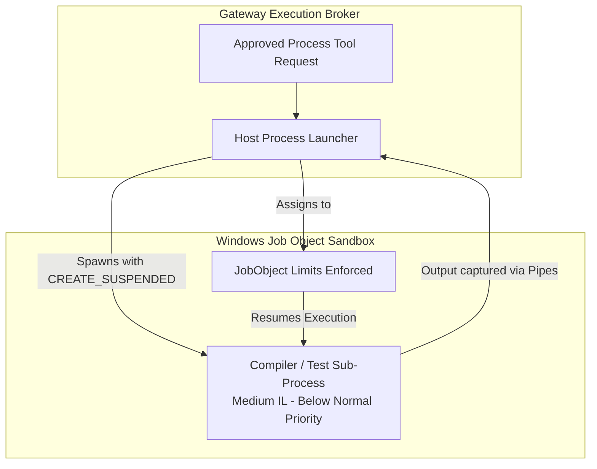

# NexLudic Engine: AI Agent Process, Network & External Service Execution Boundary

**Document ID:** `NLE-SEC-ATE-001`  
**Phase:** 7 of 12 (AI Coding-Agent Orchestration)  
**Step:** 58 of 100  
**Classification:** Host Boundary & System Security Specification  
**Status:** IMPLEMENTATION-READY SPECIFICATION  
**Upstream Dependencies:** `NLE-SEC-ARI-001` (Step 57 Runtime Isolation), `DEC-002` (Medium IL), `BLK-SEC-01` (Anti-Cheat Dominance)  
**Downstream Dependents:** `NLE-SEC-ATT-001` (Threat Model), `NLE-CAT-ATS-001` (Synthetic Scenarios)  

---

## 1. Process Execution Boundary & Job Object Containment

When an authorized tool operation requires executing an external compiler, linter, or test runner (e.g. `tool:linter`, `tool:test_runner`), the execution is brokered under strict operating system controls:

### 1.1 Process Execution Invariants
1. **Approved Executable Whitelist:** The gateway dispatches ONLY whitelisted, pre-installed tool binaries:
   - `cargo.exe`, `rustc.exe`, `python.exe`, `mypy.exe`, `git.exe`.
   - Raw shells (`cmd.exe`, `powershell.exe`, `bash.exe`) are permanently disallowed.
2. **Windows Job Object Controls:**
   - `JOB_OBJECT_LIMIT_KILL_ON_JOB_CLOSE`: Prevents orphaned compiler processes upon supervisor exit.
   - `JOB_OBJECT_LIMIT_PROCESS_MEMORY`: Hard physical RAM cap (2048 MB default).
   - `JOB_OBJECT_LIMIT_PRIORITY_CLASS`: Set to `BELOW_NORMAL_PRIORITY_CLASS`.
3. **Environment Block Sanitization:** Sensitive host environment variables (cloud credentials, API keys, SSH keys) are completely removed before process spawn.

---

## 2. Network Access Policy & Default Deny

### 2.1 Default Network Prohibition
- By default, all AI agent tool operations operate in a **completely offline, air-gapped network state**.
- Test runners and compilers execute with socket creation disabled.

### 2.2 Controlled Network Whitelisting (When Explicitly Authorized)
- If a task explicitly authorizes external network access (e.g. querying a public documentation schema):
  1. Traffic is restricted strictly to HTTPS (port 443).
  2. Target domains must match the task's static `allowed_domains` whitelist.
  3. Connections to local loopback (`127.0.0.1`, `localhost`), private LAN subnets (`10.0.0.0/8`, `192.168.0.0/16`), or link-local addresses (`169.254.0.0/16`) are **permanently blocked** to prevent SSRF against local gaming servers or cloud metadata services.

---

## 3. Game Integration & Anti-Cheat Boundary (`BLK-SEC-01`)

To safeguard the user's gaming system, multiplayer standing, and anti-cheat compliance:
- **Zero Process Memory Access:** The gateway strictly vetoes any tool or parameter attempting Win32 `OpenProcess`, `VirtualAllocEx`, `WriteProcessMemory`, or `ReadProcessMemory` targeting game executables.
- **Anti-Cheat Dominance:** The supervisor scans for active anti-cheat kernel services (`vgk.sys`, `BEDaisy.sys`, `EasyAntiCheat.sys`). If detected, all dynamic memory inspection tools are disabled.
- **Zero Game Binary Patching:** The gateway prevents file modifications targeting installed game directories (`SteamLibrary`, `Riot Games`, etc.). All engineering work is restricted to adapter source code.
