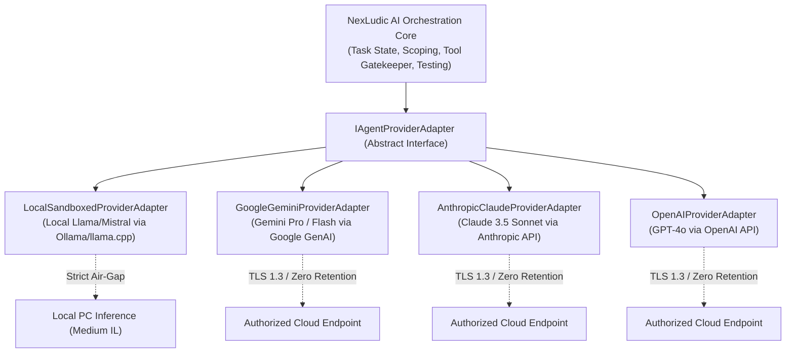

# NexLudic Engine: AI Agent Provider Adapter & Capability Contract

**Document ID:** `NLE-CON-APA-001`  
**Phase:** 7 of 12 (AI Coding-Agent Orchestration)  
**Step:** 52 of 100  
**Classification:** Provider Abstraction & Interface Specification  
**Status:** IMPLEMENTATION-READY SPECIFICATION  

---

## 1. The Provider Neutrality Architecture

To ensure long-term architectural longevity, prevent vendor lock-in, and accommodate both cloud-based AI providers and local air-gapped models, NexLudic Engine enforces strict **Provider Neutrality**.

The core engine communicates with AI coding agents exclusively through a standardized, provider-agnostic adapter interface:



---

## 2. Abstract Provider Adapter Interface (`IAgentProviderAdapter`)

The provider adapter translates between the engine's canonical task definitions and the vendor-specific API wire formats:

```csharp
// Conceptual Interface Contract (C# / .NET 8.0 LTS LTS Reference)
public interface IAgentProviderAdapter
{
    string ProviderId { get; }
    string ModelIdentifier { get; }
    AgentProviderMetadata Metadata { get; }

    Task<ProviderSessionToken> InitializeSessionAsync(
        ContextEnvelope context, 
        CancellationToken cancellationToken);

    IAsyncEnumerable<AgentEventStreamRecord> StreamEventsAsync(
        ProviderSessionToken sessionToken, 
        CancellationToken cancellationToken);

    Task<NormalizedAgentResponse> DispatchToolResultAsync(
        ProviderSessionToken sessionToken, 
        ToolResultRecord toolResult, 
        CancellationToken cancellationToken);

    Task AbortExecutionAsync(
        ProviderSessionToken sessionToken);

    Task<ProviderResourceMetrics> GetResourceMetricsAsync(
        ProviderSessionToken sessionToken);
}
```

---

## 3. Provider Identity, Capability & Data Residency Metadata

Every eligible AI coding-agent provider must register a complete `AgentProviderDescriptor`:

| Descriptor Property | Type / Constraints | Description & Purpose |
| :--- | :--- | :--- |
| `provider_id` | String (e.g., `gemini-api`, `ollama-local`) | Globally unique provider registry identifier. |
| `model_identifier`| String (e.g., `gemini-1.5-pro-002`) | Concrete model version string. |
| `adapter_version` | SemVer (e.g., `1.0.0`) | Version of the adapter bridge DLL. |
| `max_context_tokens`| Integer ($\ge 32768$) | Total context window size supported by model. |
| `max_output_tokens` | Integer ($\ge 4096$) | Maximum output generation limit. |
| `supports_tool_calling`| Boolean (must be `true`) | Whether model natively supports structured function calling. |
| `supports_streaming`| Boolean (must be `true`) | Whether model streams tokens for real-time observation. |
| `data_residency_tier`| Enum (`LOCAL_ONLY`, `PRIVATE_CLOUD`, `PUBLIC_CLOUD`) | Data governance tier governing permissible context exposure. |

---

## 4. Task-Agent Eligibility Matrix

Not all models are eligible for all tasks. The orchestrator evaluates task category, security sensitivity, and context size against provider descriptors:

| Task Category | Minimum Context Tokens | Mandatory Tool Support | Minimum Data Residency Tier | Recommended Model Class |
| :--- | :---: | :---: | :--- | :--- |
| **Adapter Development** | $128\text{k}$ | Strict JSON Tool Calls | `PRIVATE_CLOUD` or `LOCAL_ONLY` | Advanced Code Reasoning (Pro Class) |
| **Protocol Codegen** | $64\text{k}$ | Strict JSON Tool Calls | `PRIVATE_CLOUD` or `LOCAL_ONLY` | Fast Deterministic (Flash/Sonnet) |
| **Test Authoring** | $64\text{k}$ | Read File, Run Test | `PUBLIC_CLOUD` (if non-proprietary) | General Code Reasoning |
| **Defect Analysis** | $128\text{k}$ | Read Log, AST Query | `PRIVATE_CLOUD` or `LOCAL_ONLY` | Long-Context Reasoning |
| **Documentation** | $32\text{k}$ | Read Markdown | `PUBLIC_CLOUD` | Standard Documentation Model |
| **Security Review** | $128\text{k}$ | Read AST, Memory Scan | **`LOCAL_ONLY` (Air-Gapped)** | Local Fine-Tuned Security Model |

---

## 5. Output Normalization & Diff Extraction

Different providers emit code modifications in divergent formats (e.g., raw unified diffs, JSON arrays of file modifications, or markdown code fences). The adapter bridge normalizes all outputs into canonical `GeneratedArtifact` records:

```json
{
  "artifact_id": "art-09a8b7c6-1234-5678-9abc-def012345678",
  "task_id": "c7a8b3f1-4e92-4a7b-8912-3f1d8e0a1234",
  "target_file_path": "src/adapters/game-orion/OrionTelemetryHook.cs",
  "action_type": "MODIFY",
  "content_hash_sha256": "4a5b6c7d8e9f0123456789abcdef0123456789abcdef0123456789abcdef0123",
  "unified_diff": "--- a/src/adapters/game-orion/OrionTelemetryHook.cs\n+++ b/src/adapters/game-orion/OrionTelemetryHook.cs\n@@ -12,4 +12,6 @@\n+    // Fixed memory offset alignment\n+    private const int TELEMETRY_OFFSET = 0x004A2F00;\n",
  "normalized_by_adapter": "GoogleGeminiProviderAdapter-v1.0"
}
```

---

## 6. Provider Failure & Resiliency Semantics

| Failure Condition | Detection Trigger | Orchestrator Action | Failover Permitted? |
| :--- | :--- | :--- | :---: |
| **Network Disconnect (Cloud)** | Socket exception / TLS drop | Retry with exponential backoff (up to 3x). | Yes (to alternate cloud endpoint) |
| **Rate Limit / 429 Quota** | HTTP 429 received | Check retry-after header; if $>60\text{s}$, pause task. | Yes (to equivalent eligible model) |
| **Context Window Exceeded** | HTTP 400 Context Overflow | Halt task; emit `ERR_CONTEXT_LIMIT_EXCEEDED`. | No (requires context re-minimization) |
| **Malformed Tool Call** | Schema parser failure | Send feedback prompt to agent to correct syntax. | No (same agent attempt) |
| **Model Hallucination / Timeout** | Watchdog $>300\text{s}$ no token | Abort session; record `ERR_PROVIDER_TIMEOUT`. | Yes (if idempotency verified) |
