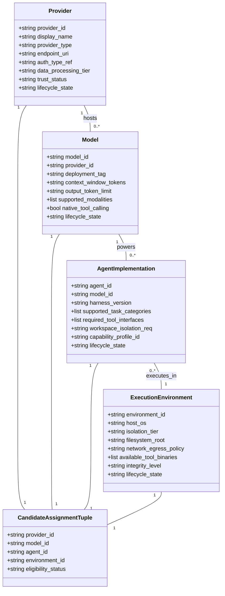

# NexLudic Engine: Provider, Model, Agent Implementation & Execution Environment Domain Model

**Document ID:** `NLE-MOD-APR-001`  
**Phase:** 7 of 12 (AI Coding-Agent Orchestration)  
**Step:** 54 of 100  
**Classification:** Conceptual & Logical Domain Model Specification  
**Status:** IMPLEMENTATION-READY SPECIFICATION  

---

## 1. Domain Modeling Philosophy & Structural Separation

In many conventional AI wrappers, the concepts of "provider", "model", "agent", and "sandbox" are collapsed into a single amorphous entity (e.g., "OpenAI agent"). This creates severe security vulnerabilities, untraced capabilities, and brittle architectures.

NexLudic Engine enforces strict structural separation among four distinct domain concepts:



---

## 2. Detailed Entity Specifications

### 2.1 Entity: `Provider`
A `Provider` represents an external cloud vendor (e.g., Anthropic, OpenAI, Google Cloud), a self-hosted corporate inferencing cluster (e.g., vLLM on enterprise network), or a local on-device inference runtime (e.g., llama.cpp or Ollama running locally on the Windows host).

- **`provider_id` (string, UUID or kebab-case slug, Primary Key):** Globally unique, stable identifier (e.g., `prov-local-ollama`, `prov-anthropic-direct`).
- **`display_name` (string):** Human-readable label for UI visualization (e.g., "Local Ollama Daemon", "Anthropic Claude API").
- **`provider_type` (enum):** `LOCAL_DEVICE`, `LOCAL_NETWORK`, `PRIVATE_CLOUD`, `PUBLIC_CLOUD`.
- **`endpoint_uri` (string, URI):** Base network endpoint (e.g., `http://127.0.0.1:11434`, `https://api.anthropic.com/v1`).
- **`auth_type_ref` (string):** Reference to the platform credential vault schema (e.g., `vault:keys/anthropic/api_key`, `none:local`). **Zero credentials or secrets may ever be stored in the registry document.**
- **`data_processing_tier` (enum):**  
  - `ZERO_RETENTION_AIR_GAPPED`: Operates entirely offline; zero network packets transmitted.
  - `COMMERCIAL_NO_TRAINING`: Cloud API with legally binding zero-data-retention and no model training.
  - `STANDARD_CLOUD`: Default cloud service that may retain logs for abuse monitoring.
  - `PUBLIC_UNRESTRICTED`: Public endpoints with unverified data retention.
- **`trust_status` (enum):** `VERIFIED_ENTERPRISE`, `LOCAL_TRUSTED`, `COMMUNITY_UNVERIFIED`, `REVOKED`.
- **`lifecycle_state` (enum):** Defined in `NLE-POL-ARL-001`.

---

### 2.2 Entity: `Model`
A `Model` represents a specific versioned weights deployment hosted by a Provider.

- **`model_id` (string, Primary Key):** Stable model identifier (e.g., `mod-claude-3-7-sonnet`, `mod-qwen-2-5-coder-32b`).
- **`provider_id` (string, Foreign Key):** References the hosting Provider.
- **`deployment_tag` (string):** Exact vendor deployment string (e.g., `claude-3-7-sonnet-20250219`, `gpt-4o-2024-11-20`, `qwen2.5-coder:32b-instruct-q4_K_M`).
- **`context_window_tokens` (integer):** Verified maximum input token context.
- **`output_token_limit` (integer):** Verified maximum generation limit per turn.
- **`supported_modalities` (array of enum):** `TEXT`, `CODE`, `IMAGE_INPUT`, `AUDIO_INPUT`.
- **`native_tool_calling` (boolean):** Whether the model supports native JSON Schema function calling natively in its API.
- **`known_limitations` (array of string):** Explicit architectural limits (e.g., `["no_vision", "context_degradation_over_64k"]`).
- **`lifecycle_state` (enum):** Defined in `NLE-POL-ARL-001`.

---

### 2.3 Entity: `AgentImplementation`
An `AgentImplementation` is the concrete software harness, prompt scaffolding, and tool integration layer that uses a Model to perform engineering work.

- **`agent_id` (string, Primary Key):** Stable agent identifier (e.g., `agt-adapter-scaffold-v1`, `agt-doc-author-v2`).
- **`model_id` (string, Foreign Key):** References the backing Model.
- **`harness_name` (string):** Name of the orchestration harness (e.g., `NexLudicCoreHarness`, `ExternalMcpAgent`).
- **`harness_version` (string, SemVer):** Semantic version of the agent wrapper.
- **`supported_task_categories` (array of enum):** Categories from Step 53 (`NLE-CAT-TIN-001`) that this agent is engineered to handle.
- **`required_tool_interfaces` (array of string):** Tool interfaces the agent expects (e.g., `["tool.fs.read", "tool.git.diff", "tool.test.runner"]`).
- **`workspace_isolation_req` (enum):** `READ_ONLY_SANDBOX`, `ISOLATED_WORKSPACE_SHARE`, `EPHEMERAL_BRANCH`.
- **`capability_profile_id` (string, Foreign Key):** References the formal Capability Profile (`NLE-CON-ACP-001`).
- **`lifecycle_state` (enum):** Defined in `NLE-POL-ARL-001`.

---

### 2.4 Entity: `ExecutionEnvironment`
The `ExecutionEnvironment` describes the physical or virtual boundary where agent tools run and where file modifications occur.

- **`environment_id` (string, Primary Key):** Stable environment identifier (e.g., `env-desktop-medium-il`, `env-container-isolated`).
- **`host_os` (string):** Target operating system (e.g., `Windows 11 x64 Build 26100`).
- **`isolation_tier` (enum):**  
  - `LOCAL_PROCESS_MEDIUM_IL`: Windows Medium Integrity Level non-elevated desktop workspace (`DEC-002`).
  - `CONTAINER_SANDBOX`: Local Windows/Hyper-V container with virtualized filesystem.
  - `REMOTE_EPHEMERAL_WORKER`: Air-gapped worker node without network egress.
- **`filesystem_root` (string):** Root directory bounded to project workspace (e.g., `D:\App Winrar Files\Nexludic Engine (working)`).
- **`network_egress_policy` (enum):** `DISALLOWED`, `ALLOW_LOCAL_LOOPBACK_ONLY`, `ALLOW_AUTHORIZED_CLOUD_EGRESS`.
- **`available_tool_binaries` (array of string):** Verified binaries present on the host (e.g., `["git.exe", "dotnet.exe", "cargo.exe"]`).
- **`integrity_level` (string):** Verified process integrity level (`MediumIL`, strictly non-admin).

---

## 3. The Candidate Tuple Concept

For an engineering task, eligibility is **never** evaluated on a model in isolation. It is evaluated exclusively on a concrete **Candidate Assignment Tuple**:

$$\text{CandidateTuple} = \langle \text{Provider}, \text{Model}, \text{AgentImplementation}, \text{ExecutionEnvironment} \rangle$$

If an enterprise-approved model is hosted on a compliant provider, but the bound agent harness lacks a diff-generation tool or the execution environment has an unverified compiler binary, the tuple as a whole fails eligibility matching.

---

## 4. Formal JSON Schema Specification

The following JSON Schema (Draft 2020-12) establishes the machine-readable contract for registry records:

```json
{
  "$schema": "https://json-schema.org/draft/2020-12/schema",
  "$id": "https://schemas.nexludic.internal/orchestration/provider-registry-v1.json",
  "title": "NexLudicProviderRegistryRecord",
  "type": "object",
  "required": [
    "schema_version",
    "provider",
    "models",
    "agents",
    "environments"
  ],
  "properties": {
    "schema_version": {
      "type": "string",
      "const": "1.0.0"
    },
    "provider": {
      "type": "object",
      "required": ["provider_id", "display_name", "provider_type", "endpoint_uri", "auth_type_ref", "data_processing_tier", "trust_status", "lifecycle_state"],
      "properties": {
        "provider_id": { "type": "string", "pattern": "^prov-[a-z0-9-]+$" },
        "display_name": { "type": "string", "minLength": 3 },
        "provider_type": { "type": "string", "enum": ["LOCAL_DEVICE", "LOCAL_NETWORK", "PRIVATE_CLOUD", "PUBLIC_CLOUD"] },
        "endpoint_uri": { "type": "string", "format": "uri" },
        "auth_type_ref": { "type": "string", "pattern": "^(vault:[a-z0-9_/]+|none:[a-z0-9]+)$" },
        "data_processing_tier": { "type": "string", "enum": ["ZERO_RETENTION_AIR_GAPPED", "COMMERCIAL_NO_TRAINING", "STANDARD_CLOUD", "PUBLIC_UNRESTRICTED"] },
        "trust_status": { "type": "string", "enum": ["VERIFIED_ENTERPRISE", "LOCAL_TRUSTED", "COMMUNITY_UNVERIFIED", "REVOKED"] },
        "lifecycle_state": { "type": "string", "enum": ["DRAFT", "PENDING_VALIDATION", "APPROVED_FOR_USE", "AVAILABLE", "DEGRADED", "TEMPORARILY_UNAVAILABLE", "SUSPENDED", "REVOKED", "RETIRED"] }
      },
      "additionalProperties": false
    },
    "models": {
      "type": "array",
      "items": {
        "type": "object",
        "required": ["model_id", "provider_id", "deployment_tag", "context_window_tokens", "output_token_limit", "supported_modalities", "native_tool_calling", "lifecycle_state"],
        "properties": {
          "model_id": { "type": "string", "pattern": "^mod-[a-z0-9-]+$" },
          "provider_id": { "type": "string", "pattern": "^prov-[a-z0-9-]+$" },
          "deployment_tag": { "type": "string" },
          "context_window_tokens": { "type": "integer", "minimum": 1024 },
          "output_token_limit": { "type": "integer", "minimum": 256 },
          "supported_modalities": { "type": "array", "items": { "type": "string", "enum": ["TEXT", "CODE", "IMAGE_INPUT", "AUDIO_INPUT"] } },
          "native_tool_calling": { "type": "boolean" },
          "known_limitations": { "type": "array", "items": { "type": "string" } },
          "lifecycle_state": { "type": "string", "enum": ["DRAFT", "PENDING_VALIDATION", "APPROVED_FOR_USE", "AVAILABLE", "DEGRADED", "SUSPENDED", "RETIRED"] }
        },
        "additionalProperties": false
      }
    },
    "agents": {
      "type": "array",
      "items": {
        "type": "object",
        "required": ["agent_id", "model_id", "harness_name", "harness_version", "supported_task_categories", "required_tool_interfaces", "workspace_isolation_req", "capability_profile_id", "lifecycle_state"],
        "properties": {
          "agent_id": { "type": "string", "pattern": "^agt-[a-z0-9-]+$" },
          "model_id": { "type": "string", "pattern": "^mod-[a-z0-9-]+$" },
          "harness_name": { "type": "string" },
          "harness_version": { "type": "string", "pattern": "^[0-9]+\\.[0-9]+\\.[0-9]+$" },
          "supported_task_categories": { "type": "array", "items": { "type": "string" } },
          "required_tool_interfaces": { "type": "array", "items": { "type": "string" } },
          "workspace_isolation_req": { "type": "string", "enum": ["READ_ONLY_SANDBOX", "ISOLATED_WORKSPACE_SHARE", "EPHEMERAL_BRANCH"] },
          "capability_profile_id": { "type": "string", "pattern": "^prof-[a-z0-9-]+$" },
          "lifecycle_state": { "type": "string", "enum": ["DRAFT", "PENDING_VALIDATION", "APPROVED_FOR_USE", "AVAILABLE", "SUSPENDED", "RETIRED"] }
        },
        "additionalProperties": false
      }
    },
    "environments": {
      "type": "array",
      "items": {
        "type": "object",
        "required": ["environment_id", "host_os", "isolation_tier", "filesystem_root", "network_egress_policy", "integrity_level", "lifecycle_state"],
        "properties": {
          "environment_id": { "type": "string", "pattern": "^env-[a-z0-9-]+$" },
          "host_os": { "type": "string" },
          "isolation_tier": { "type": "string", "enum": ["LOCAL_PROCESS_MEDIUM_IL", "CONTAINER_SANDBOX", "REMOTE_EPHEMERAL_WORKER"] },
          "filesystem_root": { "type": "string" },
          "network_egress_policy": { "type": "string", "enum": ["DISALLOWED", "ALLOW_LOCAL_LOOPBACK_ONLY", "ALLOW_AUTHORIZED_CLOUD_EGRESS"] },
          "available_tool_binaries": { "type": "array", "items": { "type": "string" } },
          "integrity_level": { "type": "string", "enum": ["MediumIL"] },
          "lifecycle_state": { "type": "string", "enum": ["AVAILABLE", "DEGRADED", "UNAVAILABLE"] }
        },
        "additionalProperties": false
      }
    }
  },
  "additionalProperties": false
}
```

---

## 5. Security & Secret Isolation Invariants

1. **Zero Secret Storage Invariant (`SEC-REG-01`):** Registry files are stored on disk in plaintext or version control. Under no circumstance may an API token, password, private key, or OAuth client secret be committed to a registry entity. All authentication must resolve via `auth_type_ref` indirection through the operating system credential manager or protected key vault.
2. **Identifier Immutability Invariant (`SEC-REG-02`):** Once a `provider_id`, `model_id`, or `agent_id` is registered and referenced by historical task execution traces, it cannot be repurposed for a different entity or deployment. Retired entities transition to `RETIRED` state; new versions must receive unique semantic identifiers.
3. **Workspace Anchoring Invariant (`SEC-REG-03`):** The `ExecutionEnvironment` entity must assert `integrity_level: "MediumIL"` in compliance with `DEC-002` and restrict `filesystem_root` to paths residing on project volumes (`DEC-009`, `ADR-0009`).
