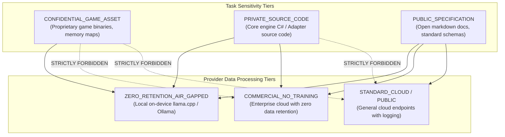

# NexLudic Engine: AI Agent Provider Privacy, Security & Trust Policy

**Document ID:** `NLE-SEC-APR-001`  
**Phase:** 7 of 12 (AI Coding-Agent Orchestration)  
**Step:** 54 of 100  
**Classification:** Information Security, Privacy & Trust Governance Policy  
**Status:** IMPLEMENTATION-READY SPECIFICATION  

---

## 1. Information Security & Trust Governance

The integration of external AI providers and autonomous coding agents introduces unique security and data privacy threats. A compromised or misconfigured provider could leak proprietary game intellectual property, exfiltrate user credentials, or execute unauthorized code on the developer's workstation.

This policy establishes mandatory security invariants governing provider registration, capability authorization, data residency, and threat mitigation.

---

## 2. Fundamental Security Invariants

### 2.1 Capability Does Not Confer Authority (`INV-SEC-CAP-01`)
A candidate agent or model may possess technical support for filesystem writes, diff application, network transmission, or compiler execution. **Technical capability grants zero ambient authorization.**
- All tool execution requires an explicit authorization token issued by a human stakeholder.
- If a task contract is read-only (`allow_write: false`), an agent possessing `CAP_SOURCE_EDIT_DIFF` is strictly barred from modifying files. Any attempt to write triggers an immediate security abort.

### 2.2 Windows Medium Integrity Level Boundary (`DEC-002`, `INV-SEC-CAP-02`)
In strict adherence to `DEC-002`:
- All agent harnesses, execution environments, tool binaries, and test runners must execute exclusively within **Windows Medium Integrity Level (Medium IL)**.
- Any request or capability profile demanding administrative elevation, UAC prompt bypass, or kernel driver loading is permanently vetoed.

### 2.3 Anti-Cheat & Process Integrity Dominance (`BLK-SEC-01`, `INV-SEC-CAP-03`)
In strict adherence to `BLK-SEC-01`:
- NexLudic Engine prohibits any capability, tool, or task that attempts direct memory scanning, process injection, DLL hijacking, or reverse engineering of game executables protected by commercial anti-cheat systems (e.g., Easy Anti-Cheat, BattlEye, Vanguard).
- All game interoperability must be achieved through authorized Universal Adapter SDK contracts and external IPC bridges running outside the game process space.

---

## 3. Data Residency & Provider Disclosure Tiers

Incoming tasks are tagged with a **Data Sensitivity Tier**. A candidate provider must possess an approved **Data Processing Tier** equal to or more restrictive than the task's sensitivity:

### 3.1 Policy Enforcement Rules
1. **Rule SEC-RES-01 (Air-Gapped Mandate):** If a task references `CONFIDENTIAL_GAME_ASSET`, it can *only* match candidate tuples utilizing `LOCAL_DEVICE` providers with `ZERO_RETENTION_AIR_GAPPED`. Transmission to any cloud endpoint evaluates to `INELIGIBLE_PRIVACY_CONSTRAINT`.
2. **Rule SEC-RES-02 (Commercial No-Training Mandate):** Engine source code (`PRIVATE_SOURCE_CODE`) may be transmitted to cloud providers only if the provider has an active, legally verified corporate agreement guaranteeing zero data retention and no model training.
3. **Rule SEC-RES-03 (Automated Secret Scrubbing):** Before any prompt or context payload is serialized for dispatch to an external provider, the payload passes through regex and Shannon entropy scanners (`NLE-SEC-TIN-001`) to scrub API keys, private tokens, and passwords.

---

## 4. Threat Model & Safeguards Against Registry Manipulation

The Provider Registry identifies five critical attack vectors and enforces deterministic defenses:

| Threat ID | Threat Description | Attack Vector | Mandatory Defensive Countermeasure |
| :--- | :--- | :--- | :--- |
| **THR-REG-01** | **Unverified Capability Elevation** | A compromised profile claims `CAP_TOOL_EXEC_CMD` without passing tests. | **Cryptographic Conformance Binding:** Matcher checks evidence hash against the immutable evidence repository. Unverified claims fail `PRED_05`. |
| **THR-REG-02** | **Registry File Tampering** | An attacker modifies `provider-registry-v1.json` on disk to approve a malicious model. | **HMAC / Digital Signature Verification:** Registry files are digitally signed with an engine root certificate. Tampered files are rejected (`EVALUATION_FAILED`). |
| **THR-REG-03** | **Prompt Injection Tool Escalation** | Model output instructs harness to run bash commands outside whitelisted tools. | **Harness Tool Schema Lockdown:** Harness only exposes tools whitelisted in the task token. Unknown tool invocations are rejected by the adapter ABI. |
| **THR-REG-04** | **Data Exfiltration via Telemetry** | A candidate model attempts to embed sensitive source code into error logs or diagnostics. | **Diagnostic Sanitization:** All diagnostic records are filtered against the secret scrubber before being written to disk or shown in the UI. |
| **THR-REG-05** | **Supply Chain Weight Poisoning** | A community model deployment introduces backdoored code generation logic. | **Air-Gapped Sandboxing & Deterministic Tests:** All generated code must compile and pass independent unit test verification (`CAP_INDEPENDENT_VERIFICATION`). |

---

## 5. Audit Logging & Data Minimization

1. **Audit Record Retention:** Registry state changes, matching decisions, and authorization tokens must be archived for 90 days to support forensic audits.
2. **Secret Non-Storage:** Under no circumstances may plaintext API keys or OAuth secrets appear in audit logs.
3. **Context Minimization:** Audit trails record task IDs, decision hashes, and timestamps; they do not retain complete multi-megabyte prompt context bodies indefinitely.
