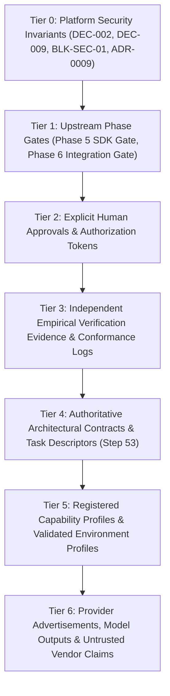
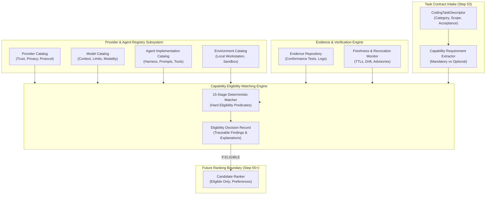

# NexLudic Engine: AI Agent Provider Registry, Capability Profiles & Eligibility Matching Specification

**Document ID:** `NLE-SPC-APR-001`  
**Phase:** 7 of 12 (AI Coding-Agent Orchestration)  
**Step:** 54 of 100  
**Classification:** Provider Registry, Capability Profiles & Eligibility Architecture Specification  
**Status:** IMPLEMENTATION-READY SPECIFICATION  
**Authoritative Scope:** Specification, Domain Modeling, Matching Rules, Security Gateways, and Policy Only (No Registry Implementation, No AI Provider Connections, No Agent Invocations, No Code Execution, No Game Tampering)

---

## 1. Executive Summary & Architectural Purpose

The **AI Agent Provider Registry, Capability Profiles & Eligibility Matching Specification** establishes the authoritative foundation for discovering, characterizing, evaluating, and gating AI coding agents within the NexLudic Engine orchestration subsystem.

Before an engineering task—normalized and authorized under Step 53 (`NLE-SPC-TIN-001`)—can ever be scheduled, ranked, or assigned to an AI agent, the platform must objectively evaluate whether a candidate agent possesses the verifiable capabilities, tool compatibility, environment access, and policy entitlements required to execute the work safely.

This specification enforces four non-negotiable architectural axioms:
1. **Separation of Four Structural Identities:** The system strictly decouples the **Provider** (service or vendor host), the **Model** (computational reasoning engine), the **Agent Implementation** (orchestration harness, prompts, and tool adapters), and the **Execution Environment** (workstation, container, or remote sandbox). A capable model in an unverified agent wrapper or an unsafe environment is never eligible.
2. **Epistemic Capability Stratification:** Capabilities are governed across four strictly separated states: **Declared** (vendor claim), **Supported** (contractually specified), **Verified** (empirically tested in target environment), and **Authorized** (permitted by task token). A claim never equals verification, and verification never confers authorization.
3. **Hard Predicate Gating Prior to Ranking:** Eligibility matching is an absolute binary filter. If a candidate fails any mandatory capability, security boundary, data residency rule, or upstream gate condition, it is marked `INELIGIBLE` or `BLOCKED`. Ranking preferences (cost, latency, token velocity) can never outweigh or bypass a hard eligibility failure.
4. **Provider Neutrality & Zero Ambient Trust:** NexLudic Engine maintains total vendor independence. No external provider (OpenAI, Anthropic, Google, local llama.cpp/Ollama) is hardcoded or granted ambient trust. All entries in the registry require explicit validation evidence, signed lifecycle transitions, and strict secret isolation.

---

## 2. Epistemic Hierarchy & Source-of-Truth Governance

The Provider Registry and Capability Matcher operate strictly under the 7-tier epistemic hierarchy established in Step 52 (`NLE-SPC-ACO-001`) and extended in Step 53 (`NLE-SPC-TIN-001`):

### 2.1 Governance Rules for Capability Claims
- **Tier 0 Dominance:** No capability profile, provider configuration, or task requirement may authorize memory injection, anti-cheat circumvention (`BLK-SEC-01`), UAC elevation (`DEC-002`), or direct file writes outside the project workspace (`DEC-009`, `ADR-0009`).
- **Tier 6 Untrusted Baseline:** Marketing claims, model system card benchmarks, provider documentation, and model self-reports reside at Tier 6. They cannot qualify a candidate for `VERIFIED` status without empirical conformance logs (Tier 3) and signed architectural acceptance (Tier 2).
- **Consuming Step 53 Normalized Tasks:** The capability matcher accepts only validated `CodingTaskDescriptor` contracts (`NLE-MOD-TIN-001`). The matcher does not re-interpret ambiguous user prompts or compensate for missing prerequisites by selecting a supposedly more sophisticated agent.

---

## 3. Mandatory Upstream Gate & Handoff Audit

Before evaluating candidate eligibility, the system must assert the status of upstream roadmap gates:

### 3.1 Phase 5 Universal Adapter SDK Gate (`NLE-GAT-PH5-001`)
- **Recorded Status:** **`READY WITH CONDITIONS`** (`P5-C01`, `P5-C02`, `P5-C03`).
- **Condition `P5-C01` Impact:** Native language SDK bindings (C++, Rust, C#) are actively being developed across Phases 7 and 8. The provider registry specifically defines the `CAP_ADAPTER_WIRE_SERIALIZATION` capability to match agents authoring wire protocol wrappers that satisfy `P5-C01`.

### 3.2 Phase 6 Mashup Designer & Planning Gate Audit
- **Audit Findings:** Step 51 (Phase 6 Readiness Review) is not present in the repository. As audited in Step 52 and Step 53, Phase 6 gate status is formally **`UNVERIFIED / MISSING FORMAL SIGN-OFF`**.
- **Impact on Capability Matching (`ERR_PRECONDITION_PHASE6_UNVERIFIED`):**  
  > **Hard Invariant:** Any normalized task whose objective is the runtime implementation of a Step 49 Mashup Integration Plan (`ACCEPTED_FOR_PLANNING`) is held in **`BLOCKED_BY_DEPENDENCY`**. The capability matcher will evaluate candidate profiles against task requirements for diagnostic readiness, but the final outcome is strictly blocked from `READY_FOR_ASSIGNMENT` until Step 51 is formally conducted and approved.

---

## 4. Architectural Organization of the Registry & Matching Subsystem

The provider registry and capability matching subsystem is structured into 6 decoupled functional components:

### 4.1 Registry Component Responsibilities
1. **Provider Catalog:** Tracks external vendors, cloud services, and local inference runtimes. Stores connection endpoints, supported authentication protocols, data-processing agreements, and organizational trust status. **Credentials are strictly prohibited from registry files.**
2. **Model Catalog:** Records distinct model versions, supported token contexts, verified modalities, native tool-calling capabilities, and rate-limiting limits.
3. **Agent Implementation Catalog:** Defines the specific client wrapper, orchestration harness, prompt templates, and tool adapters bound to a model. Represents the operational unit that interacts with the repository.
4. **Environment Catalog:** Characterizes the host machine, container sandbox, filesystem mount points, and network egress policies where the agent executes tools.
5. **Evidence Repository:** Stores immutable, timestamped conformance test runs, benchmark logs, and human sign-offs validating capability assertions.
6. **Freshness & Revocation Monitor:** Audits time-to-live (TTL) counters, watches for provider model deprecations or API revisions, and immediately invalidates stale evidence.

---

## 5. Summary of Step 54 Deliverables Suite

The complete architectural, domain, security, and verification standard for Step 54 is specified across 14 synchronized documents in `docs/ai-orchestration/`:

1. `AI_AGENT_PROVIDER_REGISTRY_AND_CAPABILITY_ELIGIBILITY_SPECIFICATION.md` (`NLE-SPC-APR-001`): Primary specification (this document).
2. `AI_AGENT_PROVIDER_MODEL_IMPLEMENTATION_AND_EXECUTION_ENVIRONMENT_DOMAIN_MODEL.md` (`NLE-MOD-APR-001`): Formal entity schemas for Provider, Model, Agent, Environment, and JSON Schema Draft 2020-12 (`NLE-SCH-APR-001`).
3. `AI_AGENT_CAPABILITY_TAXONOMY_AND_PROFILE_CONTRACT.md` (`NLE-CON-ACP-001`): 32 granular capability tokens across 5 domains, conditional rules, and profile contracts.
4. `AI_AGENT_CAPABILITY_DECLARATION_AND_EVIDENCE_VERIFICATION_POLICY.md` (`NLE-POL-ACD-001`): 4-state epistemic lifecycle, evidence hierarchy, conformance testing standards, freshness policies.
5. `AI_AGENT_REGISTRY_LIFECYCLE_AND_GOVERNANCE_POLICY.md` (`NLE-POL-ARL-001`): 12 registry lifecycle states, promotion criteria, suspension/revocation triggers, audit logging.
6. `AI_CODING_TASK_CAPABILITY_REQUIREMENT_BINDING_SPECIFICATION.md` (`NLE-SPC-TCR-001`): Extraction rules mapping Step 53 `CodingTaskDescriptor` fields into mandatory, optional, and prohibited capabilities.
7. `AI_AGENT_CAPABILITY_ELIGIBILITY_MATCHING_RULES.md` (`NLE-RUL-AEM-001`): 15-stage deterministic matching pipeline, 9 hard eligibility predicates, 14 outcome states.
8. `AI_AGENT_ELIGIBILITY_AND_CANDIDATE_RANKING_BOUNDARY_POLICY.md` (`NLE-POL-ARB-001`): Strict separation between eligibility (binary pass/fail) and ranking (preference scoring), prohibition of pseudo-scores.
9. `AI_AGENT_PROVIDER_PRIVACY_SECURITY_AND_TRUST_POLICY.md` (`NLE-SEC-APR-001`): Data residency constraints, private context protection, anti-cheat invariants, secret scrubbing.
10. `AI_AGENT_CAPABILITY_FAILURE_FRESHNESS_AND_INVALIDATION_POLICY.md` (`NLE-POL-ACF-001`): Failure handling, recovery workflows, TTL expiration, invalidation triggers.
11. `AI_AGENT_REGISTRY_AND_ELIGIBILITY_DIAGNOSTIC_CONTRACT.md` (`NLE-CON-AED-001`): Machine-readable diagnostic schema (`NLE-SCH-AED-001`), error taxonomy, explainability contracts.
12. `AI_AGENT_PROVIDER_REGISTRY_SYNTHETIC_SCENARIOS_AND_TEST_PLAN.md` (`NLE-CAT-APS-001`): 20 synthetic test scenarios (Scenarios A through T) exercising normal and edge cases.
13. `STEP_54_CAPABILITY_REQUIREMENTS_TRACEABILITY_MATRIX.md` (`NLE-MAT-STP-054`): Bidirectional mapping of 26 core capability and matching requirements (`APR-REQ-001..026`).
14. `STEP_54_COMPLETION_REPORT.md` (`NLE-REP-STP-054`): Milestone audit, verification of 21 acceptance criteria (`AC-01..21`), sign-off verdict.

---

## 6. Strict Stop Boundary & Forward Directives

Step 54 establishes the architectural and policy framework for the Provider Registry and Capability Matcher. It does **not** implement software, connect to APIs, invoke agents, rank candidates, or assign tasks.

Execution halts strictly upon completion of Step 54 documentation and QA review. Step 55 (*AI Coding Context Preparation, Repository Indexing & Knowledge Retrieval Specification*) shall remain untouched until explicitly authorized by the project owner.
