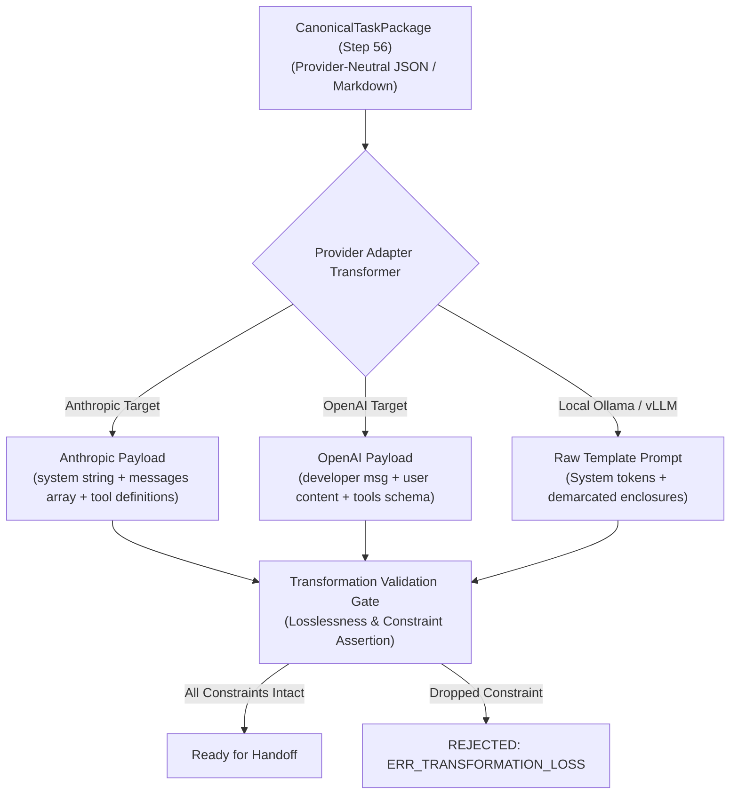

# NexLudic Engine: AI Agent Provider-Specific Context Transformation Contract

**Document ID:** `NLE-CON-PTC-001`  
**Phase:** 7 of 12 (AI Coding-Agent Orchestration)  
**Step:** 56 of 100  
**Classification:** Provider Adapter Transformation Contract  
**Status:** IMPLEMENTATION-READY SPECIFICATION  

---

## 1. Transformation Architecture & Invariant Preservation

Different AI providers and agent runtimes require distinct serialization formats: Anthropic requires separate `system` parameters and `messages` arrays; OpenAI requires `developer` or `system` messages and JSON Schema `tools`; local Ollama or llama.cpp daemons require raw formatted text with special tokens.

The **Provider-Specific Context Transformation Contract** defines how a `CanonicalTaskPackage` is transformed into an agent-specific delivery package while strictly preserving semantic fidelity and security constraints:

---

## 2. Mandatory Transformation Invariants

Every adapter transformation must satisfy **7 Non-Negotiable Invariants**:

1. **Objective Invariant (`INV-TRN-01`):** The `primary_objective` text must be transcribed verbatim without alteration, softening, or paraphrasing.
2. **Scope & Whitelist Invariant (`INV-TRN-02`):** `permitted_path_globs` and `max_diff_lines` must appear verbatim in the transformed instruction block.
3. **Exclusion Invariant (`INV-TRN-03`):** `explicit_exclusions` must be rendered prominently as negative directives (e.g., "DO NOT MODIFY...").
4. **Acceptance Criteria Invariant (`INV-TRN-04`):** All `acceptance_criteria` items must be rendered in full. No criterion may be omitted or summarized.
5. **Security Policy Invariant (`INV-TRN-05`):** Citations to `DEC-002` (Medium IL) and `BLK-SEC-01` (Anti-Cheat Dominance) must be preserved in the system instruction block.
6. **Demarcation Invariant (`INV-TRN-06`):** Untrusted file enclosures (`<untrusted_task_data_enclosure>`) must remain intact with closing tags and XML escaping.
7. **Zero Tool Escalation Invariant (`INV-TRN-07`):** The transformed tool schema must contain *only* the authorized tool interfaces declared in `execution_boundaries`.

---

## 3. Transformation Mapping by Provider Architecture

### 3.1 Anthropic Claude Transformation (`ADAPT-ANTHROPIC-V1`)
- **`system` parameter:** Contains Governing Instructions (Section C), Security Policies, Epistemic Grounding Directive, and Execution Boundaries.
- **`messages[0]` (`user`):** Contains Authorized Objective (Section B), Deliverable Contract (Section F), and Technical Context with demarcated Source Items (Section D).
- **`tools` parameter:** Formatted as Anthropic-compliant JSON tool declarations for authorized tool interfaces only.

### 3.2 OpenAI GPT-4o Transformation (`ADAPT-OPENAI-V1`)
- **`messages[0]` (`developer` or `system`):** Contains Governing Instructions, Security Policies, Grounding Directive, and Path Whitelists.
- **`messages[1]` (`user`):** Contains Objective, Deliverables, Acceptance Criteria, and Demarcated Context Items.
- **`tools` parameter:** Formatted as standard OpenAI function definitions.

### 3.3 Local Ollama / llama.cpp Transformation (`ADAPT-LOCAL-RAW-V1`)
- Serializes the entire canonical package into a single structured text stream using standardized Markdown section headers (`# SYSTEM INSTRUCTIONS`, `# AUTHORIZED TASK CONTRACT`, `# TECHNICAL CONTEXT`), ensuring clear boundary delimiters.

---

## 4. The Transformation Validation Gate

Before any transformed payload can be dispatched to a network socket or agent process, it must pass through an automated **Transformation Validation Gate**:
- The validator parses the transformed representation and cross-checks every mandatory field against the original `CanonicalTaskPackage`.
- If an adapter omitted a security invariant, dropped an acceptance criterion, or failed to close an untrusted enclosure, the gate aborts with `ERR_TRANSFORMATION_LOSS`.
