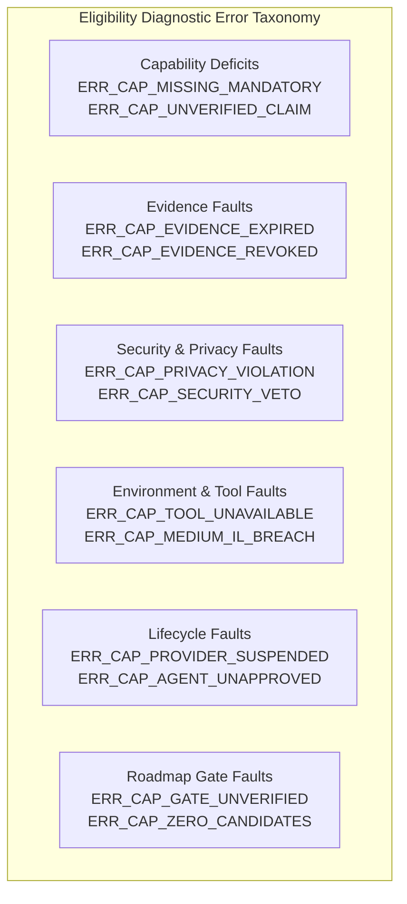

# NexLudic Engine: AI Agent Registry & Eligibility Diagnostic Contract

**Document ID:** `NLE-CON-AED-001`  
**Phase:** 7 of 12 (AI Coding-Agent Orchestration)  
**Step:** 54 of 100  
**Classification:** Diagnostic Schema & Explainability Contract  
**Status:** IMPLEMENTATION-READY SPECIFICATION  

---

## 1. Diagnostic Architecture & Explainability Mandate

When an engineering task fails to match an eligible AI agent, developers and creators require clear, actionable, and non-mysterious explanations. Silently dropping tasks or emitting vague error strings (e.g., "matching failed") breeds distrust and halts development.

The **Registry & Eligibility Diagnostic Contract** establishes a standardized, machine-readable diagnostic schema that explains:
1. Exactly which candidate tuples were evaluated;
2. Which hard predicates passed and which specific predicate failed;
3. The precise capability, tool, or privacy mismatch;
4. The exact remediation steps required to achieve eligibility.

---

## 2. Standardized Error Code Taxonomy

The matching engine emits structured error codes organized across 6 diagnostic domains:



| Diagnostic Error Code | Severity | Description | Remediation Action |
| :--- | :---: | :--- | :--- |
| **`ERR_CAP_MISSING_MANDATORY`** | High | Candidate lacks a required capability in `VERIFIED` status. | Author conformance test fixture or select a more specialized agent. |
| **`ERR_CAP_UNVERIFIED_CLAIM`** | High | Capability is declared by provider but has no valid empirical evidence. | Execute automated conformance fixture (`NLE-POL-ACD-001`). |
| **`ERR_CAP_EVIDENCE_EXPIRED`** | Medium | Evidence record exceeded its 14-day or 30-day TTL. | Run scheduled re-conformance benchmark to refresh evidence. |
| **`ERR_CAP_EVIDENCE_REVOKED`** | High | Evidence revoked due to failed regression test or security advisory. | Audit security advisory and upgrade model or harness version. |
| **`ERR_CAP_PRIVACY_VIOLATION`** | Critical | Task contains confidential files; candidate is on public cloud. | Select a local on-device provider (`ZERO_RETENTION_AIR_GAPPED`). |
| **`ERR_CAP_SECURITY_VETO`** | Critical | Task or candidate attempted kernel hooking or anti-cheat tampering. | Modify task scope; remove prohibited memory manipulation. |
| **`ERR_CAP_TOOL_UNAVAILABLE`** | High | Environment lacks a required tool binary (e.g. `dotnet.exe`). | Install the required SDK/compiler tool on the host workstation. |
| **`ERR_CAP_MEDIUM_IL_BREACH`** | Critical | Environment requires administrative elevation or UAC bypass. | Ensure all tool harnesses execute strictly in Windows Medium IL. |
| **`ERR_CAP_PROVIDER_SUSPENDED`**| High | Provider is in `SUSPENDED` or `REVOKED` state. | Resolve provider outage or restore administrative approval. |
| **`ERR_CAP_GATE_UNVERIFIED`** | Critical | Blocked by unverified upstream phase gate (e.g. Step 51 Phase 6). | Complete and record formal upstream roadmap phase review. |
| **`ERR_CAP_ZERO_CANDIDATES`** | High | No registered candidate in the registry satisfies all hard predicates. | Register new capable agents or decompose task into smaller subtasks. |

---

## 3. Formal Machine-Readable Diagnostic Schema

The diagnostic output conforms to JSON Schema `NLE-SCH-AED-001`:

```json
{
  "diagnostic_report_id": "diag-match-c7a8b3f1-20261119-001",
  "task_id": "c7a8b3f1-9d2e-4b8a-b1f4-8e7c6d5a4b3c",
  "task_version": "1.0.0",
  "task_category": "ADAPTER_DEVELOPMENT",
  "timestamp": "2026-11-19T15:17:00Z",
  "overall_matching_outcome": "INELIGIBLE_MISSING_CAPABILITY",
  "primary_blocking_code": "ERR_CAP_MISSING_MANDATORY",
  "candidates_evaluated_count": 3,
  "eligible_candidates_count": 0,
  "candidate_evaluations": [
    {
      "candidate_tuple": {
        "provider_id": "prov-local-ollama",
        "model_id": "mod-qwen-2-5-coder-7b",
        "agent_id": "agt-doc-author-v2",
        "environment_id": "env-desktop-medium-il"
      },
      "outcome": "INELIGIBLE_MISSING_CAPABILITY",
      "failing_predicates": ["PRED_05_CAPABILITIES_VERIFIED"],
      "missing_mandatory_capabilities": [
        "CAP_ADAPTER_WIRE_SERIALIZATION",
        "CAP_SOURCE_EDIT_DIFF"
      ],
      "diagnostic_message": "Candidate agt-doc-author-v2 is specialized for documentation authoring and lacks verified capabilities for wire serialization and source diff editing.",
      "remediation_guidance": "Select an agent implementation configured with C# adapter scaffolding tools."
    },
    {
      "candidate_tuple": {
        "provider_id": "prov-anthropic-direct",
        "model_id": "mod-claude-3-7-sonnet",
        "agent_id": "agt-adapter-scaffold-v1",
        "environment_id": "env-desktop-medium-il"
      },
      "outcome": "INELIGIBLE_PRIVACY_CONSTRAINT",
      "failing_predicates": ["PRED_09_PRIVACY_COMPLIANT"],
      "missing_mandatory_capabilities": [],
      "diagnostic_message": "Task contains CONFIDENTIAL_GAME_ASSET (proprietary binary dump). Provider prov-anthropic-direct is a cloud API, violating air-gapped data residency mandate.",
      "remediation_guidance": "Run task with local air-gapped model (ZERO_RETENTION_AIR_GAPPED) or scrub proprietary binaries from task scope."
    }
  ],
  "remediation_summary": [
    "1. Deploy a larger local coding model (e.g. qwen2.5-coder-32b) with the agt-adapter-scaffold harness to satisfy both capability and data residency requirements.",
    "2. Alternatively, if confidential game assets can be separated, decouple the task into public wire protocol docs and private local adapter integration."
  ]
}
```

---

## 4. Diagnostic Privacy & Sanitization Safeguards

1. **No Secret Disclosure:** Diagnostic messages must never output API keys, bearer tokens, or internal credential paths.
2. **Path Sanitization:** File paths are reported relative to the workspace root (e.g., `src/adapters/orion/OrionHook.cs`) rather than exposing full host filesystem hierarchy.
3. **No Raw Content Echoing:** If a task was rejected due to prompt injection or confidential content, the diagnostic describes the rule violation without reflecting the malicious payload verbatim.
