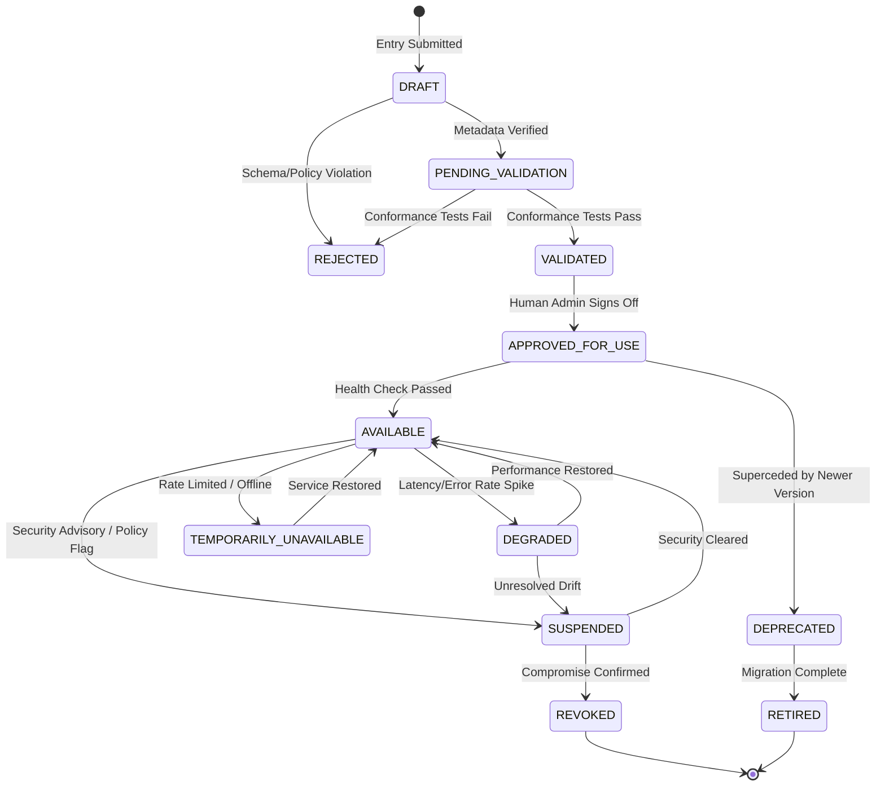

# NexLudic Engine: AI Agent Registry Lifecycle & Governance Policy

**Document ID:** `NLE-POL-ARL-001`  
**Phase:** 7 of 12 (AI Coding-Agent Orchestration)  
**Step:** 54 of 100  
**Classification:** Registry Lifecycle & Governance Policy  
**Status:** IMPLEMENTATION-READY SPECIFICATION  

---

## 1. Registry Governance Philosophy

Every entity registered within the NexLudic Engine Provider Registry—including Providers, Models, Agent Implementations, and Execution Environments—operates under a formal, auditable state machine.

No candidate agent may be matched or assigned to an engineering task simply because it has been entered into the catalog. Eligibility matching requires that the candidate tuple's constituents reside in explicitly approved operational states.

---

## 2. The 12 Lifecycle States

The registry governs all entries through 12 formal lifecycle states:

### 2.1 State Definitions & Semantics

| State Name | Operational Meaning | Eligible for Matching? | Authorizing Authority |
| :--- | :--- | :---: | :--- |
| **`DRAFT`** | Initial configuration record created; missing validation evidence. | **NO** | Developer / Integrator |
| **`PENDING_VALIDATION`** | Scheduled for automated conformance testing and schema verification. | **NO** | Automated Test Runner |
| **`VALIDATED`** | All required conformance tests passed; awaiting human governance approval. | **NO** | Automated Test Runner |
| **`APPROVED_FOR_USE`** | Formally accepted by human technical lead; approved for production use. | **CONDITIONAL** (If healthy) | Human Architect / Lead |
| **`AVAILABLE`** | Fully active, healthy, and reachable; ready for task matching. | **YES** | System Health Monitor |
| **`DEGRADED`** | Operational but exhibiting elevated latency or minor failure rates. | **YES (Low Priority)** | System Health Monitor |
| **`TEMPORARILY_UNAVAILABLE`** | Provider endpoint down, network offline, or quota exhausted. | **NO** | System Health Monitor |
| **`SUSPENDED`** | Temporarily locked due to suspected security anomaly or test failure. | **NO** | Security Monitor / Lead |
| **`REVOKED`** | Permanently disqualified due to security violation or severe drift. | **NO (Permanent)** | Security Architect |
| **`DEPRECATED`** | Superseded by newer model/agent version; phased out gracefully. | **YES (Existing only)** | Technical Lead |
| **`RETIRED`** | Decommissioned; preserved strictly for historical audit and replay. | **NO** | System Administrator |
| **`REJECTED`** | Failed intake validation or violated platform architecture policies. | **NO** | Automated Validator / Lead |

---

## 3. State Transition Rules & Governance Gateways

### 3.1 Registration Gateway (`DRAFT` $\rightarrow$ `PENDING_VALIDATION` $\rightarrow$ `VALIDATED`)
- **Trigger:** An administrator adds a new provider endpoint or agent harness.
- **Assertion:** Entity schemas validated against JSON Schema `NLE-SCH-APR-001`.
- **Validation Execution:** The engine test runner invokes the conformance test suite (`NLE-POL-ACD-001`). If all tests pass, the entry transitions to `VALIDATED`. If any test fails, it transitions to `REJECTED`.

### 3.2 Human Approval Gateway (`VALIDATED` $\rightarrow$ `APPROVED_FOR_USE`)
- **Mandatory Invariant:** Automated test success does **not** grant production approval.
- A human architect must inspect the data processing agreement, verify external disclosure tiers, and digitally sign the approval record. Only then does the entry transition to `APPROVED_FOR_USE`.

### 3.3 Runtime Health Transitions (`APPROVED_FOR_USE` $\leftrightarrow$ `AVAILABLE` $\leftrightarrow$ `TEMPORARILY_UNAVAILABLE`)
- The orchestration health daemon periodically pings endpoints and checks rate-limit counters.
- If an endpoint returns HTTP 429 (Rate Limited) or 503 (Service Unavailable), it transitions to `TEMPORARILY_UNAVAILABLE`. Tasks awaiting this provider are held in queue; no new tasks are matched.

### 3.4 Suspension & Revocation Gateway (`*` $\rightarrow$ `SUSPENDED` / `REVOKED`)
- **Immediate Suspension:** If prompt injection leakage, secret exfiltration, or anti-cheat violation is detected during any task, the security monitor instantly sets the agent to `SUSPENDED`.
- Active tasks using that agent are immediately halted and placed in `ABORTED_BY_SECURITY_POLICY`.
- If an investigation confirms malicious behavior or uncorrectable vulnerability, the entry is transitioned to `REVOKED`.

---

## 4. Historical Traceability & Record Immutability

1. **No Hard Deletion:** Registry entries, model tags, and capability records are **never hard-deleted** from disk. When an agent or model is decommissioned, its state is set to `RETIRED`.
2. **Identifier Permanence:** Entity IDs (`prov-*`, `mod-*`, `agt-*`) are permanently bound to their historical revisions. A new version of an agent must receive a new identifier or incremented SemVer (`agt-adapter-scaffold-v2`).
3. **Audit Trail Preservation:** Every state transition must record:
   - `from_state` and `to_state`.
   - `transition_timestamp` (ISO 8601 UTC).
   - `authorized_by` (Service name or human username).
   - `reason_or_ticket_ref` (Traceable rationale).
   - `evidence_hash` (Cryptographic digest of supporting test logs).
