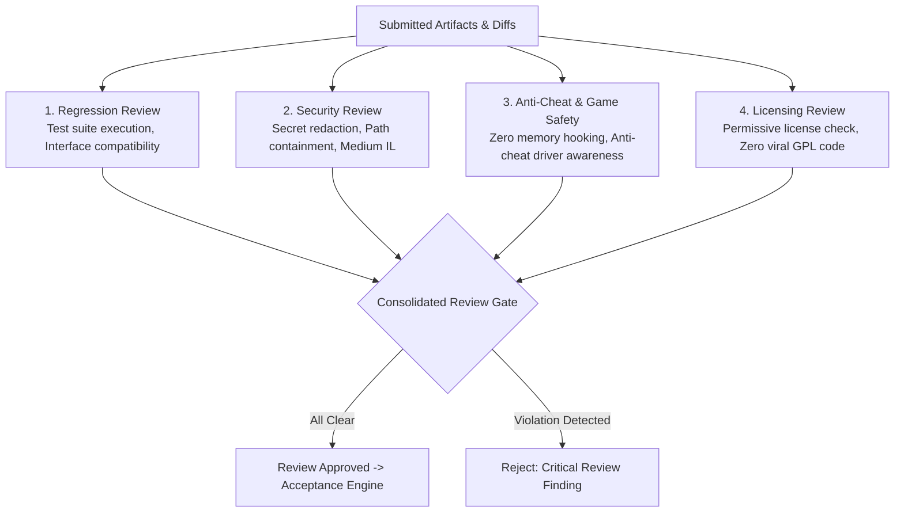

# NexLudic Engine: AI Agent Regression, Security, Compatibility & Licensing Review Policy

**Document ID:** `NLE-POL-ARS-001`  
**Phase:** 7 of 12 (AI Coding-Agent Orchestration)  
**Step:** 59 of 100  
**Classification:** Security, Compatibility & Compliance Policy  
**Status:** IMPLEMENTATION-READY SPECIFICATION  
**Upstream Dependencies:** `NLE-SPC-AOC-001` (Master Spec), `NLE-SEC-ATT-001` (Step 58 Threat Model)  
**Downstream Dependents:** `NLE-CON-AAC-001` (Acceptance Contract), Step 60 Phase Gate  

---

## 1. Multi-Dimensional Review Architecture

Prior to final task acceptance, submitted code and artifacts must undergo four mandatory, non-bypassable reviews:
1. **Regression Review:** Ensuring existing engine workflows, adapters, and schemas remain unbroken.
2. **Security & Vulnerability Review:** Detecting credential leaks, buffer overflows, and privilege escalation.
3. **Anti-Cheat & Game Protection Review:** Enforcing absolute non-interference with live game memory (`BLK-SEC-01`).
4. **Licensing & Dependency Review:** Preventing the infiltration of viral copyleft licenses (GPLv3) into the proprietary engine core.

---

## 2. Review Dimension Specifications

### 2.1 Regression Review Policy
- All pre-existing unit and integration tests covering the affected module must execute and pass.
- Public API signatures, IPC protocols, and JSON schemas cannot be altered without an authorized task revision.

### 2.2 Security & Threat Neutralization Policy
- **Credential & Secret Scanning:** All submitted files are scanned for API keys, private tokens, and passwords. Any detected secret halts acceptance immediately.
- **Untrusted Code Execution Prohibition:** The engine NEVER executes untrusted submitted code on the host OS outside the Windows Job Object sandbox (`KILL_ON_JOB_CLOSE`).

### 2.3 Game Safety & Anti-Cheat Compliance (`BLK-SEC-01`, `DEC-002`)
- **Zero Game Tampering:** Any submitted code containing Win32 process injection (`WriteProcessMemory`, `CreateRemoteThread`), DLL injection hooks, or DRM circumvention routines is **HARD-VETO REJECTED**.
- **Medium Integrity Level:** Submitted code must run cleanly under standard Windows Medium IL without requiring elevated Administrator rights or UAC prompts.

### 2.4 Licensing & Third-Party Dependency Policy
- **Permissive License Invariant:** All introduced dependencies must conform to approved permissive licenses (MIT, Apache 2.0, BSD-3-Clause).
- **Viral License Ban:** Dependencies licensed under GPLv2, GPLv3, AGPL, or proprietary non-commercial terms are strictly prohibited from the engine core.
