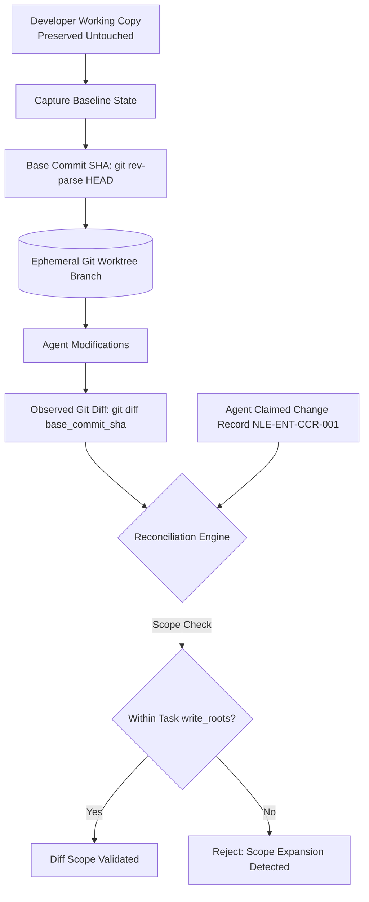

# NexLudic Engine: AI Agent Repository Diff Reconciliation & User Change Preservation Policy

**Document ID:** `NLE-POL-ARD-001`  
**Phase:** 7 of 12 (AI Coding-Agent Orchestration)  
**Step:** 59 of 100  
**Classification:** Repository Integrity & Change Reconciliation Policy  
**Status:** IMPLEMENTATION-READY SPECIFICATION  
**Upstream Dependencies:** `NLE-SPC-AOC-001` (Master Spec), `NLE-POL-ATF-001` (Step 58 Filesystem Policy)  
**Downstream Dependents:** `NLE-POL-ADC-002` (Deliverable Completeness), `NLE-CON-AAC-001` (Acceptance Contract)  

---

## 1. Baseline Capture & Workspace Segregation

To prevent the accidental destruction or corruption of developer work, NexLudic Engine enforces strict baseline separation:
1. **Starting Baseline Snapshot:** At session creation, the supervisor captures a baseline snapshot of the repository:
   - Primary repository commit SHA (`base_commit_sha`).
   - Uncommitted user modifications (staged and unstaged) in the primary working tree.
   - Untracked files list.
2. **Dedicated Git Worktree:** The agent executes strictly within an isolated Git worktree linked to branch `nexludic/agent/<task_id>/attempt-<n>`.
3. **Absolute Protection of Developer Work:** The verification engine NEVER runs `git reset --hard`, `git clean -fd`, or `git checkout -- .` on the user's primary working copy.

---

## 2. Claimed vs. Observed Change Reconciliation

The verification engine compares the agent's self-reported **Claimed Change Record (`NLE-ENT-CCR-001`)** with the physically observed **Git Unified Diff**:

| Discrepancy Category | Detection Condition | Verification Outcome | Action |
| :--- | :--- | :--- | :--- |
| **Unreported Modification** | File modified in git diff but omitted from agent's claimed change list. | `WARNING_UNREPORTED_CHANGE` | Flag for review; do not auto-accept. |
| **Phantom Modification** | File claimed modified by agent but absent from physical git diff. | `DEFECT_PHANTOM_CHANGE` | Flag as hallucinated work; mark criterion unverified. |
| **Unauthorized Scope Expansion** | File modified outside the task contract's `write_roots`. | **`CRITICAL_SCOPE_VIOLATION`** | Reject submission immediately; worktree sealed. |
| **Unexpected Deletion** | Existing file deleted in worktree without explicit task authorization. | **`CRITICAL_UNAUTHORIZED_DELETION`** | Reject submission; restore from base commit. |
| **Dependency Tampering** | `Cargo.toml`, `package.json`, or lockfiles modified without authorization. | **`SECURITY_DEPENDENCY_VIOLATION`** | Reject submission; mandatory human security review. |

---

## 3. Preservation of Concurrent & Unrelated Edits

If concurrent task activity occurs:
- Changes are isolated by Git branch namespaces (`nexludic/agent/<task_id>/...`).
- Merging into developer integration branches is strictly prohibited during verification.
- Staging and merging remain the sole prerogative of the human operator via Step 59 UI controls.
