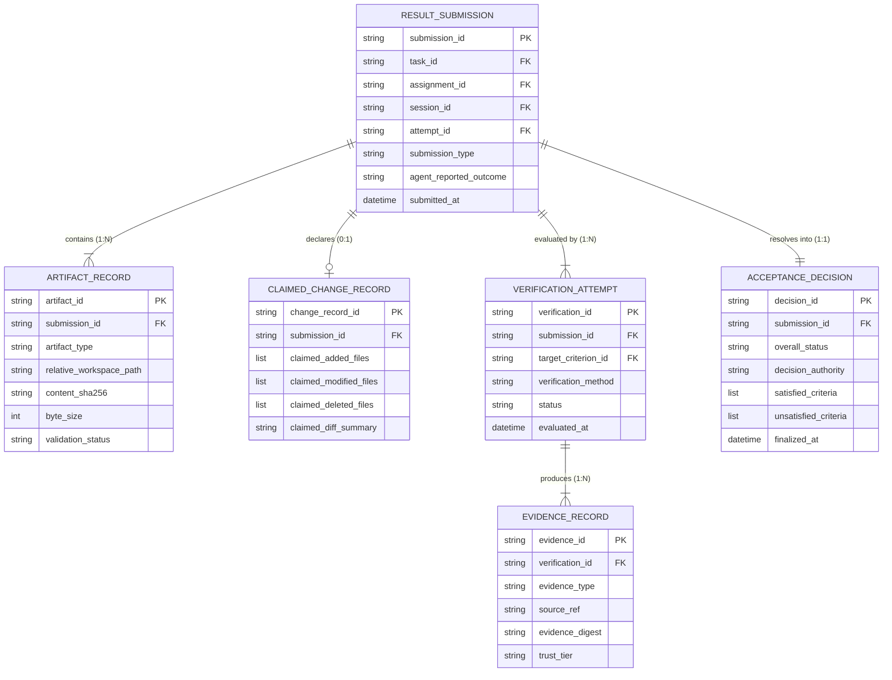

# NexLudic Engine: AI Agent Result Submission & Artifact Domain Model

**Document ID:** `NLE-MOD-AOC-001`  
**Phase:** 7 of 12 (AI Coding-Agent Orchestration)  
**Step:** 59 of 100  
**Classification:** Core Domain Model & Entity Specification  
**Status:** IMPLEMENTATION-READY SPECIFICATION  
**Upstream Dependencies:** `NLE-SPC-AOC-001` (Master Spec), `NLE-MOD-ATO-001` (Step 58 Tool Model), `NLE-MOD-ASL-001` (Step 57 Session Model)  
**Downstream Dependents:** `NLE-POL-API-001` (Provenance Policy), `NLE-CON-AAC-001` (Acceptance Contract)  

---

## 1. Domain Entity Architecture

The Output Verification subsystem models six core entities representing the lifecycle of an agent's completed submission:



---

## 2. Entity Specifications

### 2.1 Result Submission (`NLE-ENT-RSB-001`)
- **Cardinality:** Exactly 1 per completion event emitted by an execution attempt.
- **Mutability:** Strictly Immutable once ingested.
- **Attributes:**
  - `submission_id`: Primary key, UUIDv4 with prefix `rsb-`.
  - `task_id`: Normalized task contract reference (`tsk-...`).
  - `assignment_id`: Active candidate assignment reference (`asg-...`).
  - `session_id`: Parent execution session reference (`exs-...`).
  - `attempt_id`: Execution attempt reference (`exa-...`).
  - `submission_type`: Enum (`FINAL_DELIVERY`, `PARTIAL_CHECKPOINT`, `ABORT_WITH_DIAGNOSTICS`).
  - `agent_reported_outcome`: Natural language statement from the agent.
  - `submitted_at`: ISO 8601 UTC timestamp.

### 2.2 Artifact Record (`NLE-ENT-ART-001`)
- **Cardinality:** 1 to N per Result Submission.
- **Attributes:**
  - `artifact_id`: Primary key, UUIDv4 with prefix `art-`.
  - `submission_id`: Reference to parent `Result Submission`.
  - `artifact_type`: Enum (`MARKDOWN_DOCUMENT`, `RUST_SOURCE`, `PYTHON_SOURCE`, `JSON_SCHEMA`, `TEST_REPORT`, `UNIFIED_DIFF`, `DIAGNOSTIC_LOG`).
  - `relative_workspace_path`: Relative path within staging worktree (e.g. `docs/adapters/NEW_ADAPTER.md`).
  - `content_sha256`: Hexadecimal SHA-256 digest of physical file bytes.
  - `byte_size`: Integer byte count.
  - `validation_status`: Enum (`RECEIVED`, `STRUCTURALLY_VALID`, `VERIFIED_CONFORMANT`, `REJECTED_DEFECTIVE`).

### 2.3 Claimed Change Record (`NLE-ENT-CCR-001`)
- **Cardinality:** 0 to 1 per Result Submission (present for repository tasks).
- **Attributes:**
  - `change_record_id`: Primary key, UUIDv4 with prefix `ccr-`.
  - `submission_id`: Reference to parent submission.
  - `claimed_added_files`: Array of string paths claimed added by agent.
  - `claimed_modified_files`: Array of string paths claimed modified.
  - `claimed_deleted_files`: Array of string paths claimed removed.
  - `claimed_diff_summary`: Agent's narrative explanation of changes.

### 2.4 Verification Attempt (`NLE-ENT-VAT-001`)
- **Cardinality:** 1 to N per Result Submission (evaluated per acceptance criterion).
- **Attributes:**
  - `verification_id`: Primary key, UUIDv4 with prefix `vat-`.
  - `submission_id`: Reference to parent submission.
  - `target_criterion_id`: Specific task acceptance criterion ID (`AC-01`, etc.).
  - `verification_method`: Enum (`SCHEMA_VALIDATION`, `LINTER_EXECUTION`, `UNIT_TEST_EVALUATION`, `DIFF_AUDIT`, `INDEPENDENT_HUMAN_REVIEW`).
  - `status`: Enum (`NOT_EVALUATED`, `PASSED`, `FAILED`, `INCONCLUSIVE_UNCERTAIN`, `BLOCKED`).
  - `evaluated_at`: Timestamp of evaluation.

### 2.5 Evidence Record (`NLE-ENT-EVD-001`)
- **Cardinality:** 1 to N per Verification Attempt.
- **Attributes:**
  - `evidence_id`: Primary key, UUIDv4 with prefix `evd-`.
  - `verification_id`: Reference to parent verification attempt.
  - `evidence_type`: Enum (`DISK_FILE_HASH`, `TEST_RUNNER_XML`, `LINTER_JSON_REPORT`, `GIT_DIFF_SNAPSHOT`, `OPERATOR_REVIEW_TOKEN`).
  - `source_ref`: URI or local filesystem path to evidentiary artifact.
  - `evidence_digest`: SHA-256 cryptographic digest of the raw evidence payload.
  - `trust_tier`: Enum (`INDEPENDENT_KERNEL_EVIDENCE`, `HOST_BROKERED_TOOL_RESULT`, `UNTRUSTED_AGENT_CLAIM`).

### 2.6 Acceptance Decision (`NLE-ENT-ACD-001`)
- **Cardinality:** Exactly 1 per finalized Result Submission.
- **Attributes:**
  - `decision_id`: Primary key, UUIDv4 with prefix `acd-`.
  - `submission_id`: Reference to evaluated submission.
  - `overall_status`: Enum (`ACCEPTED`, `ACCEPTED_WITH_APPROVED_LIMITATIONS`, `NEEDS_REMEDIATION`, `REJECTED`, `BLOCKED_BY_DEPENDENCY`).
  - `decision_authority`: Identity of deciding entity (`PLATFORM_VERIFICATION_ENGINE`, `OPERATOR_ADMIN`).
  - `satisfied_criteria`: Array of criterion IDs confirmed satisfied.
  - `unsatisfied_criteria`: Array of criterion IDs failed or unverified.
  - `decision_rationale`: Detailed markdown explanation.
  - `finalized_at`: Timestamp of decision.

---

## 3. Formal JSON Schema for Result Submission (`NLE-SCH-RSB-001`)

```json
{
  "$schema": "https://json-schema.org/draft/2020-12/schema",
  "$id": "https://schemas.nexludic.com/v1/orchestration/result-submission.json",
  "title": "NexLudicResultSubmission",
  "type": "object",
  "required": [
    "schema_version",
    "submission_id",
    "task_id",
    "assignment_id",
    "session_id",
    "attempt_id",
    "submission_type",
    "artifacts",
    "submitted_at"
  ],
  "properties": {
    "schema_version": { "type": "string", "const": "1.0.0" },
    "submission_id": { "type": "string", "pattern": "^rsb-[0-9a-f]{8}-[0-9a-f]{4}-4[0-9a-f]{3}-[89ab][0-9a-f]{3}-[0-9a-f]{12}$" },
    "task_id": { "type": "string", "pattern": "^tsk-[0-9a-f]{8}-[0-9a-f]{4}-4[0-9a-f]{3}-[89ab][0-9a-f]{3}-[0-9a-f]{12}$" },
    "assignment_id": { "type": "string", "pattern": "^asg-[0-9a-f]{8}-[0-9a-f]{4}-4[0-9a-f]{3}-[89ab][0-9a-f]{3}-[0-9a-f]{12}$" },
    "session_id": { "type": "string", "pattern": "^exs-[0-9a-f]{8}-[0-9a-f]{4}-4[0-9a-f]{3}-[89ab][0-9a-f]{3}-[0-9a-f]{12}$" },
    "attempt_id": { "type": "string", "pattern": "^exa-[0-9a-f]{8}-[0-9a-f]{4}-4[0-9a-f]{3}-[89ab][0-9a-f]{3}-[0-9a-f]{12}$" },
    "submission_type": { "type": "string", "enum": ["FINAL_DELIVERY", "PARTIAL_CHECKPOINT", "ABORT_WITH_DIAGNOSTICS"] },
    "agent_reported_outcome": { "type": "string" },
    "artifacts": {
      "type": "array",
      "items": {
        "type": "object",
        "required": ["artifact_id", "artifact_type", "relative_workspace_path", "content_sha256", "byte_size"],
        "properties": {
          "artifact_id": { "type": "string" },
          "artifact_type": { "type": "string" },
          "relative_workspace_path": { "type": "string" },
          "content_sha256": { "type": "string", "pattern": "^[0-9a-f]{64}$" },
          "byte_size": { "type": "integer", "minimum": 0 }
        }
      }
    },
    "submitted_at": { "type": "string", "format": "date-time" }
  },
  "additionalProperties": false
}
```
