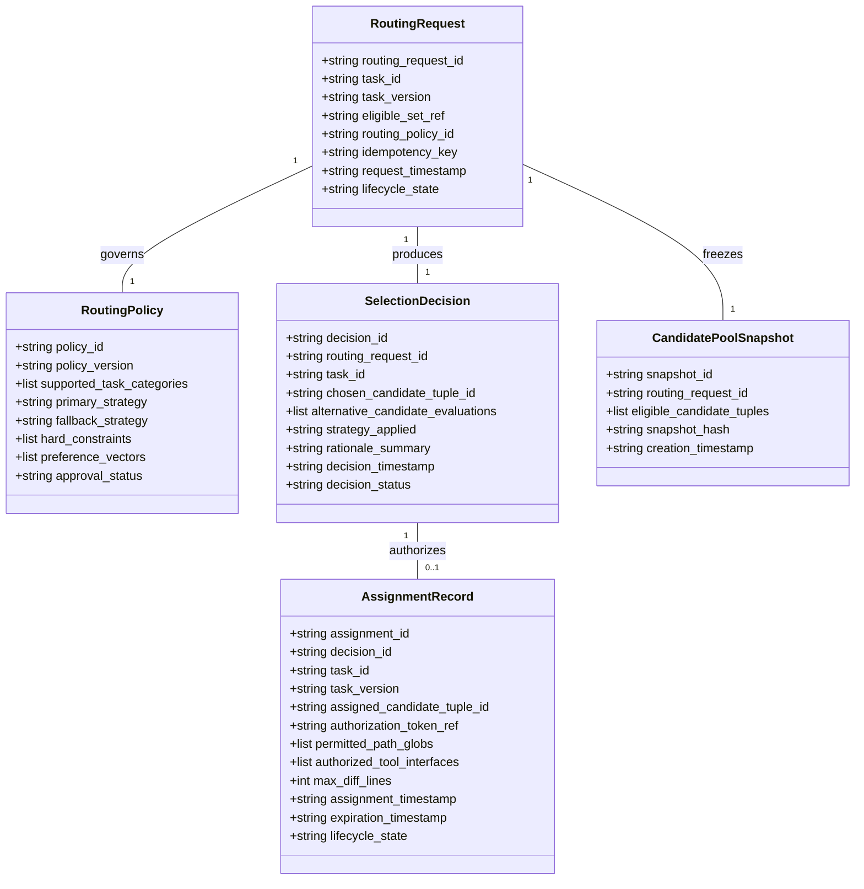

# NexLudic Engine: AI Agent Routing & Assignment Domain Model

**Document ID:** `NLE-MOD-ASR-001`  
**Phase:** 7 of 12 (AI Coding-Agent Orchestration)  
**Step:** 55 of 100  
**Classification:** Conceptual & Logical Domain Model Specification  
**Status:** IMPLEMENTATION-READY SPECIFICATION  

---

## 1. Domain Modeling Philosophy & Entity Decoupling

Candidate selection and task assignment are separate conceptual phases from intake (Step 53) and eligibility matching (Step 54). The orchestration subsystem must not collapse a candidate's selection into an active assignment, nor an assignment into task execution.

NexLudic Engine enforces strict domain decoupling among 5 core entities:



---

## 2. Detailed Entity Specifications

### 2.1 Entity: `RoutingRequest`
Represents a formal request to identify and select an eligible execution destination for an authorized task.
- **`routing_request_id` (string, UUID, Primary Key):** Unique request identifier (e.g., `rrq-9d2e-4b8a-b1f4-8e7c6d5a4b3c`).
- **`task_id` (string, UUID, Foreign Key):** References the normalized task from Step 53 (`NLE-MOD-TIN-001`).
- **`task_version` (string, SemVer):** Exact SemVer of the task descriptor.
- **`eligible_set_ref` (string, Foreign Key):** References the `EligibleCandidateSet` from Step 54 (`NLE-RUL-AEM-001`).
- **`routing_policy_id` (string, Foreign Key):** References the governing `RoutingPolicy`.
- **`idempotency_key` (string, SHA-256):** Deterministic hash computed as $\text{SHA-256}(\text{task\_id} + \text{task\_version} + \text{eligible\_set\_ref} + \text{policy\_id})$.
- **`lifecycle_state` (enum):** `ROUTING_REQUESTED`, `VALIDATING_INPUTS`, `SELECTION_PENDING`, `SELECTION_COMPLETED`, `ROUTING_FAILED`.

### 2.2 Entity: `RoutingPolicy`
Represents an independently versioned governance contract defining how tasks in specific categories are matched to candidates.
- **`policy_id` (string, Primary Key):** Stable policy identifier (e.g., `pol-route-adapter-dev-v1`).
- **`policy_version` (string, SemVer):** Semantic version of the policy.
- **`supported_task_categories` (array of enum):** Step 53 task categories governed by this policy.
- **`primary_strategy` (enum):** Strategy identifier from `NLE-CAT-ASR-001` (e.g., `CAPABILITY_FIT`, `PRIVACY_CONSTRAINED`).
- **`fallback_strategy` (enum):** Strategy applied if primary strategy yields no unique winner.
- **`preference_vectors` (array of string):** Ordered list of comparison vectors (`V_ACCURACY`, `V_LATENCY`, `V_COST`, `V_REVIEW`).
- **`approval_status` (enum):** `APPROVED_FOR_USE`, `PROPOSED_NOT_YET_APPROVED`, `RETIRED`.

### 2.3 Entity: `SelectionDecision`
Records the outcome of comparing eligible candidates under the governing routing policy.
- **`decision_id` (string, UUID, Primary Key):** Unique decision record identifier (e.g., `dec-sel-c7a8b3f1-001`).
- **`routing_request_id` (string, UUID, Foreign Key):** References the initiating `RoutingRequest`.
- **`task_id` (string, UUID):** Task being routed.
- **`chosen_candidate_tuple_id` (string):** The selected candidate tuple $\langle \text{Provider}, \text{Model}, \text{Agent}, \text{Env} \rangle$.
- **`alternative_candidate_evaluations` (array of object):** Evaluations of non-selected eligible candidates with explicit disqualification or lower-ranking rationales.
- **`strategy_applied` (string):** Concrete strategy used to arrive at selection.
- **`rationale_summary` (string):** Human-readable and machine-auditable justification.
- **`decision_status` (enum):** `SELECTED`, `NO_ELIGIBLE_CANDIDATE`, `TIE_REQUIRING_HUMAN_CHOICE`, `BLOCKED_BY_POLICY`.

### 2.4 Entity: `AssignmentRecord`
Represents the formal contract binding a validated task to a selected agent for execution.
- **`assignment_id` (string, UUID, Primary Key):** Globally unique assignment identifier (e.g., `asg-4f8a-9c2e-b1f4-7d6e5a4b3c2d`).
- **`decision_id` (string, UUID, Foreign Key):** References the supporting `SelectionDecision`.
- **`task_id` (string, UUID):** Target task identifier.
- **`task_version` (string, SemVer):** Exact task version at time of assignment.
- **`assigned_candidate_tuple_id` (string):** Fully qualified candidate tuple.
- **`authorization_token_ref` (string):** Cryptographic reference to the verified task authorization token.
- **`permitted_path_globs` (array of string):** Strict filesystem write whitelist.
- **`authorized_tool_interfaces` (array of string):** Exact tool interfaces activated for this assignment.
- **`max_diff_lines` (integer):** Bounded ceiling on code modifications.
- **`expiration_timestamp` (string, ISO 8601 UTC):** Time after which unacknowledged or uncompleted assignments expire.
- **`lifecycle_state` (enum):** Defined in `NLE-SPC-AAL-001`.

---

## 3. Formal JSON Schema Specification

The following JSON Schema (Draft 2020-12) establishes the machine-readable contract for routing and assignment records:

```json
{
  "$schema": "https://json-schema.org/draft/2020-12/schema",
  "$id": "https://schemas.nexludic.internal/orchestration/task-assignment-v1.json",
  "title": "NexLudicTaskAssignmentRecord",
  "type": "object",
  "required": [
    "schema_version",
    "assignment_id",
    "decision_id",
    "task_id",
    "task_version",
    "assigned_candidate",
    "authorization_token_ref",
    "execution_boundaries",
    "lifecycle_state",
    "timestamps"
  ],
  "properties": {
    "schema_version": { "type": "string", "const": "1.0.0" },
    "assignment_id": { "type": "string", "pattern": "^asg-[a-z0-9-]+$" },
    "decision_id": { "type": "string", "pattern": "^dec-sel-[a-z0-9-]+$" },
    "task_id": { "type": "string", "format": "uuid" },
    "task_version": { "type": "string", "pattern": "^[0-9]+\\.[0-9]+\\.[0-9]+$" },
    "assigned_candidate": {
      "type": "object",
      "required": ["provider_id", "model_id", "agent_id", "environment_id"],
      "properties": {
        "provider_id": { "type": "string", "pattern": "^prov-[a-z0-9-]+$" },
        "model_id": { "type": "string", "pattern": "^mod-[a-z0-9-]+$" },
        "agent_id": { "type": "string", "pattern": "^agt-[a-z0-9-]+$" },
        "environment_id": { "type": "string", "pattern": "^env-[a-z0-9-]+$" }
      },
      "additionalProperties": false
    },
    "authorization_token_ref": { "type": "string", "pattern": "^tok-[a-z0-9-]+$" },
    "execution_boundaries": {
      "type": "object",
      "required": ["permitted_path_globs", "authorized_tool_interfaces", "max_diff_lines", "allow_command_execution"],
      "properties": {
        "permitted_path_globs": { "type": "array", "items": { "type": "string" } },
        "authorized_tool_interfaces": { "type": "array", "items": { "type": "string" } },
        "max_diff_lines": { "type": "integer", "minimum": 1, "maximum": 5000 },
        "allow_command_execution": { "type": "boolean" }
      },
      "additionalProperties": false
    },
    "lifecycle_state": {
      "type": "string",
      "enum": [
        "ASSIGNMENT_CREATED",
        "ASSIGNMENT_DISPATCHED",
        "ASSIGNMENT_ACKNOWLEDGED",
        "ASSIGNMENT_DECLINED",
        "ASSIGNMENT_EXPIRED",
        "ASSIGNMENT_CANCELLED",
        "ASSIGNMENT_SUPERSEDED",
        "ASSIGNMENT_FAILED"
      ]
    },
    "timestamps": {
      "type": "object",
      "required": ["created_at", "expires_at"],
      "properties": {
        "created_at": { "type": "string", "format": "date-time" },
        "expires_at": { "type": "string", "format": "date-time" },
        "acknowledged_at": { "type": "string", "format": "date-time" }
      },
      "additionalProperties": false
    }
  },
  "additionalProperties": false
}
```

---

## 4. Security & Isolation Invariants

1. **Zero Credential Transmission (`SEC-ASG-01`):** An `AssignmentRecord` must **never** contain plaintext API keys, passwords, or tokens. Tool execution must authenticate through local OS credential vault references.
2. **Path Whitelist Lockdown (`SEC-ASG-02`):** `permitted_path_globs` in the assignment record must be an exact subset of the whitelisted paths from Step 53's authorized descriptor. Routing cannot expand filesystem permissions.
3. **Immutability of Decision Links (`SEC-ASG-03`):** Once created, an `AssignmentRecord` cannot be edited to point to a different candidate. Any candidate change requires creating a new assignment record referencing a new selection decision.
