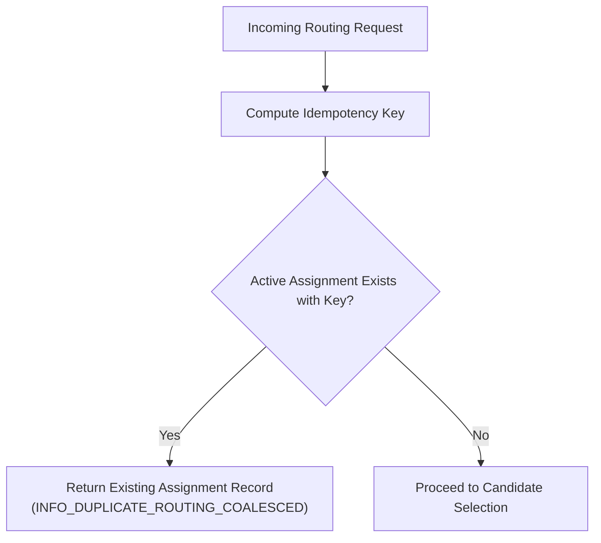
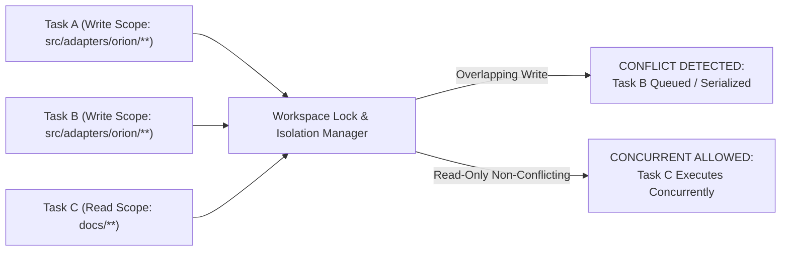

# NexLudic Engine: AI Agent Routing Concurrency, Duplicate & Conflict Control Policy

**Document ID:** `NLE-POL-ACC-001`  
**Phase:** 7 of 12 (AI Coding-Agent Orchestration)  
**Step:** 55 of 100  
**Classification:** Concurrency Control & Conflict Prevention Policy  
**Status:** IMPLEMENTATION-READY SPECIFICATION  

---

## 1. Concurrency Governance & Conflict Prevention

In an agentic engineering platform, multiple tasks and subtasks may be routed concurrently. If two agents are assigned to modify the same source directory simultaneously, race conditions, conflicting git merges, and corrupted code diffs inevitably result.

This policy establishes deterministic controls for:
1. Identifying and coalescing duplicate routing requests;
2. Enforcing assignment uniqueness;
3. Preventing file and workspace modification collisions.

---

## 2. Idempotency & Duplicate Request Detection

To prevent accidental duplicate assignments caused by network retries, UI double-clicks, or automated polling triggers, the router computes a deterministic **Idempotency Key**:

$$\text{IdempotencyKey} = \text{SHA-256}(\text{task\_id} + \text{task\_version} + \text{routing\_policy\_id} + \text{eligible\_set\_ref})$$

### 2.1 Duplicate Coalescing Rules
- If a routing request arrives while an active assignment exists with the identical `IdempotencyKey`, the router creates **no new assignment**.
- It returns the existing `assignment_id` and emits diagnostic `INFO_DUPLICATE_ROUTING_COALESCED`.
- Distinct, legitimate tasks that happen to share similar text descriptions are distinguished by unique `task_id` UUIDs and are never coalesced.

---

## 3. Assignment Uniqueness Invariant (`INV-ASG-UNIQ-01`)

For any given task revision ($\text{task\_id} + \text{task\_version}$), there can be **at most one active assignment** in state `ASSIGNMENT_CREATED`, `ASSIGNMENT_DISPATCHED`, or `ASSIGNMENT_ACKNOWLEDGED`.

If a user or automated supervisor initiates a reassignment:
1. The existing active assignment must transition to `ASSIGNMENT_SUPERSEDED` or `ASSIGNMENT_CANCELLED`.
2. Workspace file locks held by the old assignment are released.
3. Only then can a new `AssignmentRecord` be persisted.

---

## 4. Workspace & Filesystem Conflict Prevention

The routing engine coordinates directly with Step 52 workspace isolation contracts (`ADR-0009`, `NLE-SPC-AMC-001`):

### 4.1 Path Overlap Matrix & Concurrency Rules

| Task Pair Type | Path Overlap Condition | Concurrency Policy | Operational Enforcement |
| :--- | :--- | :---: | :--- |
| **Read-Only + Read-Only** | Any paths (overlapping or disjoint) | **CONCURRENT ALLOWED** | Shared workspace read access permitted simultaneously. |
| **Read-Only + Write** | Paths overlap | **ISOLATED SNAPSHOT** | Read task executes against fixed git commit snapshot; write task operates in isolated branch. |
| **Write + Write** | Paths disjoint ($\text{Path}_A \cap \text{Path}_B = \emptyset$) | **CONCURRENT ALLOWED** | Assigned to separate git worktrees (`workspace: "share"`). |
| **Write + Write** | Paths overlap ($\text{Path}_A \cap \text{Path}_B \neq \emptyset$) | **STRICTLY SERIALIZED** | Second task held in `WAITING_FOR_DEPENDENCY` until first task completes or rolls back. |

### 4.2 Stale-State Abort Rule
If a target source file within a task's `permitted_path_globs` is modified externally (e.g. by developer direct edit) while routing is underway:
- The pre-assignment authorization check detects a hash mismatch;
- The routing transaction is immediately aborted with `ERR_CONCURRENT_WORKSPACE_MODIFICATION`;
- The task is returned to Step 53 for re-normalization.
