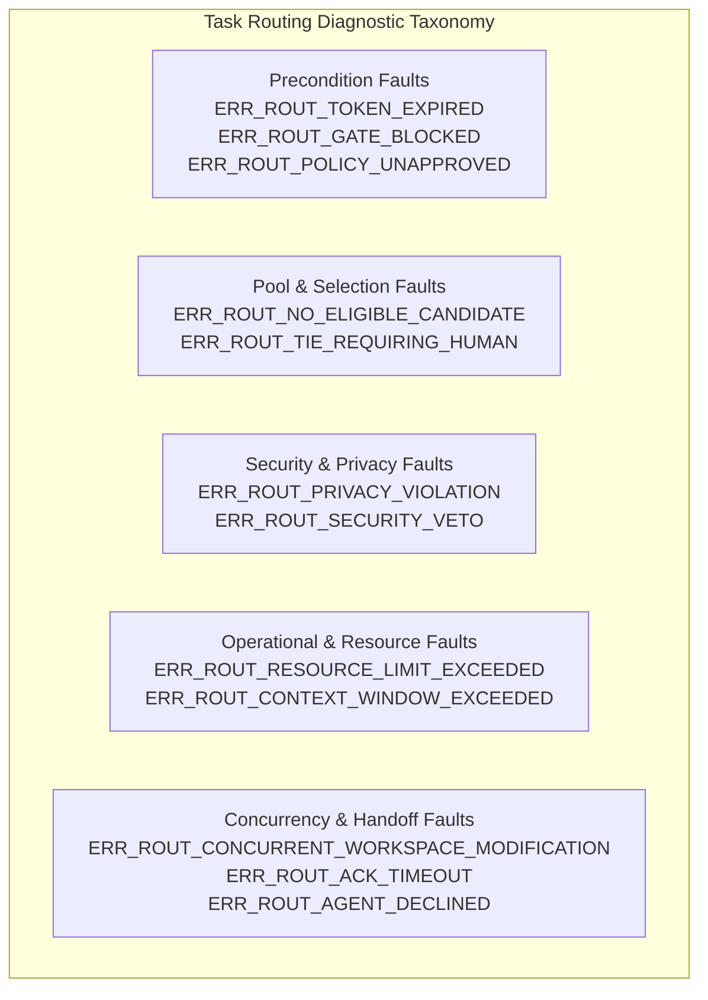

# NexLudic Engine: AI Agent Routing Diagnostic, Audit & Explainability Contract

**Document ID:** `NLE-CON-ARD-001`  
**Phase:** 7 of 12 (AI Coding-Agent Orchestration)  
**Step:** 55 of 100  
**Classification:** Diagnostic Schema & Audit Contract  
**Status:** IMPLEMENTATION-READY SPECIFICATION  

---

## 1. Explainability & Audit Mandate

In autonomous software engineering, routing and assignment decisions must never be opaque "black box" outcomes. When an engineering task is assigned to an agent—or when routing fails—developers and auditors must be able to inspect the exact causal chain: which candidates were evaluated, which policy governed the selection, why the winner was chosen, and what trade-offs were made.

This contract defines the standardized diagnostic error taxonomy, the machine-readable explainability schema, and privacy-preserving audit logging rules.

---

## 2. Standardized Routing Error Taxonomy



| Diagnostic Error Code | Severity | Description | Operational Remediation |
| :--- | :---: | :--- | :--- |
| **`ERR_ROUT_NO_ELIGIBLE_CANDIDATE`** | High | Candidate pool contains zero tuples satisfying all hard predicates. | Register new agents or decompose task into smaller subtasks. |
| **`ERR_ROUT_TOKEN_EXPIRED`** | High | Task authorization token TTL expired before assignment creation. | Re-normalize and re-authorize task in Step 53. |
| **`ERR_ROUT_GATE_BLOCKED`** | Critical | Task depends on an unverified roadmap gate (e.g. Step 51 Phase 6). | Complete and record formal upstream phase review. |
| **`ERR_ROUT_PRIVACY_VIOLATION`** | Critical | Task sensitivity requires local air-gap; candidate is public cloud. | Select a local on-device inference provider. |
| **`ERR_ROUT_SECURITY_VETO`** | Critical | Task or candidate attempted prohibited memory hooks or UAC bypass. | Modify task scope; remove prohibited operations. |
| **`ERR_ROUT_RESOURCE_LIMIT_EXCEEDED`**| Medium | Provider concurrency ceiling or host VRAM limit reached. | Task queued in `WAITING_FOR_RESOURCE` for automatic retry. |
| **`ERR_ROUT_CONTEXT_WINDOW_EXCEEDED`** | High | Prepared task context exceeds candidate's verified context window. | Prune non-essential context or select larger-context model. |
| **`ERR_ROUT_CONCURRENT_WORKSPACE_MODIFICATION`** | High | Target files modified concurrently during routing. | Re-evaluate task against latest workspace commit. |
| **`ERR_ROUT_ACK_TIMEOUT`** | Medium | Selected agent failed to acknowledge assignment within 60s. | Reassign to secondary fallback candidate. |
| **`ERR_ROUT_AGENT_DECLINED`** | Medium | Agent explicitly refused assignment due to local resource limits. | Reassign to secondary fallback candidate. |
| **`ERR_ROUT_TIE_REQUIRING_HUMAN`** | Low | Multiple candidates tied across all preference vectors. | Present candidate selection dialog in desktop UI. |

---

## 3. Formal Machine-Readable Routing Decision Schema

The routing decision output conforms to JSON Schema Draft 2020-12 (`NLE-SCH-ARD-001`):

```json
{
  "diagnostic_report_id": "diag-rout-c7a8b3f1-20261119-001",
  "task_id": "c7a8b3f1-9d2e-4b8a-b1f4-8e7c6d5a4b3c",
  "task_version": "1.0.0",
  "timestamp": "2026-11-19T15:28:45Z",
  "routing_outcome": "SELECTION_COMPLETED",
  "selected_candidate_tuple": {
    "provider_id": "prov-anthropic-direct",
    "model_id": "mod-claude-3-7-sonnet",
    "agent_id": "agt-adapter-scaffold-v1",
    "environment_id": "env-desktop-medium-il"
  },
  "applied_strategy": "CAPABILITY_FIT_ROUTING",
  "preference_evaluation": {
    "evaluated_vectors": ["V_ACCURACY", "V_REVIEW", "V_LATENCY", "V_COST"],
    "vector_scores": {
      "chosen": { "V_ACCURACY": 0.98, "V_REVIEW": 0.92, "V_LATENCY": 18.5, "V_COST": 0.015 },
      "runner_up": { "V_ACCURACY": 0.84, "V_REVIEW": 0.88, "V_LATENCY": 45.2, "V_COST": 0.000 }
    },
    "selection_justification": "Candidate prov-anthropic-direct demonstrated superior empirical accuracy on wire serialization conformance benchmarks (0.98 vs 0.84)."
  },
  "pre_assignment_recheck_status": "PASSED",
  "audit_trail_ref": "audit/orchestration/20261119/rrq-c7a8b3f1.jsonl"
}
```

---

## 4. Privacy-Preserving Audit Logging

1. **Structured JSONL Audit Records:** Every routing request, selection decision, assignment handoff, and acknowledgement event is logged in append-only JSONL format (`audit/orchestration/<date>/`).
2. **Zero Sensitive Context Retention:** Audit logs record:
   - Request IDs, task IDs, candidate tuple IDs, timestamps;
   - Cryptographic SHA-256 hashes of context envelopes and diff ceilings;
   - **Zero plaintext API keys, passwords, or raw user file contents.**
3. **90-Day Retention & Integrity:** Audit logs must be retained for at least 90 days to support compliance audits and regression tracking.
