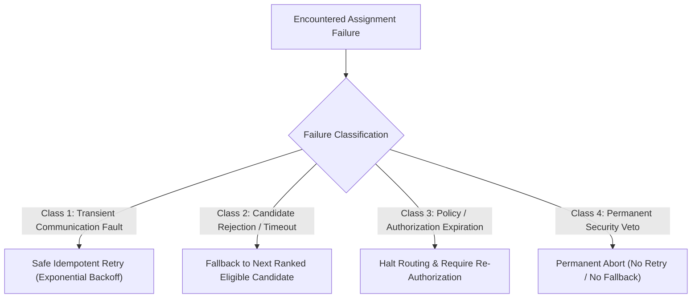
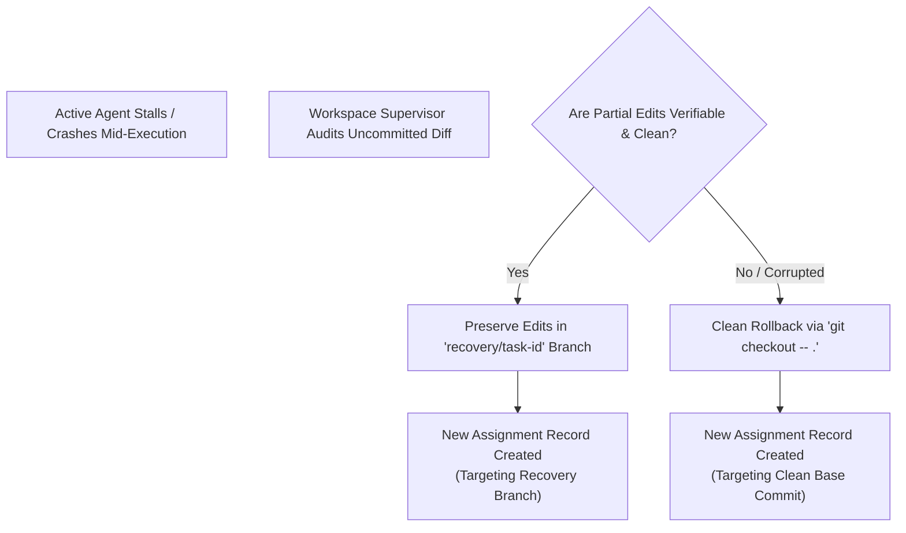

# NexLudic Engine: AI Agent Routing Fallback, Retry & Reassignment Policy

**Document ID:** `NLE-POL-AFR-002`  
**Phase:** 7 of 12 (AI Coding-Agent Orchestration)  
**Step:** 55 of 100  
**Classification:** Operational Resilience, Retry & Reassignment Policy  
**Status:** IMPLEMENTATION-READY SPECIFICATION  

---

## 1. Resilience & Recovery Philosophy

In agentic orchestration, assignments may fail due to transient network interruptions, rate-limit throttling, agent crashes, or explicit task rejection.

This policy specifies deterministic rules for **retrying failed handoffs**, **selecting secondary fallback candidates**, and **reassigning tasks with partial work** without violating security boundaries, losing developer work, or duplicating active assignments.

---

## 2. Failure Classification & Recovery Action Matrix

Failures encountered during routing, dispatch, or acknowledgement are categorized into 4 operational classes:

| Failure Type | Root Cause | Routing State | Permitted Recovery Action | Max Budget |
| :--- | :--- | :--- | :--- | :---: |
| **`FLR-ROUT-01` (Rate Limited)** | Provider endpoint returns HTTP 429 | `SELECTION_PENDING` | Retry same candidate with exponential backoff | 3 attempts |
| **`FLR-ROUT-02` (Endpoint Timeout)** | Network socket dropped during dispatch | `ASSIGNMENT_DISPATCHED` | Probe endpoint status; retry if unacknowledged | 2 attempts |
| **`FLR-ROUT-03` (Candidate Declined)** | Agent harness declined task payload | `ASSIGNMENT_DECLINED` | **Fallback to next ranked eligible candidate** | Depth: 3 |
| **`FLR-ROUT-04` (Ack Deadline Expired)** | Agent failed to acknowledge in 60s | `ASSIGNMENT_EXPIRED` | Cancel stale assignment; fallback to next candidate| Depth: 3 |
| **`FLR-ROUT-05` (Token Expired)** | 4-hour task authorization token elapsed | `ASSIGNMENT_AUTHORIZATION_PENDING` | Re-evaluation halted; request human re-authorization | 0 (Manual) |
| **`FLR-ROUT-06` (Security Veto)** | Prohibited memory hook or anti-cheat violation | `ROUTING_FAILED` | Permanent abort; task rejected | 0 (Permanent) |

---

## 3. Fallback Candidate Selection Rules

When a primary candidate declines or times out, the router may evaluate a **Fallback Candidate** under strict governance:

### 3.1 Non-Negotiable Fallback Invariants
1. **Full Eligibility Re-Assertion (`INV-FLB-01`):** The fallback candidate must independently satisfy **100% of the 9 hard eligibility predicates** (`NLE-RUL-AEM-001`).
2. **Zero-Weakening Rule (`INV-FLB-02`):** A fallback candidate can **never** be selected by weakening task acceptance criteria, broadening permissions, bypassing anti-cheat rules, or relaxing data residency constraints.
3. **Traceable Decision Record (`INV-FLB-03`):** The fallback selection creates a new, distinct `SelectionDecision` that explicitly cites the failure of the primary candidate and records the rationale for the fallback choice.

If all candidates in the eligible candidate pool fail or decline, the router halts and transitions the task to **`NO_ELIGIBLE_CANDIDATE`**.

---

## 4. Reassignment & Handling Partial Work

If an agent crashes, stalls, or is cancelled *after* execution has begun and partial modifications have been written to the workspace:

### 4.1 Partial Work Preservation Rules
1. **Audit Uncommitted Changes:** The workspace supervisor runs `git status` and `git diff` to inspect partial edits left in the isolated workspace.
2. **Preserve or Rollback:**
   - If partial edits represent well-formed, compiling progress, they are committed to an ephemeral recovery branch (`recovery/<task-id>-partial`).
   - If partial edits contain syntax corruption or invalid ASTs, the workspace is cleanly reset via `git checkout -- .`.
3. **Reassignment Handoff:**
   - The original assignment is transitioned to `ASSIGNMENT_SUPERSEDED`.
   - The new candidate receives an updated handoff contract explicitly noting the partial progress branch or clean baseline.
   - Two agents are **never** permitted to hold concurrent write access to the same workspace.

---

## 5. Retry Budgets & Exponential Backoff Specification

> **NOTICE: PROPOSED DEFAULT PARAMETERS**  
> The following numerical thresholds represent approved baseline defaults for Phase 7 orchestration:

- **Initial Backoff Delay ($T_{\text{base}}$):** 2.0 seconds.
- **Backoff Multiplier ($M$):** 2.0 with randomized jitter ($\pm 20\%$).
- **Maximum Backoff Ceiling ($T_{\text{max}}$):** 30.0 seconds.
- **Maximum Consecutive Retries ($N_{\text{max}}$):** 3 attempts per candidate.
- **Maximum Fallback Pool Depth ($D_{\text{max}}$):** 3 candidate tuples per task.
