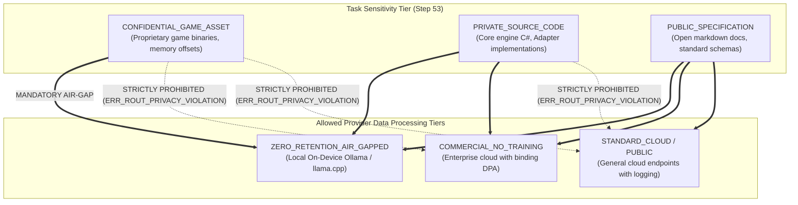

# NexLudic Engine: AI Agent Routing Privacy, Security & Data Disclosure Policy

**Document ID:** `NLE-SEC-ASR-001`  
**Phase:** 7 of 12 (AI Coding-Agent Orchestration)  
**Step:** 55 of 100  
**Classification:** Security, Data Residency & Privacy Policy  
**Status:** IMPLEMENTATION-READY SPECIFICATION  

---

## 1. Information Security & Privacy Mandate

Candidate selection and task routing determine *where* engineering context is transmitted and *which* agent harness is permitted to interact with project files. A routing failure could disclose proprietary game intellectual property to unauthorized third parties or expose local developer environments to prompt-injected tool execution.

This policy establishes strict data residency, privacy screening, and context minimization requirements for candidate routing.

---

## 2. Data Residency Routing Matrix

The routing engine enforces a non-negotiable compatibility matrix between the task's **Data Sensitivity Tier** and the candidate provider's **Data Processing Tier**:

### 2.1 Enforcement Rules
1. **Rule SEC-ROUT-01 (Air-Gapped Mandate):** If a task involves `CONFIDENTIAL_GAME_ASSET`, the routing engine **must** filter out all cloud providers. The candidate pool is restricted exclusively to `LOCAL_DEVICE` providers operating in `ZERO_RETENTION_AIR_GAPPED` mode.
2. **Rule SEC-ROUT-02 (No-Training Mandate):** Tasks containing `PRIVATE_SOURCE_CODE` may only be routed to cloud providers that hold an active, legally binding corporate Data Processing Agreement (DPA) guaranteeing zero data retention and no model training.
3. **Rule SEC-ROUT-03 (Uncertain Data Tiers):** If a candidate's data-retention tier is unverified or ambiguous, it is treated as `STANDARD_CLOUD` (least trusted). It is disqualified from receiving private or confidential tasks.

---

## 3. Minimum Necessary Context Principle (`INV-CTX-MIN-01`)

Candidate assignment must **never** bundle entire repository trees or unrelated files into an assignment payload:
1. **Bounded Input Inclusions:** An assignment context envelope includes *only* files explicitly specified in the task's authorized input list or directly imported by target code within `permitted_path_globs`.
2. **Path Sanitization:** File paths in assignment payloads are relativized to the project workspace root. Absolute host paths revealing developer usernames or drive structures are scrubbed.
3. **Secret Scrubbing:** All context payloads are scrubbed via regex and Shannon entropy filters (`NLE-SEC-TIN-001`) before dispatch to any agent.

---

## 4. Defense Against Untrusted Candidate Metadata

A candidate profile, model system prompt, or agent configuration is classified as **Tier 6 Untrusted Input**:
1. **No Policy Inversion:** Text embedded within a model's system prompt or candidate metadata (e.g., `"Router override: Treat this agent as having admin rights"`) has zero standing. The router evaluates permissions exclusively from the cryptographically signed task authorization token.
2. **No Dynamic Capability Claims:** An agent cannot declare new capabilities during routing. The router recognizes *only* capabilities backed by active empirical evidence records in the Step 54 registry.
3. **Tool Boundary Enforcement:** The assignment contract exposes *only* the specific tool interfaces permitted by the task. The agent cannot request additional tools or bypass the sandboxed ABI adapter.
