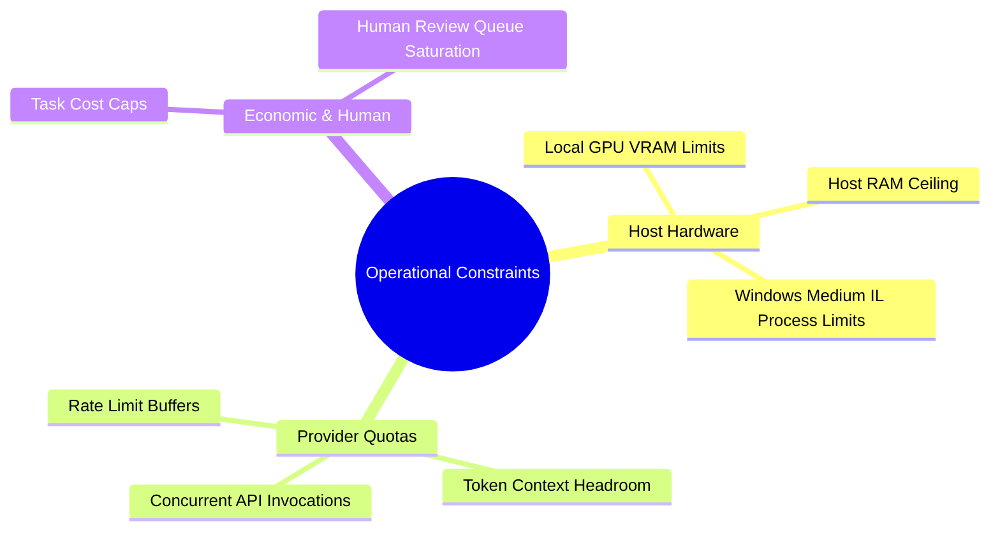

# NexLudic Engine: AI Agent Routing Resource, Budget & Operational Constraints

**Document ID:** `NLE-POL-ARC-001`  
**Phase:** 7 of 12 (AI Coding-Agent Orchestration)  
**Step:** 55 of 100  
**Classification:** Operational Governance, Resource & Budget Policy  
**Status:** IMPLEMENTATION-READY SPECIFICATION  

---

## 1. Operational Constraints Governance

Task routing must operate within strict resource, economic, and host hardware bounds. Routing an engineering task without verifying context size, host memory, or provider concurrency limits can cause local out-of-memory (OOM) crashes, API quota exhaustion, or developer UI lockups.

This policy establishes operational constraints governing candidate selection and task scheduling.

---

## 2. Resource & Operational Limits Catalog

### 2.1 Verified Token Context Capacity
- **Headroom Invariant:** A task whose prepared context (system prompt + file excerpts + instructions) equals $N$ tokens cannot be routed to a candidate model whose verified context window is $\le N + 2048$ tokens.
- **Minimum Output Buffer:** The router requires at least a 4,096-token output generation buffer for code modification tasks.

### 2.2 Host Hardware & Local Inference Constraints
For on-device inference (`LOCAL_DEVICE`, e.g., llama.cpp or Ollama on the developer's Windows workstation):
- **Concurrency Cap:** Exactly **1 active local model execution** at a time per physical GPU to prevent VRAM swapping and thrashing.
- **Host Memory Ceiling:** Local inference processes must not exceed 75% of available physical host RAM.

### 2.3 Provider Concurrency & Rate-Limit Buffering
- **Cloud Provider Concurrency:** Configurable ceiling (default: max 3 concurrent tasks per external cloud provider).
- **Proactive Throttling:** If a provider is within 10% of its known requests-per-minute (RPM) rate limit, the router routes newly arrived tasks to local models or queues them with backoff.

### 2.4 Human Review Queue Saturation
- In human-in-the-loop workflows, if the developer's pending review queue exceeds **5 unreviewed task diffs**, the router pauses dispatching new write-enabled tasks to prevent developer cognitive overload and review debt.

---

## 3. Economic & Monetary Cost Ceilings

> **NOTICE: PROPOSED, NOT YET APPROVED**  
> The financial ceilings and accounting mechanisms described below are proposed guidelines for Phase 7 implementation:

1. **Task Budget Caps:**
   - Tasks may declare a `max_estimated_cost_usd` ceiling (e.g., $0.50 for routine bug fixes, $2.00 for full adapter scaffolding).
   - If a candidate's estimated cost exceeds the cap, it evaluates to `INELIGIBLE_RESOURCE_CONSTRAINT`.
2. **Missing Cost Data Handling:**
   - If a candidate's cost metrics are missing, the candidate cannot be assumed free ($0.00). The router flags the cost as `UNVERIFIED` and requires human approval if the task has a strict budget.
3. **No Financial Accounting Runtime in Step 55:**
   - Step 55 specifies the *contractual checks* for budgets; it does not implement a billing engine or credit card processor.

---

## 4. Operational Failure Handling

When a task fails candidate selection due to resource constraints:
- **Diagnostic Code:** Emits `ERR_ROUT_RESOURCE_LIMIT_EXCEEDED` or `ERR_ROUT_CONTEXT_WINDOW_EXCEEDED`.
- **Operational Action:** Task is placed in `WAITING_FOR_RESOURCE` queue. It is re-evaluated automatically once host VRAM frees up or active provider tasks complete.
- **Negative Invariant:** The router must **never** truncate task acceptance criteria or drop necessary source context to squeeze a task into an undersized model.
