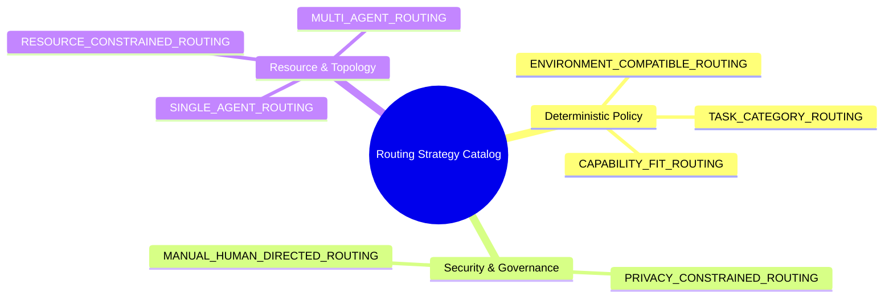
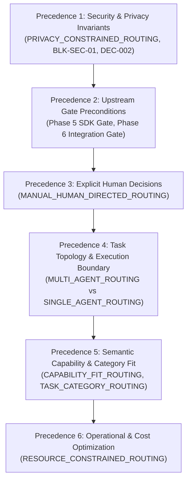

# NexLudic Engine: AI Agent Routing Strategy Catalog & Policy Rules

**Document ID:** `NLE-CAT-ASR-001`  
**Phase:** 7 of 12 (AI Coding-Agent Orchestration)  
**Step:** 55 of 100  
**Classification:** Strategy Catalog & Governance Policy  
**Status:** IMPLEMENTATION-READY SPECIFICATION  

---

## 1. Strategy Catalog Overview

NexLudic Engine provides a structured catalog of 8 provider-neutral routing strategies. These strategies govern how the orchestration engine evaluates and selects among eligible candidate tuples.

---

## 2. Catalog of 8 Routing Strategies

### 2.1 Strategy: `CAPABILITY_FIT_ROUTING`
- **Objective:** Selects the candidate whose verified capabilities provide the highest semantic overlap with the task's required and optional capabilities.
- **Mechanism:** Evaluates optional capability coverage (`optional_capabilities` from `NLE-SPC-TCR-001`) after mandatory capabilities have passed.
- **Applicability:** General coding, refactoring, and complex adapter development tasks.

### 2.2 Strategy: `TASK_CATEGORY_ROUTING`
- **Objective:** Routes tasks to candidate agents specifically trained, prompted, or scaffolded for the designated task category.
- **Mechanism:** Evaluates `supported_task_categories` in `AgentImplementation`. For example, a task categorized as `DOCUMENTATION_AUTHORING` prioritizes `agt-doc-author-v2` over a generalist coding agent.
- **Applicability:** Specialized documentation, defect investigation, and architecture reviews.

### 2.3 Strategy: `ENVIRONMENT_COMPATIBLE_ROUTING`
- **Objective:** Selects the candidate operating in the most appropriate execution boundary for the task's tool requirements.
- **Mechanism:** Matches tool dependencies to host binaries and workspace isolation models (`LOCAL_PROCESS_MEDIUM_IL` vs `CONTAINER_SANDBOX`).
- **Applicability:** Verification execution tasks requiring specific compilers or CLI toolchains.

### 2.4 Strategy: `PRIVACY_CONSTRAINED_ROUTING`
- **Objective:** Restricts candidate selection strictly based on data sensitivity and provider data-retention agreements.
- **Mechanism:** Mandatory air-gapped filtering. If a task contains `CONFIDENTIAL_GAME_ASSET`, this strategy eliminates all cloud providers and routes exclusively to local on-device models (`ZERO_RETENTION_AIR_GAPPED`).
- **Applicability:** Proprietary game modding, closed-source game analysis, sensitive adapter development.

### 2.5 Strategy: `RESOURCE_CONSTRAINED_ROUTING`
- **Objective:** Selects candidates that fit within strict operational budgets, token ceilings, or latency constraints.
- **Mechanism:** Evaluates candidate token velocity, cost per 1k tokens, and queue saturation.
- **Applicability:** High-volume automated diagnostic runs, repetitive test generation, background maintenance.

### 2.6 Strategy: `SINGLE_AGENT_ROUTING`
- **Objective:** Assigns an entire coherent task to a single eligible agent without subtask decomposition.
- **Mechanism:** Ensures single-turn or multi-turn conversational consistency within one isolated workspace.
- **Applicability:** Self-contained bug fixes, localized documentation updates, single-file adapter patches.

### 2.7 Strategy: `MULTI_AGENT_ROUTING`
- **Objective:** Routes decomposed, independent subtasks across multiple specialized agents.
- **Mechanism:** Enforces Step 52 multi-agent coordination contracts (`NLE-SPC-AMC-001`). Requires completely disjoint path whitelists or strict dependency ordering (e.g., Coder Agent $\rightarrow$ Verifier Agent).
- **Applicability:** Large-scale adapter scaffolding (documentation agent + serialization agent + integration test agent).

### 2.8 Strategy: `MANUAL_HUMAN_DIRECTED_ROUTING`
- **Objective:** Defers final candidate selection to the human developer in the desktop UI.
- **Mechanism:** Presents confirmed `ELIGIBLE` candidate tuples with their multi-dimensional preference vectors to the user. The system records the user's explicit selection.
- **Applicability:** Ambiguous candidate ties, high-risk architectural tasks, or when automated routing is disabled.

---

## 3. Strategy Precedence & Hierarchy

When multiple routing strategies are applicable to a task, they are governed by a strict **Non-Negotiable Precedence Hierarchy**:

> **NON-NEGOTIABLE PRECEDENCE AXIOM:**  
> Operational and cost optimizations (Precedence 6) can **never** override semantic capability fit (Precedence 5), human directives (Precedence 3), upstream gates (Precedence 2), or security/privacy invariants (Precedence 1).

---

## 4. Task-Category Applicability Matrix

| Task Category | Default Primary Strategy | Default Fallback Strategy | Multi-Agent Permitted? |
| :--- | :--- | :--- | :---: |
| **`DOCUMENTATION_AUTHORING`** | `TASK_CATEGORY_ROUTING` | `RESOURCE_CONSTRAINED_ROUTING` | No (Single agent) |
| **`SPECIFICATION_ANALYSIS`** | `CAPABILITY_FIT_ROUTING` | `MANUAL_HUMAN_DIRECTED_ROUTING`| Yes (Reviewer pair) |
| **`ARCHITECTURE_REVIEW`** | `MANUAL_HUMAN_DIRECTED_ROUTING` | `CAPABILITY_FIT_ROUTING` | Yes (Dual review) |
| **`TEST_CASE_DESIGN`** | `TASK_CATEGORY_ROUTING` | `CAPABILITY_FIT_ROUTING` | No |
| **`TEST_AUTHORING`** | `CAPABILITY_FIT_ROUTING` | `ENVIRONMENT_COMPATIBLE_ROUTING`| No |
| **`CODE_MODIFICATION`** | `CAPABILITY_FIT_ROUTING` | `MANUAL_HUMAN_DIRECTED_ROUTING`| Yes (Coder + Verifier) |
| **`DEFECT_INVESTIGATION`** | `TASK_CATEGORY_ROUTING` | `CAPABILITY_FIT_ROUTING` | No |
| **`ADAPTER_DEVELOPMENT`** | `CAPABILITY_FIT_ROUTING` | `PRIVACY_CONSTRAINED_ROUTING` | Yes (Decomposed subtasks)|
| **`DEPENDENCY_ANALYSIS`** | `TASK_CATEGORY_ROUTING` | `RESOURCE_CONSTRAINED_ROUTING` | No |
| **`VERIFICATION_EXECUTION`**| `ENVIRONMENT_COMPATIBLE_ROUTING`| `MANUAL_HUMAN_DIRECTED_ROUTING`| No (Independent Verifier)|

---

## 5. Policy Versioning & Governance Lifecycle

1. **Versioned Policy Contracts:** Every routing policy is versioned using Semantic Versioning (`MAJOR.MINOR.PATCH`).
2. **Approval Gateway:** New routing policies or updates to existing strategy precedence must be marked `PROPOSED_NOT_YET_APPROVED` until reviewed and digitally approved by a human system architect.
3. **Immutability of Applied Policies:** Once a `SelectionDecision` is executed, the policy version that governed it is immutably linked in the decision record. Policy revisions cannot rewrite past routing rationales.
