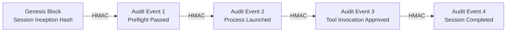

# NexLudic Engine: AI Agent Runtime Audit Event & Diagnostic Contract

**Document ID:** `NLE-CON-AAD-001`  
**Phase:** 7 of 12 (AI Coding-Agent Orchestration)  
**Step:** 57 of 100  
**Classification:** Audit Logging & Diagnostic Specification  
**Status:** IMPLEMENTATION-READY SPECIFICATION  
**Upstream Dependencies:** `NLE-MOD-ASL-001` (Domain Model), `NLE-CON-AEV-001` (Event Contract)  
**Downstream Dependents:** `NLE-CAT-AES-001` (Synthetic Scenarios), Step 59 (Human Review UI)  

---

## 1. Audit Logging Architecture & Immutability

NexLudic Engine enforces comprehensive, tamper-evident audit logging for all AI coding agent execution sessions. Every lifecycle mutation, tool invocation, security check, and watchdog alert is recorded locally in an append-only JSON Lines ledger.

### Cryptographic Chaining
Every audit log entry contains a cryptographic hash binding it to the preceding entry:
$$\text{entry\_hash}_n = \text{HMAC-SHA256}(\text{entry\_hash}_{n-1} \parallel \text{payload}_n)$$
This ensures that any retroactive modification, deletion, or reordering of audit events is immediately detected during verification.



---

## 2. Audit Event Schema (`NLE-SCH-AUD-001`)

```json
{
  "$schema": "https://json-schema.org/draft/2020-12/schema",
  "$id": "https://schemas.nexludic.com/v1/orchestration/session-audit-event.json",
  "title": "NexLudicSessionAuditEvent",
  "type": "object",
  "required": [
    "audit_record_id",
    "session_id",
    "sequence_id",
    "timestamp",
    "actor_tier",
    "action_type",
    "event_data",
    "prev_hash",
    "record_hash"
  ],
  "properties": {
    "audit_record_id": { "type": "string", "pattern": "^aud-[0-9a-f]{8}-[0-9a-f]{4}-4[0-9a-f]{3}-[89ab][0-9a-f]{3}-[0-9a-f]{12}$" },
    "session_id": { "type": "string" },
    "sequence_id": { "type": "integer", "minimum": 1 },
    "timestamp": { "type": "string", "format": "date-time" },
    "actor_tier": { "type": "string", "enum": ["SUPERVISOR_CORE", "AGENT_WORKER", "OPERATOR", "OS_KERNEL"] },
    "action_type": { "type": "string" },
    "event_data": { "type": "object" },
    "prev_hash": { "type": "string", "pattern": "^[0-9a-f]{64}$" },
    "record_hash": { "type": "string", "pattern": "^[0-9a-f]{64}$" }
  }
}
```

---

## 3. Diagnostic Bundle Specification

Upon session finalization (whether success, failure, timeout, or cancellation), the supervisor packages a complete **Diagnostic Bundle** at:
`.nexludic/diagnostics/sessions/diag_<session_id>.zip`

### Diagnostic Bundle Contents:
1. `audit_ledger.jsonl`: Complete, cryptographically chained audit events.
2. `preflight_decision.json`: The 8-stage preflight evaluation record (`NLE-SCH-PDR-001`).
3. `session_manifest.json`: Snapshot of the active `Execution Session` and `Runtime Environment`.
4. `supervisor.log`: Host supervisor diagnostic messages and watchdog telemetry.
5. `agent_stdout.log`: Standard output emitted by the agent process (scrubbed of secrets).
6. `agent_stderr.log`: Standard error emitted by the agent process.
7. `partial_diff.patch`: Snapshot of all Git modifications made in the worktree.
8. `cleanup_record.json`: Verified resource deallocation evidence (`NLE-ENT-CLR-001`).

### Data Retention & Privacy
- Diagnostic bundles are stored exclusively on local disk (`%LOCALAPPDATA%\NexLudic\diagnostics\`).
- Bundles are retained for **30 days** before automatic pruning.
- Zero diagnostic data or telemetry is transmitted to external servers without explicit, interactive user consent.
