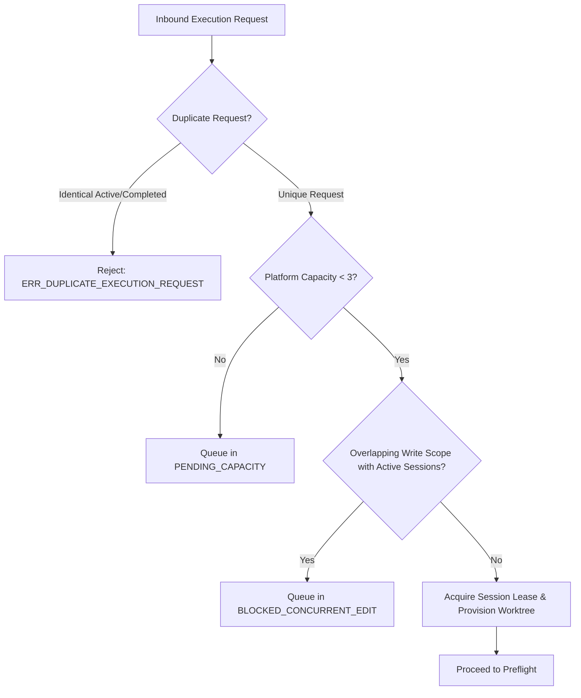

# NexLudic Engine: AI Agent Runtime Concurrency, Duplicate Execution & Recovery Policy

**Document ID:** `NLE-POL-ADC-001`  
**Phase:** 7 of 12 (AI Coding-Agent Orchestration)  
**Step:** 57 of 100  
**Classification:** Concurrency & Fault Recovery Policy  
**Status:** IMPLEMENTATION-READY SPECIFICATION  
**Upstream Dependencies:** `NLE-MOD-ASL-001` (Domain Model), `NLE-SPC-ASM-001` (State Machine)  
**Downstream Dependents:** `NLE-CAT-AES-001` (Synthetic Scenarios), Step 58 (Artifact Verification)  

---

## 1. Concurrency Architecture & Anti-Collision Policy

In a desktop gaming engine environment, running multiple AI agents concurrently can create catastrophic resource starvation, Git branch collisions, and conflicting file overwrites.

NexLudic Engine enforces strict concurrency, mutual exclusion, and deduplication controls:
1. **Global Concurrency Ceiling:** Maximum of **3 concurrent execution sessions** platform-wide.
2. **Mutual Exclusion per Task:** Exactly one active execution session per `task_id` is permitted at any instant.
3. **Disjoint Workspaces:** Every active session is isolated into its own independent Git worktree and filesystem path.
4. **File-Level Overlap Detection:** If two concurrent tasks claim write access to overlapping file paths, the second task is queued in `BLOCKED_CONCURRENT_EDIT` until the first completes.

---

## 2. Duplicate Execution Prevention & Deduplication Keys

To prevent redundant execution caused by accidental double-clicks or automated re-triggers:
- **Deduplication Key Formulation:**  
  `dedup_key = SHA256(task_id + ":" + assignment_id + ":" + handoff_package_digest)`
- **Evaluation Rules:**
  1. If an active session exists with the identical `dedup_key`: the new request is rejected with `ERR_DUPLICATE_SESSION_ACTIVE`.
  2. If a previously completed session exists with the identical `dedup_key` and its outputs have not been invalidated: the request is rejected with `ERR_EXECUTION_ALREADY_COMPLETED`, returning a pointer to the existing completion record.
  3. Re-execution requires the task to be explicitly re-intaken and re-authorized with a new `task_id` or bumped task version.

---

## 3. Failure Classification & Recovery Boundaries

Failures during execution are strictly classified into two categories:

| Failure Category | Classification | Examples | Permitted Recovery Action |
| :--- | :--- | :--- | :--- |
| **Transient / Retryable** | Retryable within Session | Remote AI provider 503 HTTP glitch; transient file lock on compiler cache; transient socket timeout. | Up to 2 automatic retries (incrementing `attempt_number`), preserving session lease. |
| **Deterministic / Terminal** | Non-Retryable | Syntax error resulting in boundary breach; unauthorized tool call; path traversal; Phase 6 gate blocked; timeout. | Session transitions immediately to `FAILED` or `TIMED_OUT`. No automatic restart. |

### 3.1 Partial Results Preservation
When a session crashes, times out, or fails:
- The supervisor captures a `git diff` of all changes produced up to the failure point.
- The partial diff is written into the diagnostic bundle (`partial_diff.patch`) before the workspace is scrubbed.
- Partial results are **NEVER merged** into the primary branch, ensuring zero half-baked or broken code enters production.

### 3.2 Escalation Boundary
The execution supervisor **never performs candidate reassignment**. If all attempts within a session fail, the failure is reported up to the Step 55 Routing & Assignment layer (`NLE-CON-CSR-001`) for fallback decision-making.
