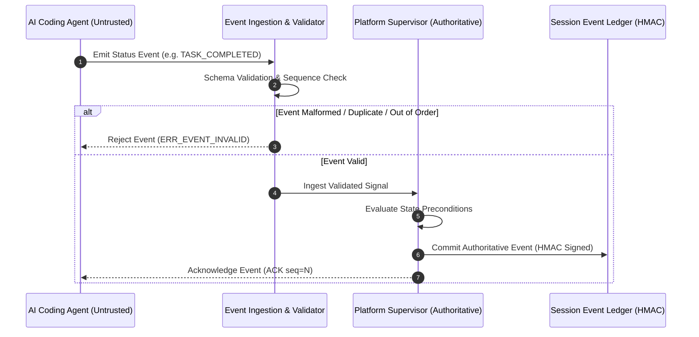

# NexLudic Engine: AI Agent Runtime Event & Status Validation Contract

**Document ID:** `NLE-CON-AEV-001`  
**Phase:** 7 of 12 (AI Coding-Agent Orchestration)  
**Step:** 57 of 100  
**Classification:** Telemetry & Event Validation Contract  
**Status:** IMPLEMENTATION-READY SPECIFICATION  
**Upstream Dependencies:** `NLE-MOD-ASL-001` (Domain Model), `NLE-SPC-ASM-001` (State Machine)  
**Downstream Dependents:** `NLE-CON-AAD-001` (Audit & Diagnostic Contract), `NLE-CAT-AES-001` (Synthetic Scenarios)  

---

## 1. Event Telemetry Architecture

All communication between the isolated agent worker and the platform supervisor flows through a structured, append-only event stream. 

Crucially, NexLudic Engine maintains a **strict trust boundary between agent-emitted signals and supervisor-verified facts**:
- **Agent Signals (Untrusted):** Suggestions, tool invocation proposals, and self-reported progress assertions emitted by the agent process.
- **Supervisor Events (Authoritative):** Verified state transitions, tool execution outputs, resource watchdog warnings, and lifecycle milestones committed by the host supervisor.



---

## 2. Event Categories & Taxonomy

| Category | Source Tier | Description | Examples |
| :--- | :--- | :--- | :--- |
| `LIFECYCLE` | Supervisor | Authoritative session state mutations. | `SESSION_STARTED`, `SESSION_PAUSED`, `SESSION_TERMINATED` |
| `TOOL_CONTROL`| Bi-directional | Proposals from agent; approvals/results from supervisor. | `TOOL_CALL_PROPOSED`, `TOOL_APPROVED`, `TOOL_EXEC_RESULT` |
| `AGENT_STATUS`| Agent Worker | Progress reporting, sub-step claims, textual reasoning. | `PROGRESS_UPDATE`, `AGENT_HEARTBEAT`, `TASK_COMPLETED_ASSERTION` |
| `WATCHDOG` | Supervisor | Resource usage alerts, threshold warnings, timeouts. | `MEMORY_WARNING`, `WALLCLOCK_TIMEOUT_EXCEEDED` |
| `SECURITY` | Supervisor | Detected boundary violations, path escapes, injection attempts. | `PATH_TRAVERSAL_DETECTED`, `REVOCATION_TRIGGERED` |

---

## 3. Event Provenance, Sequencing & Duplicate Handling

### 3.1 Monotonic Sequence Numbering
- Every event emitted within a session possesses an unsigned 64-bit sequence number (`seq_num`).
- The supervisor enforces strict monotonic incrementation (`seq_num = last_seq_num + 1`).
- If an agent emits a sequence number that is duplicate (`seq_num <= last_seq_num`) or skips a number (`seq_num > last_seq_num + 1`):
  - **Duplicate Handling:** If duplicate payload is identical, it is treated as an idempotent retry and ignored (`ACK` re-sent). If payload differs, it is flagged as a sequencing corruption error (`ERR_EVENT_SEQUENCE_DESYNC`).
  - **Gap Handling:** The supervisor requests re-transmission of missing events or terminates the attempt if the connection cannot synchronize within 5 seconds.

### 3.2 Out-of-Order Completion Handling
- An agent may emit `TASK_COMPLETED_ASSERTION` while tool calls are still in-flight or uncommitted.
- **Enforcement Rule:** The supervisor will NEVER accept a completion assertion while pending tool operations exist. The completion signal is queued until all in-flight tools return and file buffers flush.

---

## 4. Formal JSON Schema for Session Events (`NLE-SCH-SEV-001`)

```json
{
  "$schema": "https://json-schema.org/draft/2020-12/schema",
  "$id": "https://schemas.nexludic.com/v1/orchestration/session-event.json",
  "title": "NexLudicSessionEvent",
  "type": "object",
  "required": [
    "schema_version",
    "event_id",
    "session_id",
    "attempt_id",
    "sequence_number",
    "timestamp",
    "category",
    "event_type",
    "source_tier",
    "payload",
    "event_digest"
  ],
  "properties": {
    "schema_version": { "type": "string", "const": "1.0.0" },
    "event_id": { "type": "string", "pattern": "^sev-[0-9a-f]{8}-[0-9a-f]{4}-4[0-9a-f]{3}-[89ab][0-9a-f]{3}-[0-9a-f]{12}$" },
    "session_id": { "type": "string" },
    "attempt_id": { "type": "string" },
    "sequence_number": { "type": "integer", "minimum": 1 },
    "timestamp": { "type": "string", "format": "date-time" },
    "category": { "type": "string", "enum": ["LIFECYCLE", "TOOL_CONTROL", "AGENT_STATUS", "WATCHDOG", "SECURITY"] },
    "event_type": { "type": "string" },
    "source_tier": { "type": "string", "enum": ["SUPERVISOR_CORE", "AGENT_WORKER", "OPERATOR_OVERRIDE"] },
    "payload": { "type": "object" },
    "event_digest": { "type": "string", "pattern": "^[0-9a-f]{64}$" }
  },
  "additionalProperties": false
}
```
