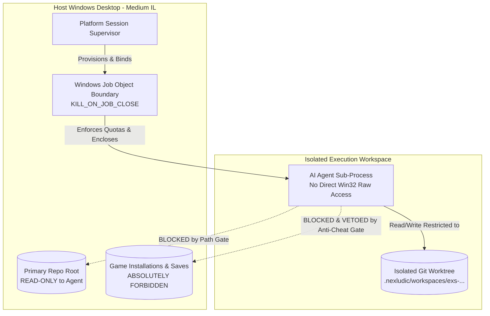

# NexLudic Engine: AI Agent Runtime Isolation & Workspace Boundary Requirements

**Document ID:** `NLE-SEC-ARI-001`  
**Phase:** 7 of 12 (AI Coding-Agent Orchestration)  
**Step:** 57 of 100  
**Classification:** Security Architecture & Isolation Specification  
**Status:** IMPLEMENTATION-READY SPECIFICATION  
**Upstream Dependencies:** `NLE-SPC-ASL-001` (Lifecycle Spec), `NLE-MOD-ASL-001` (Domain Model), ADR-0002 (Adapter Isolation), `DEC-002` (Medium IL), `BLK-SEC-01` (Anti-Cheat Dominance)  
**Downstream Dependents:** `NLE-POL-APB-001` (Permission Binding), `NLE-CON-ATC-001` (Tool Control Boundary)  

---

## 1. Security Architecture & Threat Model Summary

An AI coding agent running on a user's Windows gaming desktop presents severe operational risks if not aggressively contained. Untrusted prompts, malicious dependencies, prompt injection, or agent hallucination can result in accidental game save file destruction, tampering with anti-cheat protected game binaries, host credential theft, or resource starvation.

To eliminate these vectors, NexLudic Engine implements a **defense-in-depth, triple-barrier isolation architecture**:
1. **Filesystem & Git Worktree Isolation:** The agent never works directly in the user's primary repository checkout or live game directory. All filesystem operations occur in an ephemeral Git worktree or isolated scratch directory.
2. **Windows Process & Job Object Sandbox:** Agent processes are spawned strictly at **Medium Integrity Level** under a Windows Job Object configured with hard resource ceilings and `JOB_OBJECT_LIMIT_KILL_ON_JOB_CLOSE`.
3. **Game & Anti-Cheat Boundary:** A strict, non-bypassable barrier blocks access to game executables, anti-cheat drivers, and game memory.

---

## 2. Workspace & Filesystem Boundary Requirements

### 2.1 Isolated Staging Directory
- All file creations, edits, and temporary compilations must occur strictly inside:
  `D:\NexLudic\workspaces\<session_id>\` (or dynamically configured user staging root).
- Path traversal outside this directory (e.g. `..\`, absolute drive paths `C:\...`, symbolic links, NTFS junction points, or hard links) is strictly blocked by the supervisor's path canonicalization filter before any disk operation occurs.

### 2.2 Git Worktree Isolation
- Rather than cloning the entire repository, the supervisor provisions an ephemeral Git worktree:
  `git worktree add -b nexludic/agent/<task_id>/attempt-<n> D:\NexLudic\workspaces\<session_id> HEAD`
- The agent process operates on this branch. If the agent fails, times out, or produces unverified code, the worktree is cleanly removed (`git worktree remove --force`) without corrupting the developer's working tree.

### 2.3 Forbidden Filesystem Paths
The following filesystem locations are permanently blacklisted from both read and write operations by the agent worker:
1. **User Profile & Secrets:** `%USERPROFILE%\.ssh`, `%USERPROFILE%\.aws`, `%APPDATA%`, `%LOCALAPPDATA%\Google\Chrome\User Data`.
2. **Windows System Trees:** `C:\Windows`, `C:\Program Files`, `C:\Program Files (x86)`.
3. **Game Client & Anti-Cheat Directories:** Any directory containing game executables or known anti-cheat modules (`Riot Vanguard`, `BattlEye`, `EasyAntiCheat`, `Steam\steamapps\common`).
4. **NexLudic Core Executables & Keystore:** The platform's own binary installation directory and master cryptographic keys.

---

## 3. Windows Process & Environment Restrictions

### 3.1 Medium Integrity Level Invariant (`DEC-002`)
- The agent process token is assigned `SECURITY_MANDATORY_MEDIUM_RID`.
- Tokens are explicitly stripped of `SeDebugPrivilege`, `SeTcbPrivilege`, `SeTakeOwnershipPrivilege`, and `SeLoadDriverPrivilege`.
- Any call attempting to invoke `runas.exe`, trigger UAC prompts, or spawn elevated child processes results in immediate process termination by the supervisor.

### 3.2 Windows Job Object Enclosure
The supervisor creates a dedicated Windows Job Object (`JobObjectNexLudicAgent-<session_id>`) with the following attributes:
- `JOB_OBJECT_LIMIT_KILL_ON_JOB_CLOSE`: If the supervisor process exits, crashes, or closes the job handle, Windows kernel automatically terminates all processes attached to the job object, eliminating orphaned processes.
- `JOB_OBJECT_LIMIT_PROCESS_MEMORY`: Hard physical RAM limit (e.g. 2048 MB or as specified by `memory_limit_mb`).
- `JOB_OBJECT_LIMIT_JOB_MEMORY`: Cumulative memory cap across parent agent and any spawned compiler/test sub-processes.
- `JOB_OBJECT_LIMIT_ACTIVE_PROCESSES`: Maximum of 8 concurrent processes per session.
- `JOB_OBJECT_LIMIT_PRIORITY_CLASS`: Set to `BELOW_NORMAL_PRIORITY_CLASS` to guarantee the user's desktop responsiveness and gaming framerates are never degraded.

### 3.3 Environment Variable Sanitization
When launching agent processes, the supervisor scrubs the environment block:
- **Stripped:** `AWS_SECRET_ACCESS_KEY`, `GITHUB_TOKEN`, `OPENAI_API_KEY`, `GEMINI_API_KEY`, `NEXLUDIC_MASTER_SECRET`, `SSH_AUTH_SOCK`.
- **Injected (Minimal Set):** `SYSTEMROOT`, `PATH` (restricted to approved tool binaries), `TEMP` (pointing to `<workspace>\tmp`), `NEXLUDIC_SESSION_ID`, `NEXLUDIC_WORKSPACE_ROOT`.

---

## 4. Game Integration & Anti-Cheat Boundary (`BLK-SEC-01`)

To prevent game bans, anti-cheat triggers, and system instability:
1. **Zero Game Tampering:** Agent processes are strictly prohibited from opening handles to live game processes (`OpenProcess` with `PROCESS_VM_READ` or `PROCESS_VM_WRITE`).
2. **Anti-Cheat Driver Awareness:** The supervisor continuously monitors for loaded anti-cheat kernel drivers (`vgk.sys`, `BEDaisy.sys`, `EasyAntiCheat.sys`). If detected, all dynamic memory-reading tools are hard-disabled.
3. **Zero Kernel Drivers:** No driver installation, filter driver configuration, or kernel-mode debugging is permitted.
