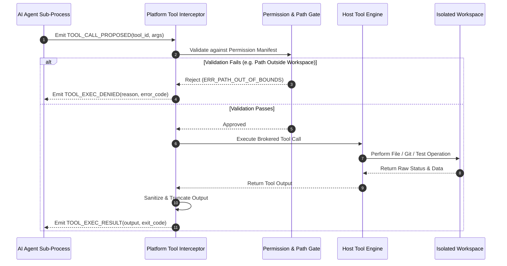

# NexLudic Engine: AI Agent Runtime Tool Operation Control Boundary

**Document ID:** `NLE-CON-ATC-001`  
**Phase:** 7 of 12 (AI Coding-Agent Orchestration)  
**Step:** 57 of 100  
**Classification:** Runtime Tool Interception & Governance Contract  
**Status:** IMPLEMENTATION-READY SPECIFICATION  
**Upstream Dependencies:** `NLE-SPC-ASL-001` (Lifecycle Spec), `NLE-POL-APB-001` (Permission Binding), `NLE-SEC-ARI-001` (Runtime Isolation)  
**Downstream Dependents:** `NLE-CON-AEV-001` (Event Contract), `NLE-POL-ARW-001` (Resource Policy)  

---

## 1. Tool Interception Architecture

A critical vulnerability in agentic systems is granting the agent direct, ambient execution access to shell interpreters (`cmd.exe`, `powershell.exe`, `bash`) or Win32 API functions. Under such models, prompt injection or malformed output immediately results in arbitrary code execution.

NexLudic Engine enforces **Host-Brokered Tool Invocation**:
1. **Tool Invocation as a Message:** The agent cannot execute tools. It can only emit a structured JSON event proposing a tool invocation (`TOOL_CALL_PROPOSED`).
2. **Supervisor Interception & Validation:** The Platform Supervisor intercepts the message, validates arguments against JSON schemas, verifies target paths against the session permission manifest, and checks rate limits.
3. **Execution in Host Boundary:** The supervisor—running with controlled host permissions—executes the operation on behalf of the agent.
4. **Sanitized Response Delivery:** The supervisor sanitizes output buffers (truncating massive logs, redacting leaked host secrets) and delivers a structured result event (`TOOL_EXEC_RESULT`) back to the agent.

---

## 2. Approved Host-Brokered Tool Catalog

| Tool ID | Permitted Operations | Scope Boundary | Security Controls |
| :--- | :--- | :--- | :--- |
| `tool:fs_read` | `read_file`, `list_directory`, `file_stat` | Whitelisted paths within primary repo and staging workspace. | Max read buffer 2 MB; path canonicalization prevents traversal. |
| `tool:fs_write` | `write_file`, `create_directory`, `delete_file` | STRICTLY restricted to `<workspace_root_path>`. | Cannot touch primary repo; overwrites require explicit flag. |
| `tool:git_ops` | `git_status`, `git_diff`, `git_add`, `git_commit` | Ephemeral Git worktree branch only. | Cannot checkout `main`; cannot force-push; commits signed with agent ID. |
| `tool:linter` | `run_eslint`, `run_mypy`, `run_cargo_check` | Workspace directory only. | Timeout 30s; runs under Job Object with memory ceiling. |
| `tool:test_runner` | `run_unit_tests`, `run_adapter_test` | Targeted test files in workspace. | Timeout 60s; network disabled; no live game process attachment. |
| `tool:schema_val` | `validate_json_schema`, `validate_adapter_contract` | In-memory verification. | Deterministic schema evaluation; no disk side effects. |

---

## 3. Forbidden Tool Categories

The following capabilities are **permanently disallowed** and will cause immediate preflight failure or session abort:
- **Raw Shell Interpreters:** Direct invocation of `cmd.exe`, `powershell.exe`, `bash.exe`, `sh.exe`, or arbitrary shell strings.
- **Arbitrary Process Spawning:** Spawning any binary not explicitly registered in the engine's approved tool manifest.
- **Network Socket Creation:** Raw TCP/UDP socket creation or HTTP requests to non-whitelisted destinations.
- **System Configuration & Registry Writes:** Any Win32 registry modification (`RegOpenKey`, `RegSetValue`) or service manipulation.
- **Game Process Attachment:** Any call to `OpenProcess`, `VirtualAllocEx`, or `CreateRemoteThread` targeting third-party software.

---

## 4. Tool Denial & Error Handling

When a tool invocation is denied:
- **Denial Payload:** The supervisor returns `TOOL_EXEC_DENIED` with structured metadata (`error_code`, `violating_parameter`, `guidance`).
- **Resilience:** A single denial does not abort the session; the agent is permitted to adjust its proposed parameters.
- **Threshold Escalation:** If an agent accumulates 5 consecutive tool denials or 2 severe security boundary violations (e.g. attempting to read `%APPDATA%`), the supervisor marks the session `FAILED` with `ERR_SECURITY_REPEATED_BOUNDARY_VIOLATIONS`.
